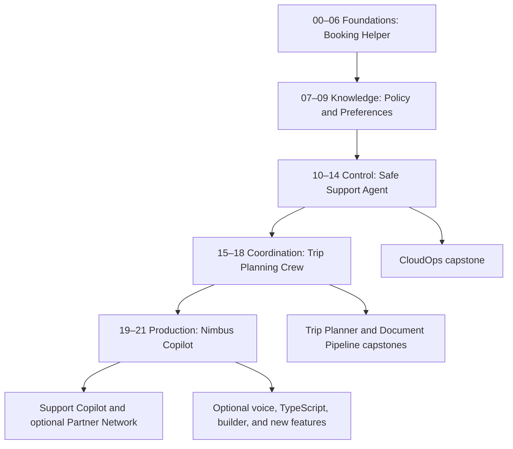

# Learning path: build the Nimbus assistant

Tier 1 delivered; later tiers planned · October 29, 2026

Start with basic Python, terminal use, and git. You do not need prior agent or AWS knowledge. The core course is approximately 58 hours, including checkpoint practice; capstones and optional cloud/voice extensions take additional time. Modules 00–06 and their checkpoint are implemented; later tiers remain planned. See the [implementation plan](docs/IMPLEMENTATION_PLAN.md) and [feature map](docs/FEATURE_MAP.md).

## Choose your route

- **Learn in order:** work through 00–21, complete the three exercises per module, and pass each checkpoint before continuing.
- **Find a topic:** use the feature map, then read the module's prerequisite list. Each row identifies the example, use case, AWS requirement, and official source.
- **Build a capstone:** read its acceptance criteria, complete its prerequisite tiers, then attempt the starter before reading the reference solution.

Use Ollama for the core learning route or Bedrock for hosted inference. Offline mock mode checks application behavior without running an LLM; it does not measure model quality. Local tools and vision models require separate downloads. Optional live weather and AWS MCP servers need internet access even when inference runs locally.

## Tier 1 — Foundations · 10 hours

| Module | Minutes | Ability you will demonstrate | Assistant progression |
|---|---:|---|---|
| [00 Setup and orientation](modules/00_setup/README.md) | 90 | Explain an agent; configure an offline/local path or safe SSO and budget prerequisites | v0: prepared workspace |
| [01 Your first agent](modules/01_first_agent/README.md) | 60 | Run a call and inspect messages, stop reason, tokens, latency, callbacks, and async invocation | v1: FAQ responder |
| [02 Model providers](modules/02_model_providers/README.md) | 90 | Switch providers, implement a minimal model interface, and compare cost and quality | v1: configurable responder |
| [03 Conversations and multimodal input](modules/03_conversations/README.md) | 90 | Manage a conversation window and interpret receipt images and document content | v2: trip-planning conversation |
| [04 Structured output](modules/04_structured_output/README.md) | 75 | Validate ticket triage and nested itineraries with Pydantic | v3: typed responses |
| [05 Building tools](modules/05_building_tools/README.md) | 120 | Build typed booking tools and explain toolUse/toolResult by comparing Converse with Strands | v4: booking helper |
| [06 Community and vended tools](modules/06_community_tools/README.md) | 75 | Combine tools while preserving consent, trusted inputs, and read-only AWS access | v4: travel-day assistance |

First encounters: model, token, context window, agent loop, IAM, SSO, async/await, schema, Pydantic, and tool specification. The raw `Agent()` defaults are inspected without a paid invocation; all normal runs use the configured factory.

**Checkpoint: [Nimbus Booking Helper](checkpoints/01_booking_helper/README.md).** Search flights/hotels, look up an existing booking, and produce a validated itinerary. Submit its tool trajectory and estimated token cost. Tests must reject malformed inputs and avoid changing the committed database.

You're ready for Tier 2 when you can explain who chooses the next tool, read a tool result, distinguish model configuration from a system prompt, validate a typed response, and switch between mock and live inference deliberately.

## Tier 2 — Knowledge and memory · 10 hours

| Module | Minutes | Ability you will demonstrate | Assistant progression |
|---|---:|---|---|
| 07 Retrieval-augmented generation | 210 | Chunk policies, calculate cosine similarity, index embeddings, and cite source files/pages | v5: Ask Nimbus |
| 08 Advanced retrieval and evaluation | 180 | Compare hybrid search, query rewriting, reranking, and grounded answers on held-out questions | v5: measured retrieval improvements |
| 09 Memory, state, and sessions | 210 | Resume a conversation, isolate travelers' preferences, and delete stored memory | v6: persistent preferences |

First encounters: embedding, vector, cosine similarity, BM25, retrieval hit rate, faithfulness, evaluation set, and retention. A simple judge is explained here; the full Strands Evals suite comes in 19.

**Checkpoint: Policy & Preferences Assistant.** Answer policy questions with checkable citations, remember a synthetic traveler's preferences, and return an honest “not found” for unsupported claims. Submit before/after retrieval results and a user-deletion test.

You're ready for Tier 3 when you can trace an answer back to its source, distinguish session history from private application state and long-term memory, explain why a high retrieval score does not prove answer correctness, and prevent memory from crossing user boundaries.

Optional AWS branches: Knowledge Base with S3 Vectors; S3 session storage; AgentCore Memory. Each branch has its own cost and teardown steps. They can be deferred until Tier 5.

## Tier 3 — Controlling behavior · 12 hours

| Module | Minutes | Ability you will demonstrate | Assistant progression |
|---|---:|---|---|
| 10 Streaming and async | 150 | Stream text/tool events to a terminal and app; cancel work and bound concurrency | v6: streaming experience |
| 11 Hooks and lifecycle | 120 | Audit tool calls, enforce a booking budget, and redact data before logging | v7: auditable behavior |
| 12 Human approval and interrupts | 150 | Pause a refund, approve/reject/expire it, and resume without duplicate payment effects | v8: approval workflow |
| 13 Guardrails and safety | 150 | Enforce tool boundaries, resist the planted injection, and bound cycles, calls, and time | v9: hardened support agent |
| 14 Model Context Protocol | 150 | Build and consume a booking MCP server with correct transport lifetime and tool filtering | v9: interoperable tools |

First encounters: async iterator, server-sent events, cancellation, lifecycle hook, invocation state, interrupt, idempotency, authorization, and protocol. Tool approval is a business decision; consent to execute local code is a separate control.

**Checkpoint: Safe Support Agent.** Stream a support interaction, obtain approval for a refund over $500, reject an injection attempt, and invoke a booking tool over MCP. Tests cover rejection, timeout, replay, and client disconnect, not just the successful path.

You're ready for Tier 4 when you can distinguish callbacks from hooks, pause and resume safely, identify untrusted retrieved text, keep consent enabled, and demonstrate that refused actions do not execute.

The optional Bedrock Guardrails branch creates resources. The local branch enforces policy with hooks and typed tools; it does not claim equivalent managed content-filter coverage. CloudOps Copilot is now available as a capstone.

## Tier 4 — Multi-agent systems · 12 hours

| Module | Minutes | Ability you will demonstrate | Assistant progression |
|---|---:|---|---|
| 15 Agents as tools | 150 | Delegate to bounded flight, hotel, and policy specialists and count the added model calls | v10: concierge |
| 16 Swarms | 180 | Observe handoffs and stop repetitive or over-budget itinerary collaboration | v10: itinerary team |
| 17 Graphs and workflows | 240 | Build parallel search, conditional budget checks, approval, and confirmation with bounded loops | v10: group-trip pipeline |
| 18 Agent-to-Agent protocol | 150 | Discover and call an authenticated partner airline agent in another process | v10: partner integration |

First encounters: orchestration, delegation, handoff, graph node/edge, fan-out/fan-in, conditional routing, agent card, and authenticated transport. Models do not gain authority merely by receiving delegated work.

**Checkpoint: Trip Planning Crew.** Produce a group itinerary under a stated budget, explain the tool/agent sequence, and write a design rationale comparing a single agent, agents as tools, swarm, graph, and A2A. Include a pattern diagram and a failed-budget trace.

You're ready for Tier 5 when you can justify additional agents with measured benefit, cap every loop, explain why MCP tools differ from remote A2A agents, and preserve user approvals across delegation.

The Trip Planner Crew and Document Intelligence Pipeline capstones are now available. Local multi-agent runs remain free of hosted-model charges but use more compute and can take longer.

## Tier 5 — Production on AWS · 14 hours

| Module | Minutes | Ability you will demonstrate | Assistant progression |
|---|---:|---|---|
| 19 Observability, testing, evaluation | 240 | Read traces, test trajectories, evaluate held-out cases, and deliberately fail a quality gate | v10: release evidence |
| 20 Deployment choices | 300 | Package the same app for Lambda, Fargate, and AgentCore; compare costs and tear down | v10: deployment-ready support |
| 21 AgentCore services | 300 | Combine Memory, Gateway, Identity, Policy, Observability, and Evaluations with scoped permissions | v11: Nimbus Copilot |

First encounters: span, trace, OpenTelemetry, CI gate, infrastructure as code, CDK bootstrap, container, runtime session, OAuth/JWT, Cedar policy, and managed evaluation.

**Checkpoint: Production readiness review.** Produce a passing offline report and synthesized infrastructure, a cost/resource inventory, a least-privilege explanation, and a teardown runbook. If you choose a live deployment, also retain invoke/stream/session evidence and a post-cleanup scan. A learner without AWS can complete the design and local checks but cannot claim deployment validation.

You're ready to build independently when you can choose a hosting option for a concrete workload, explain what is billed while idle, distinguish application guards from service authorization, fail a release on poor quality, and identify retained resources after teardown.

## Four-week intensive schedule

| Week | Core work | Hours |
|---|---|---:|
| 1 | Tier 1 and module 07; booking checkpoint | 13.5 |
| 2 | Modules 08–12; policy checkpoint | 13.5 |
| 3 | Modules 13–17; support checkpoint and crew preparation | 14.5 |
| 4 | Modules 18–21; crew checkpoint and production review | 16.5 |

Complete exercises during each lesson, not at the end of the month. Add separate time for cloud account provisioning and one capstone. This is an intensive course, not a promise to complete all capstones in four weeks.

## Eight-week part-time schedule

| Week | Core work | Hours |
|---|---|---:|
| 1 | Modules 00–04 | 6.75 |
| 2 | Modules 05–07; booking checkpoint | 6.75 |
| 3 | Modules 08–09; policy checkpoint | 6.5 |
| 4 | Modules 10–12 | 7 |
| 5 | Modules 13–15; support checkpoint | 7.5 |
| 6 | Modules 16–18; crew checkpoint | 9.5 |
| 7 | Module 19 and first half of 20 | 6.5 |
| 8 | Remaining 20 and module 21; production review | 7.5 |

## Bonus modules and capstones

| Extension | Prerequisites | Deliverable |
|---|---|---|
| B1 Voice | 10, 12, 13 | Voice booking assistant with barge-in; stable `strands.bidi`, optional experimental providers clearly separated |
| B2 TypeScript | 01, 05; JavaScript/TypeScript primer | First agent and typed tools port with its own npm lockfile |
| B3 Self-extension | 05, 13 | Review and approve a generated tool before loading it; archived builder explained as historical context |
| B4 What's new | Relevant earlier modules | Cancellation, invocation limits, middleware, and stable red-teaming examples with release references |
| CloudOps Copilot | Tier 3 | Incident summary and cost-savings report with charts; read-only live mode optional |
| Trip Planner Crew | Tier 4 | Flight/hotel/weather/budget graph or swarm with streaming Streamlit UI |
| Document Intelligence Pipeline | Tier 4 | Receipt extraction, validation, anomaly flags, and SQLite; DynamoDB extension optional |
| Nimbus Support Copilot | Tier 5 | Full support system with policy RAG, approval, memory, evaluation, and AgentCore infrastructure |
| Partner Network | 18 and Tier 5 for cloud hosting | Strands concierge plus a LangGraph partner over authenticated A2A |

Each capstone includes user stories, acceptance criteria, a Mermaid architecture, runnable starter, complete reference solution, tests, evaluation data, costs, teardown, extension challenges, and a self-grading rubric. Plan roughly 6–12 additional hours for a first attempt at one capstone; the flagship can take longer.

## Habits to carry through every tier

Read expected output before running a script. Try the exercise before its solution. Keep a record of failures and the evidence that explains each fix. Check costs before live calls. Treat model output and retrieved documents as untrusted inputs. End optional AWS work with teardown and a scan that identifies which regions and services were actually checked.
