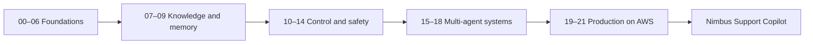

# Getting started with AWS Strands

A hands-on course for Python learners building their first AI agent. You will build the **Nimbus assistant** for a fictional travel company, then add tools, retrieval, memory, approvals, evaluation and AWS deployment.

**Delivery status: Phase 2 foundation delivered.** Lessons 00–21 and capstones are planned in the [feature map](docs/FEATURE_MAP.md); they are not yet runnable. The foundation demo and checks below are the current entry points. See the [verification record](docs/VERIFICATION_NOTES.md) for tested versions and remaining checks.



## Quick start

Install Python 3.12 and [uv](https://docs.astral.sh/uv/getting-started/installation/). Open a terminal in this repository after downloading or cloning it. The public GitHub repository has not been published yet, so no clone URL is invented here. Commands below work in PowerShell, macOS and Linux.

```text
uv sync
uv run python -c "from pathlib import Path; p=Path('.env'); p.exists() or p.write_text(Path('.env.example').read_text(), encoding='utf-8')"
uv run python scripts/check_env.py
uv run python scripts/foundation_demo.py --mock
uv run pytest
```

The mock run uses the real Strands agent loop and a scripted model. It needs no AWS account, model download, API key or network connection after dependency installation. Expect a tool call that loads the Nimbus refund policy, an answer about its 24-hour window, and usage metrics. Scripted answers demonstrate application plumbing; they do not measure model intelligence.

### Free local model

Install [Ollama](https://ollama.com/download), start its service, and download a model:

```text
ollama pull qwen3:4b
```

Edit just `MODEL_PROVIDER=ollama` in `.env`, leaving `MODEL_ID` blank. Then:

```text
uv run python scripts/check_env.py --ollama
uv run python scripts/foundation_demo.py
```

This has no hosted-model charge. Model download time and inference speed depend on your connection and hardware. Image lessons later need a vision model, such as the separately downloaded `qwen3-vl:4b`.

### Amazon Bedrock

Complete [AWS setup](docs/AWS_SETUP.md), including SSO and a budget alert, before a billable call. Set `MODEL_PROVIDER=bedrock`, `AWS_PROFILE`, and `AWS_REGION` in `.env`. The default model ID is in `.env.example`.

```text
aws sso login --profile nimbus-course
uv run python scripts/check_env.py --aws
uv run python scripts/check_env.py --probe --accept-cost
uv run python scripts/foundation_demo.py
```

The demo creates no AWS resources. Bedrock charges for inference. The readiness check is read-only; the probe makes one short billable request. An account with pending model activation or SSO provisioning may need more than 20 minutes to become ready.

### pip and venv fallback

Create the environment with `python -m venv .venv`. On Windows, run `.venv\Scripts\Activate.ps1`; on macOS/Linux, run `source .venv/bin/activate`. Then run `python -m pip install -e . --group dev`. This uses pip with dependency-group support; upgrade pip first if `--group` is unavailable. Replace `uv run python` with `python`, and `uv run pytest` with `python -m pytest`. uv is recommended because it uses the committed lockfile.

## Choose a route

1. Work through the [learning path](LEARNING_PATH.md) in order when each tier is delivered.
2. Find a specific concept in the [feature map](docs/FEATURE_MAP.md).
3. Use the planned capstones as acceptance targets: CloudOps, trip planning, document intelligence, support, or partner agents.

| Tier | Core time | Local inference | Hosted route |
|---|---:|---|---|
| Foundations | 10 h | No hosted-model charge | Token charges |
| Knowledge and memory | 10 h | No hosted-model charge | Tokens; optional storage/embedding charges |
| Control and safety | 12 h | No hosted-model charge | Tokens; optional Guardrails charges |
| Multi-agent systems | 12 h | No hosted-model charge | More calls per task; token charges |
| Production on AWS | 14 h | Local design/testing available | Compute, storage, logging and service charges |

See [cost assumptions and cleanup](docs/COSTS.md). Capstones add roughly 6–12 hours each, often more for the flagship. A budget alert is a notification, not a spending cap.

Use the [ecosystem map](docs/MENTAL_MODEL.md) to understand the parts, the [pattern guide](docs/CHOOSING_THE_RIGHT_PATTERN.md) to choose a design, and the [dataset guide](docs/SYNTHETIC_DATA.md) to explore Nimbus's synthetic inputs.

## Install only what you need

`uv sync` installs the core and developer checks. Add groups with `uv sync --group rag`, `--group providers`, `--group multiagent`, `--group apps`, `--group aws`, `--group memory`, `--group evals`, `--group observability`, `--group notebooks`, or `--group partner`. Multiple flags can be combined. Python 3.12 and 3.13 are the intended supported versions; see the verification notes for checks actually run.

## FAQ

**Is the data real?** No. Every person, booking, airline, hotel, receipt and transaction is synthetic. Destination names are real places; policies are invented teaching rules, not legal, visa or health advice.

**Is AWS required?** Not for the core of Tiers 1–4. AWS-specific labs are optional branches with their own lifecycle instructions.

**Why not just install the newest version of everything?** Some current Strands adapters cap their dependencies. The [verification notes](docs/VERIFICATION_NOTES.md) explain the selected versions and API replacements.

**Where are generated outputs?** Committed source data lives in `data/`. Mutable databases, sessions and reports go in ignored `.nimbus/`. The generator refuses to overwrite existing files without `--overwrite`.

**What is checked without keys?** Model/tool contracts, fixture integrity, mock agent runs, link targets, secret-like samples, and IAM policies. These checks do not prove a cloud deployment works.

See [contributing](CONTRIBUTING.md), the [code of conduct](CODE_OF_CONDUCT.md), and the [MIT license](LICENSE).
