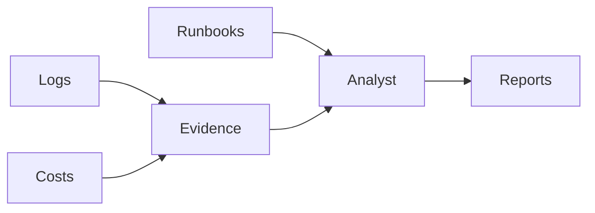

# Capstone: CloudOps Copilot

Read measured logs and spend; cite public runbooks before proposing operational changes.

Prerequisite: Tier 3. Allow 6–12 hours for your first implementation. Start from [starter.py](starter.py), then compare with the [reference solution](solution/main.py).

## User stories
- As an on-call engineer, I want the three planted incidents linked to measured log evidence and relevant runbooks.
- As a cost reviewer, I want idle or oversized resource candidates and a chart of recorded spend without unsupported savings promises.
- As an account owner, I want optional AWS reference queries to remain read-only.

## Acceptance criteria
- Detect all three incident days and distinguish latency, deployment and dependency symptoms.
- Identify idle NAT, oversized EC2 and runaway Lambda as review candidates.
- Write incident-summary.md, cost-savings.md, evidence.json and costs.png.
- Query Documentation/Pricing MCP only with explicit --live-mcp.

## Architecture

The model handles bounded reasoning; host code validates source evidence and owns authorization.

## Build it
1. Run the starter and list which acceptance criteria remain unchecked.
2. Read the evaluation cases before implementing the workflow.
3. Add a failing boundary case, then implement the narrowest capability it needs.
4. Run the reference solution and compare evidence rather than matching prose.

```text
uv sync --all-groups
uv run python capstones/01_cloudops_copilot/starter.py --mock
uv run --all-groups python capstones/01_cloudops_copilot/solution/main.py --mock
uv run --all-groups pytest capstones/01_cloudops_copilot/tests
```

Expected: checked evidence followed by `Lesson complete.`. All finite reference commands are included in the repository example sweep. The [evaluation set](evaluation.json) describes independent acceptance cases; mocks validate contracts, not real model quality.

## Design and operating limits
The report computes thresholds from logs and aggregates Decimal USD values from cost rows. It does not consult ground-truth labels. A 2,000 ms dependency peak takes precedence over a deployment-error classification; a 1,000 ms latency peak flags slow responses. These are teaching thresholds, not an incident detector tuned for arbitrary production traffic. Savings candidates need workload review, not immediate deletion. `--live-mcp` invokes the pinned, read-only AWS Documentation and Pricing tools from Module 14; default output explicitly says those servers were not contacted. Use an SSO role with only the pricing read operations needed by that server, never an operations administrator. No deployment or resource mutation tool is exposed.

## Costs
Mock mode costs $0 and creates no AWS resources. Live model calls use the configured provider's token prices; several agents or evaluations multiply usage. Read [the cost inventory](../../docs/PRODUCTION_COSTS.md) before optional AWS labs. CloudOps charts use synthetic spend, not estimates of your account. No live spending or deployment was performed during authoring.

## Teardown
Stop any notebook kernels and local processes you started. Generated reports and databases are under `.nimbus/capstones/01_cloudops_copilot`; remove that directory when no longer needed. For any optional cloud stack, use its documented destroy command and then `uv run python scripts/find_leftovers.py --regions us-east-1`. An empty tag query alone does not prove complete cleanup. Check logs, asset storage and all deployed regions.

## Rubric
| Area | Points | Evidence |
|---|---:|---|
| Correctness | 35 | Every acceptance case passes with inspected source evidence |
| Boundaries | 25 | Denial, malformed input, duplication and deadline behavior tested |
| Explanation | 15 | Diagram and clear statement of mock/live limits |
| Evaluation | 15 | Held-out cases plus a deliberate failing variant |
| Operations | 10 | Cost assumptions, retention and verified cleanup procedure |

Passing target: 80/100 with no unauthorized mutation or cross-user access. A perfect fixture score cannot compensate for a broken authorization boundary.

## Extend it
- Add a new held-out edge case that would have fooled the current implementation.
- Introduce a provider/service failure and preserve a useful, content-safe error.
- Measure a live workload only after explicit cost approval; document sampling limits.

## References
- [Course verification](../../docs/VERIFICATION_NOTES.md)
- [Strands documentation](https://strandsagents.com/docs/)
