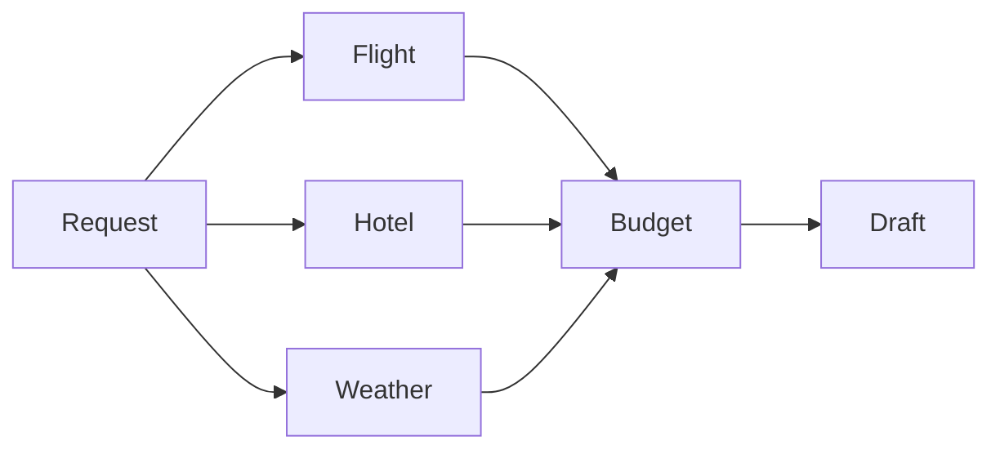

# Capstone: Trip Planner Crew

Coordinate flight, hotel, weather and budget specialists without giving them purchase authority.

Prerequisite: Tier 4. Allow 6–12 hours for your first implementation. Start from [starter.py](starter.py), then compare with the [reference solution](solution/main.py).

## User stories
- As a traveler, I want flight and hotel quotes that fit my city, party size and total budget.
- As a traveler, I want to see each specialist finish while the plan is being prepared.
- As a reviewer, I want authoritative totals, a clear over-budget result and an explicit statement that nothing was booked.

## Acceptance criteria
- Run all three source branches and join once at the budget node.
- Preserve catalog references and exact integer prices.
- Stream progress to the UI and report over-budget results honestly.
- Distinguish current weather from a forecast for synthetic future travel.

## Architecture

The model handles bounded reasoning; host code validates source evidence and owns authorization.

## Build it
1. Run the starter and list which acceptance criteria remain unchecked.
2. Read the evaluation cases before implementing the workflow.
3. Add a failing boundary case, then implement the narrowest capability it needs.
4. Run the reference solution and compare evidence rather than matching prose.

```text
uv sync --all-groups
uv run python capstones/02_trip_planner_crew/starter.py --mock
uv run --all-groups python capstones/02_trip_planner_crew/solution/main.py --mock
uv run --all-groups pytest capstones/02_trip_planner_crew/tests
```

Expected: checked evidence followed by `Lesson complete.`. All finite reference commands are included in the repository example sweep. The [evaluation set](evaluation.json) describes independent acceptance cases; mocks validate contracts, not real model quality.

## Design and operating limits
The Graph fans out into three bounded specialist branches and joins once for budget verification. The weather branch performs an actual HTTP request through a fixture transport in mock mode; live mode uses only the fixed Open-Meteo host and host-selected coordinates. Weather is current, not a forecast for the synthetic April 2027 trip. Flight quotes are one-way, and hotel inventory assumes one room without verifying occupancy. The draft must state those limits. Launch the streaming UI with `uv run --group apps streamlit run capstones/02_trip_planner_crew/solution/app.py --server.address 127.0.0.1`. The UI uses mocks by default and displays node progress plus the final evidence.

## Costs
Mock mode costs $0 and creates no AWS resources. Live model calls use the configured provider's token prices; several agents or evaluations multiply usage. Read [the cost inventory](../../docs/PRODUCTION_COSTS.md) before optional AWS labs. No live spending or deployment was performed during authoring.

## Teardown
Stop Streamlit, notebook kernels and local processes. Generated reports and databases are under `.nimbus/capstones/02_trip_planner_crew`; remove that directory when no longer needed. For any optional cloud stack, use its documented destroy command and then `uv run python scripts/find_leftovers.py --regions us-east-1`. An empty tag query alone does not prove complete cleanup. Check logs, asset storage and all deployed regions.

## Rubric
| Area | Points | Evidence |
|---|---:|---|
| Correctness | 35 | Every acceptance case passes with inspected source evidence |
| Boundaries | 25 | Denial, malformed input, duplication and deadline behavior tested |
| Explanation | 15 | Diagram and clear statement of mock/live limits |
| Evaluation | 15 | Held-out cases plus a deliberate failing variant |
| Operations | 10 | Cost assumptions, retention and verified cleanup procedure |

Passing target: 80/100 with no unauthorized mutation or cross-user access. A perfect fixture score cannot compensate for a broken authorization boundary.

## Extend it
- Add a new held-out edge case that would have fooled the current implementation.
- Introduce a provider/service failure and preserve a useful, content-safe error.
- Measure a live workload only after explicit cost approval; document sampling limits.

## References
- [Course verification](../../docs/VERIFICATION_NOTES.md)
- [Strands documentation](https://strandsagents.com/docs/)
