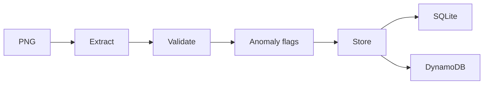

# Capstone: Document Intelligence Pipeline

Extract receipt and invoice images, flag discrepancies, and store reviewable evidence exactly once.

Prerequisite: Tier 4. Allow 6–12 hours for your first implementation. Start from [starter.py](starter.py), then compare with the [reference solution](solution/main.py).

## User stories
- As an operations clerk, I want receipt and invoice images converted into validated, searchable records.
- As a reviewer, I want a printed arithmetic discrepancy preserved and flagged instead of silently corrected.
- As an auditor, I want repeated uploads to preserve the original extraction and avoid duplicate records.

## Acceptance criteria
- Pass actual PNG bytes to a structured-output vision agent.
- Flag inconsistent totals rather than silently correcting them.
- Persist the source fingerprint, extraction and anomaly list; retries are idempotent.
- Use SQLite by default; test optional DynamoDB storage with moto.

## Architecture

The model handles bounded reasoning; host code validates source evidence and owns authorization.

## Build it
1. Run the starter and list which acceptance criteria remain unchecked.
2. Read the evaluation cases before implementing the workflow.
3. Add a failing boundary case, then implement the narrowest capability it needs.
4. Run the reference solution and compare evidence rather than matching prose.

```text
uv sync --all-groups
uv run python capstones/03_document_intelligence/starter.py --mock
uv run --all-groups python capstones/03_document_intelligence/solution/main.py --mock
uv run --all-groups pytest capstones/03_document_intelligence/tests
```

Expected: checked evidence followed by `Lesson complete.`. All finite reference commands are included in the repository example sweep. The [evaluation set](evaluation.json) describes independent acceptance cases; mocks validate contracts, not real model quality.

## Design and operating limits
Both receipt and invoice PNGs enter the same Graph. Mock extraction returns labelled fixtures to exercise the pipeline; it is not an OCR score. Omit `--mock` only after selecting a vision-capable model. Image bytes are sent to that provider, so use only the public fixtures. The output flags arithmetic mismatches and totals above USD 500. It stores both accepted and flagged records, preserving review evidence; it never pays invoices. Repeated input bytes are duplicates. To re-extract after a model/prompt change, use a new local database or explicitly version the storage key; this lesson never silently overwrites prior evidence. Optional `--dynamodb` writes to the table named by `NIMBUS_DOCUMENT_TABLE`, provisioned through [the document stack](../../infra/document_pipeline/README.md).

## Costs
Mock mode costs $0 and creates no AWS resources. Live model calls use the configured provider's token prices; several agents or evaluations multiply usage. Read [the cost inventory](../../docs/PRODUCTION_COSTS.md) before optional AWS labs. No live spending or deployment was performed during authoring.

## Teardown
Stop any notebook kernels and local processes you started. Generated reports and databases are under `.nimbus/capstones/03_document_intelligence`; remove that directory when no longer needed. For any optional cloud stack, use its documented destroy command and then `uv run python scripts/find_leftovers.py --regions us-east-1`. An empty tag query alone does not prove complete cleanup. Check logs, asset storage and all deployed regions.

## Rubric
| Area | Points | Evidence |
|---|---:|---|
| Correctness | 35 | Every acceptance case passes with inspected source evidence |
| Boundaries | 25 | Denial, malformed input, duplication and deadline behavior tested |
| Explanation | 15 | Diagram and clear statement of mock/live limits |
| Evaluation | 15 | Held-out cases plus a deliberate failing variant |
| Operations | 10 | Cost assumptions, retention and verified cleanup procedure |

Passing target: 80/100 with no unauthorized mutation or cross-user access. A perfect fixture score cannot compensate for a broken authorization boundary.

## Extend it
- Add a new held-out edge case that would have fooled the current implementation.
- Introduce a provider/service failure and preserve a useful, content-safe error.
- Measure a live workload only after explicit cost approval; document sampling limits.

## References
- [Course verification](../../docs/VERIFICATION_NOTES.md)
- [Strands documentation](https://strandsagents.com/docs/)
