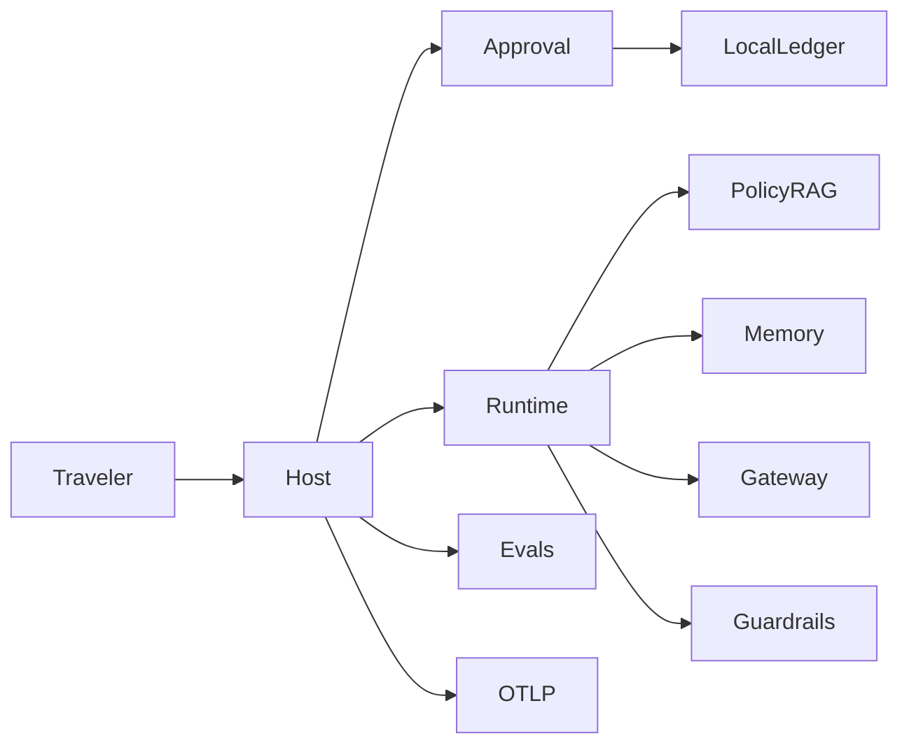

# Capstone: Nimbus Support Copilot

Compose policy retrieval, booking alternatives, memory, approvals, evaluation and managed hosting.

Prerequisite: Tier 5. Allow 6–12 hours for your first implementation. Start from [starter.py](starter.py), then compare with the [reference solution](solution/main.py).

## User stories
- As a traveler, I want policy citations and booking alternatives that respect my stored preferences.
- As a supervisor, I want a large refund to pause until my authenticated decision, with retries unable to repeat the action.
- As a release owner, I want evaluation evidence, content-free traces and a documented hosted service boundary before deployment.

## Acceptance criteria
- Retrieve source-cited policy evidence and actor-scoped preferences.
- Pause a USD 600 local refund for a durable supervisor decision.
- Reject denied, expired or replayed authorization; never send a real payment.
- Pass the policy Evals gate and capture content-free OTLP traces.
- Use the documented Runtime, Memory and Gateway composition only in explicit live mode.

## Architecture

The model handles bounded reasoning; host code validates source evidence and owns authorization.

## Build it
1. Run the starter and list which acceptance criteria remain unchecked.
2. Read the evaluation cases before implementing the workflow.
3. Add a failing boundary case, then implement the narrowest capability it needs.
4. Run the reference solution and compare evidence rather than matching prose.

```text
uv sync --all-groups
uv run python capstones/04_nimbus_support_copilot/starter.py --mock
uv run --all-groups python capstones/04_nimbus_support_copilot/solution/main.py --mock
uv run --all-groups pytest capstones/04_nimbus_support_copilot/tests
```

Expected: checked evidence followed by `Lesson complete.`. All finite reference commands are included in the repository example sweep. The [evaluation set](evaluation.json) describes independent acceptance cases; mocks validate contracts, not real model quality.

## Design and operating limits
The local reference solution composes the actual policy agent, SQLite preferences, booking-alternative tool, interrupt-based approval ledger and Strands Evals. It rejects the demo refund by default. The identity `SUPERVISOR-DEMO` is explicitly a local fixture, not production authentication. Tests cover both approve and reject, and replay protection lives in the ledger. `--guarded` attaches the configured Bedrock Guardrail through the model factory; deploy the optional Module 13 stack and supply its ID/version first. `--trace --mock` runs the entire evaluation/support workflow in a fresh process with the numeric-only OTLP exporter. The cloud composition calls one Runtime copilot operation, which validates the Cognito token before policy retrieval, actor-bound Memory, Gateway and Guardrail-protected model calls. Follow [capstone deployment](DEPLOYMENT.md), then use `--live-aws` with valid SSO and a Cognito access token. This architecture keeps trusted approval handling in the host; it does not implement production payments, shared durable Runtime chat state, or a hosted supervisor UI. Cloud approval/payment authority must not be inferred from the local demo. Destroy the Guardrail, Runtime and AgentCore stacks after optional live checks.

## Costs
Mock mode costs $0 and creates no AWS resources. Live model calls use the configured provider's token prices; several agents or evaluations multiply usage. Read [the cost inventory](../../docs/PRODUCTION_COSTS.md) before optional AWS labs. No live spending or deployment was performed during authoring.

## Teardown
Stop any notebook kernels and local processes you started. Generated reports and databases are under `.nimbus/capstones/04_nimbus_support_copilot`; remove that directory when no longer needed. For any optional cloud stack, use its documented destroy command and then `uv run python scripts/find_leftovers.py --regions us-east-1`. An empty tag query alone does not prove complete cleanup. Check logs, asset storage and all deployed regions.

## Rubric
| Area | Points | Evidence |
|---|---:|---|
| Correctness | 35 | Every acceptance case passes with inspected source evidence |
| Boundaries | 25 | Denial, malformed input, duplication and deadline behavior tested |
| Explanation | 15 | Diagram and clear statement of mock/live limits |
| Evaluation | 15 | Held-out cases plus a deliberate failing variant |
| Operations | 10 | Cost assumptions, retention and verified cleanup procedure |

Passing target: 80/100 with no unauthorized mutation or cross-user access. A perfect fixture score cannot compensate for a broken authorization boundary.

## Extend it
- Add a new held-out edge case that would have fooled the current implementation.
- Introduce a provider/service failure and preserve a useful, content-safe error.
- Measure a live workload only after explicit cost approval; document sampling limits.

## References
- [Course verification](../../docs/VERIFICATION_NOTES.md)
- [Strands documentation](https://strandsagents.com/docs/)
