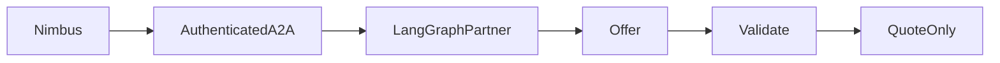

# Capstone: Partner Network

Request and validate a partner quote across an authenticated A2A process boundary.

Prerequisite: Module 18. Allow 6–12 hours for your first implementation. Start from [starter.py](starter.py), then compare with the [reference solution](solution/main.py).

## User stories
- As a travel operator, I want Nimbus to obtain a partner quote from an agent built with another framework.
- As a traveler, I want progress while the separate partner process is working.
- As an integrator, I want authentication, strict artifact validation and reliable process cleanup.

## Acceptance criteria
- Launch an actual LangGraph partner in a separate local process.
- Authenticate discovery and invocation without putting tokens in prompts.
- Reject an unapproved advertised origin or malformed offer.
- Consume streaming artifacts and stop the partner process.

## Architecture

The model handles bounded reasoning; host code validates source evidence and owns authorization.

## Build it
1. Run the starter and list which acceptance criteria remain unchecked.
2. Read the evaluation cases before implementing the workflow.
3. Add a failing boundary case, then implement the narrowest capability it needs.
4. Run the reference solution and compare evidence rather than matching prose.

```text
uv sync --all-groups
uv run python capstones/05_partner_network/starter.py --mock
uv run --all-groups python capstones/05_partner_network/solution/main.py --mock
uv run --all-groups pytest capstones/05_partner_network/tests
```

Expected: checked evidence followed by `Lesson complete.`. All finite reference commands are included in the repository example sweep. The [evaluation set](evaluation.json) describes independent acceptance cases; mocks validate contracts, not real model quality.

## Design and operating limits
The reference solution uses the tested Module 18 child-process lifecycle. LangGraph owns the partner's quote node; Nimbus consumes A2A protocol 0.3.0. The generated transport token is sent only as an HTTP header. The returned card's origin must match the approved local endpoint. The offer schema fixes the synthetic flight, amount, currency and quote-only flag. A streaming response is not proof of purchase. Use `--backend strands` to compare a Strands partner. Both servers are loopback teaching processes, not internet hosting with per-user identity. The quote's remote model usage is unavailable rather than reported as zero.

## Costs
Mock mode costs $0 and creates no AWS resources. Live model calls use the configured provider's token prices; several agents or evaluations multiply usage. Read [the cost inventory](../../docs/PRODUCTION_COSTS.md) before optional AWS labs. No live spending or deployment was performed during authoring.

## Teardown
Stop any notebook kernels and local processes you started. Generated reports and databases are under `.nimbus/capstones/05_partner_network`; remove that directory when no longer needed. The Partner helper closes its child process in `finally`. For any optional cloud stack, use its documented destroy command and then `uv run python scripts/find_leftovers.py --regions us-east-1`. An empty tag query alone does not prove complete cleanup. Check logs, asset storage and all deployed regions.

## Rubric
| Area | Points | Evidence |
|---|---:|---|
| Correctness | 35 | Every acceptance case passes with inspected source evidence |
| Boundaries | 25 | Denial, malformed input, duplication and deadline behavior tested |
| Explanation | 15 | Diagram and clear statement of mock/live limits |
| Evaluation | 15 | Held-out cases plus a deliberate failing variant |
| Operations | 10 | Cost assumptions, retention and verified cleanup procedure |

Passing target: 80/100 with no unauthorized mutation or cross-user access. A perfect fixture score cannot compensate for a broken authorization boundary.

## Extend it
- Add a new held-out edge case that would have fooled the current implementation.
- Introduce a provider/service failure and preserve a useful, content-safe error.
- Measure a live workload only after explicit cost approval; document sampling limits.

## References
- [Course verification](../../docs/VERIFICATION_NOTES.md)
- [Strands documentation](https://strandsagents.com/docs/)
