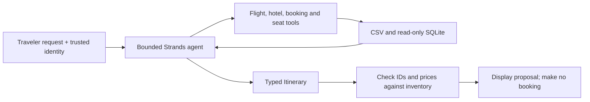

# Tier 1 checkpoint: Nimbus Booking Helper

Build a command-line assistant that helps a synthetic traveler find a trip. Finish [modules 00–06](../../LEARNING_PATH.md) first. Allow 60–90 minutes. Mock/Ollama inference has no hosted-model charge; a short Bedrock attempt uses roughly six model calls plus any validation repairs. No AWS resources are created and no bookings are mutated.

## User stories and acceptance criteria

- As a traveler, I can ask for flights and hotels in Lisbon and receive existing synthetic IDs.
- As the authenticated demo customer CUS-001, I can read BKG-0001; a different customer gets an unavailable response.
- As a traveler, I can check seat availability before considering an itinerary.
- As the application, I receive a validated `Itinerary`, reject invented prices and IDs, and stop at a bounded number of turns.
- Every result states that prices are synthetic and that no reservation was made. Hotel suggestions are separate from the flight-only total.



## Build and check

```text
uv run python checkpoints/01_booking_helper/starter.py --mock
uv run python checkpoints/01_booking_helper/solution.py --mock
uv run pytest checkpoints/01_booking_helper
```

Extend [starter.py](starter.py) before reading [solution.py](solution.py). The starter runs a useful search but intentionally does not satisfy the full project. The reference solution composes `common.assistant.booking_agent`, with the same four tools taught in module 05. Keep identity in `invocation_state`, never in model-selectable arguments. The tests validate the reusable application components and reference solution; add matching tests for your own composition.

Remove `--mock` only after configuring a tool-capable model. For Ollama use the documented `qwen3:4b` route; for Bedrock complete the SSO/budget setup first. The demo identity is fixed for synthetic exercises; it is not a login system suitable for deployment.

Expected output includes `traveler`, `legs`, `total_cents`, and `hotel_id`, followed by usage metrics. The scripted route deliberately picks the first matching fixture; it does not measure a model's planning quality. An inventory validation error is a rejected proposal, not a reason to silently change the source data.

## Rubric

| Criterion | Points |
|---|---:|
| Four tools use bounded read-only access | 2 |
| Customer isolation tested, including a denied lookup | 2 |
| Nested schema and consistent flight total | 2 |
| Inventory verification rejects invented data | 2 |
| Turn budget, clear errors and reproducible offline test | 2 |

Eight points and all identity/inventory checks passing is the checkpoint target. Extend it with date filtering, traveler-count availability, or a separately priced hotel field. Do not introduce write operations before approval and idempotency are taught.

## Clean up and next

This project creates no AWS resources. Reports and tool-demo state from earlier modules live under `.nimbus/`; remove only working files you no longer need. Tier 2 will add policy retrieval and persistent preferences; it is not delivered in Phase 3.
