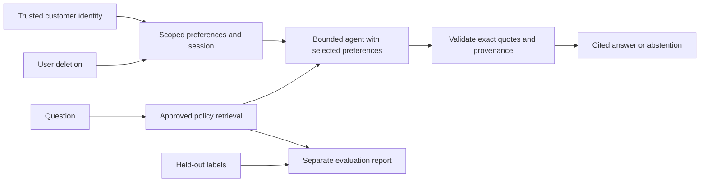

# Tier 2 checkpoint: Policy & Preferences assistant

Combine [modules 07–09](../../LEARNING_PATH.md) into a customer-scoped policy
assistant. Allow 60–90 minutes. Offline runs cost $0; live inference and embeddings
are additional. This checkpoint creates no AWS resources.

## User stories and acceptance criteria

- Answer a policy question with an exact quote, source and PDF page from retrieved evidence.
- Reject an invented source, page or quote and abstain when no evidence is available.
- Store only approved seat, meal and bounded budget preferences with explicit consent.
- Resume an application-derived customer/session ID without revealing another customer's history.
- Expire preferences after 90 days and delete all registered sessions for the selected user.
- Produce a held-out retrieval report; distinguish source hits from answer quality and model judgments.



```text
uv run python checkpoints/02_policy_preferences/starter.py --mock
uv run --group rag python checkpoints/02_policy_preferences/solution.py --mock
uv run pytest checkpoints/02_policy_preferences
```

Extend the [starter](starter.py), then compare with the [reference](solution.py).
The reference uses the transparent lexical baseline; replace it with the Chroma
retriever from module 07 or hybrid search from module 08 and rerun the same cases.
Its temporary storage demonstrates a full lifecycle and is removed on exit.
Production persistence requires an application-owned path and access controls.

Expected output contains `citations` and a PDF page, followed by
`User deletion verified` and the path `.nimbus/policy_preferences_report.json`.
The report uses the original 11 answerable golden questions. The twelfth question
tests abstention separately. The scripted response checks integration, not an
LLM's understanding of policy.

## Rubric

| Criterion | Points |
|---|---:|
| Retrieved, exact source/page/quote validation | 2 |
| Empty-evidence abstention and forged-citation rejection | 2 |
| Customer/session isolation | 2 |
| Consent, expiry and deletion preserving other users | 2 |
| Reproducible report and honest model-quality limitations | 2 |

Pass with at least eight points and every privacy/citation boundary passing.
Extend with a fresh paraphrase test set frozen before tuning, a citation-quality
review, and a real local-model evaluation. Do not tune against the held-out labels
and then call the resulting score independent evidence.

You're ready for Tier 3 when you can explain why similarity is not truth, why
state is not durable memory, how identity reaches the storage layer, and why a
successful deletion test does not prove that unrelated backups were erased.

No cloud cleanup is needed for this checkpoint. Optional lab cleanup is in the
[infrastructure guide](../../infra/README.md). Tier 3 follows in Phase 5.
