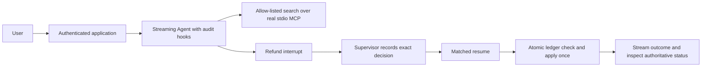

# Tier 3 checkpoint: Safe Support Agent

Build a local Nimbus assistant that searches flight alternatives through MCP,
streams its response, pauses a $600 refund for review, and applies only the
recorded decision. Complete [modules 10–14](../../LEARNING_PATH.md) first.
Budget 60–90 minutes. Offline execution costs $0 and creates no AWS resources;
live inference uses your configured provider's rates. The local MCP server and
ledger operate only on synthetic data.



## Build it

1. Run the [starter](starter.py). It describes the contract and makes no changes.
2. Connect a disposable MCP server with only `search_flights`, then review the
   discovered inventory before giving those tools to the agent.
3. Propose a refund in ApprovalLedger and construct an agent with SupervisorGate
   and an AuditPolicy allowing only flight search and apply_action.
4. Stream inside a 30-second deadline, capture the interrupt, display its terms,
   and let the trusted host record approve or reject before resuming the exact ID.
5. Check the ledger rather than model prose. Write a redacted report and close
   the MCP context before deleting its temporary database.

```text
uv run python checkpoints/03_safe_support/starter.py --mock
uv run python checkpoints/03_safe_support/solution.py --mock
uv run python checkpoints/03_safe_support/solution.py --mock --decision approve
uv run pytest checkpoints/03_safe_support tests/test_tier3_boundaries.py tests/test_tier3_mcp.py
```

Expected statuses are `rejected` and `applied`, respectively. The [solution](solution.py)
writes `.nimbus/safe_support_report.json` with tool audit records, mode and mutation
scope. The default model forces the protocol/tool path; it does not measure live
planning quality. The model may choose a different path in live mode, so retain
all boundaries and inspect the reported status.

## Open the web version

```text
uv run --group apps python checkpoints/03_safe_support/solution.py --mock --serve
```

Open the printed loopback URL and use the separate generated customer/supervisor
tokens. Search and refund operations share the reviewed MCP client lifetime.
Approval decisions stream their resumed result. Press Ctrl+C to stop. The ledger
persists at `.nimbus/support_web.db`; paused agents do not survive a restart.
These demo role tokens and a single CUS-001 identity are not production sign-in.

## Acceptance criteria and failure checks

| Behavior | Evidence |
|---|---|
| Real MCP search occurs before the scripted refund | [Checkpoint tests](test_safe_support.py) inspect the tool audit |
| Rejection never applies a refund; approval applies exactly once | Checkpoint and [transaction tests](../../tests/test_tier3_boundaries.py) |
| Forged resume text, expired decisions and another customer's booking fail | Boundary tests inspect authoritative state |
| Injection cannot execute the forbidden export marker | Boundary tests run poisoned input through baseline/hardened agents |
| Timeout/disconnect/cancellation closes the stream | Boundary tests inspect async generator finalization |
| Unauthenticated MCP calls fail and child processes stop | [MCP tests](../../tests/test_tier3_mcp.py) use real loopback HTTP |
| UI messages remain in their own session | [Streamlit test](../../tests/test_tier3_ui.py) exercises widgets and Clear |

Local allow-lists are the checkpoint's guardrail layer. Bedrock managed content
filters are optional in [Module 13's lab](../../infra/13_guardrails/README.md),
with different coverage and costs. They are not silently simulated here.

## Self-check and extensions

Award one point each for real MCP transport, correct client lifetime, public-only
streaming, trusted decision recording, expiry enforcement, replay safety, redacted
audit, and denied-injection verification. Score all eight before Tier 4. Explain
why cancellation cannot roll back a remote refund and why a chat reply cannot
authenticate a supervisor. Extend with durable pause/recovery and authenticated
multiple customers only after adding tests for restart and cross-user access.

Temporary CLI databases clean themselves up. After stopping the web app, delete
only its specific demo databases/reports if you no longer need them. No checkpoint
command deploys AWS. If you separately deployed Guardrails, complete its teardown
and leftover checks before moving on. Phase 6 adds multi-agent coordination.
