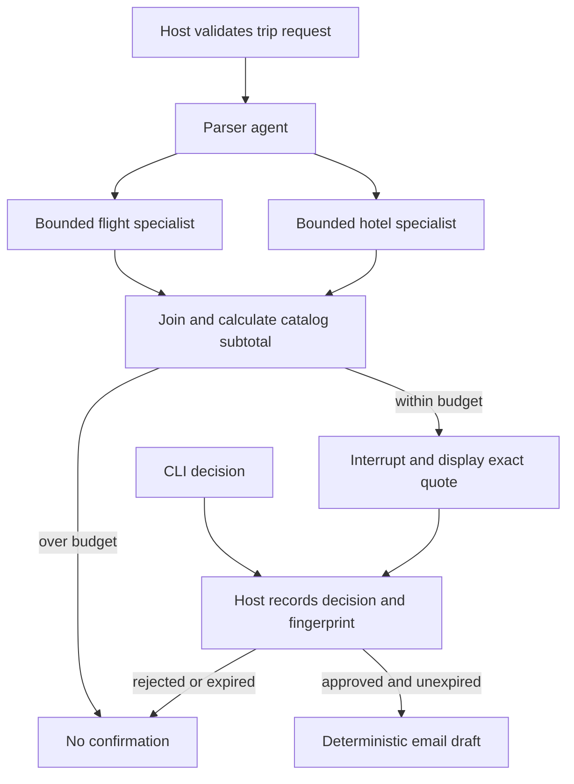

# Tier 4 checkpoint: Trip Planning Crew

Build a crew that proposes a two-person, two-night Porto trip, checks its catalog subtotal,
and drafts a confirmation only after review. This checkpoint integrates Modules 15–18's
design choices; the richer weather/Streamlit capstone is planned for Phase 8.

## Pattern and design rationale



The **Graph** enforces dependencies and branching. Its parallel search nodes each call one
specialist agent with public catalog evidence; their structured results are checked against
the original IDs and prices. Models do not choose whether a trip fits the budget. The host
adds integer cents and records approval of an immutable quote for five minutes. The model's
interrupt response carries no authority. Draft creation checks the recorded approval again.

A **single agent plus deterministic tools** would be cheaper for this small catalog, and is
the default choice outside this teaching exercise. Specialist agents become useful when
search subtasks require different prompts or complex reasoning. A **Swarm** fits creative
itinerary exploration, but would add unnecessary routing uncertainty to this approval path.
**A2A** fits an independently operated partner; putting a local hotel search behind HTTP
would add lifecycle and credential work without a service boundary. Module 18 demonstrates
the real remote upgrade extension separately.

## Run

From the repository root, these commands work in PowerShell, macOS and Linux:

```text
uv run python checkpoints/04_trip_planning_crew/starter.py --mock
uv run python checkpoints/04_trip_planning_crew/solution.py --mock --decision approve
uv run python checkpoints/04_trip_planning_crew/solution.py --mock --decision reject
uv run python checkpoints/04_trip_planning_crew/solution.py --mock --budget-cents 1
uv run python checkpoints/04_trip_planning_crew/solution.py --mock --decision ask
uv run pytest tests/test_tier4_coordination.py
```

`approve` and `reject` are explicit CLI demo decisions. `ask` displays the exact quote and
waits for the person at the terminal. These are local single-user demonstrations, not a
supervisor identity service. Expected approved subtotal: **52,800 cents ($528)**, from
FLT-0001 and HTL-132. The report is `.nimbus/trip_crew_report.json`; it includes status,
visited nodes, quote fingerprint, decision and optional draft. Nothing is booked or sent.
The subtotal covers two one-way flight seats and one room for two nights. The catalog lacks
occupancy data; return travel, meals and extras remain unresolved.

## Acceptance criteria and self-check

- Reject invalid party sizes, extra private fields, altered prices and changed catalog IDs.
- Run flight and hotel searches concurrently; calculate the budget once after both finish.
- Route over-budget trips directly to a no-draft result.
- Reject forged response text, changed terms, expired approval and repeated decisions.
- Give each child at most three model calls, a 15-second deadline and minimal public context.
- Keep total graph executions bounded; count child usage once in the result.
- Explain why a single agent is enough for the catalog and when an external partner merits A2A.

Start with the runnable catalog contract in `starter.py`, implement the graph using the
[Module 17 helper](../../common/trip_graph.py), then compare with `solution.py`. Tests cover
actual SDK routes, concurrent searches, rejection, expiry and nested usage. Try changing the
budget to exactly 52800 and then 52799. Restarting loses the in-memory review; start a new
quote and review instead of pretending it was durably approved.

## Cost and cleanup

Mock runs cost $0. For Ollama set `MODEL_PROVIDER=ollama` in `.env` and remove `--mock`;
use a model with tools and structured output. Bedrock uses configured per-token rates:
the successful fixture makes five model calls (600 synthetic tokens), which is a test
count, not a live price prediction. Each model response is bounded by `MODEL_MAX_TOKENS`.
Model retries/quality can differ live; review the printed estimate and [cost guide](../../docs/COSTS.md).
No AWS resources, databases or background servers are created. The local JSON report may
be deleted when finished. Do not treat deadline cancellation as rollback of an external write.

## Extend it

Add a third optional branch that calls the authenticated airline from Module 18 and includes
its validated $75 upgrade in a new quote fingerprint. Re-review changed terms. Report remote
tokens as unknown. For a production version, persist decisions and bind them to authenticated
reviewers before adding booking or sending tools.
