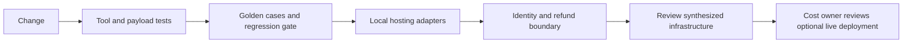

# Tier 5 checkpoint: Production Readiness

Build a release decision for Nimbus support. Passing local tests is evidence about local
behavior. A production release additionally needs image builds, live IAM/authentication,
managed-service results, load measurements and a verified teardown.



## Build and check

```text
uv sync --all-groups
uv run --all-groups python checkpoints/05_production_readiness/starter.py --mock
uv run --all-groups python checkpoints/05_production_readiness/solution.py --mock
uv run --all-groups pytest tests/test_production.py
uv run --all-groups python scripts/synth_all.py
```

Replace the starter's unchecked fields with actual results. The reference report is saved
to `.nimbus/production_readiness.json`. It reports a score of 1.0 for fixture cases, rejects
a USD 500.01 quote, verifies local streaming adapters and exercises the Copilot's bound
identity. It explicitly leaves container builds and AWS deployment unverified.

## Acceptance and rubric

| Evidence | Points | Acceptance |
|---|---:|---|
| Deterministic evaluation | 25 | All 12 cases pass; injected bad answers make the CLI exit 1 |
| Auth and input boundaries | 20 | Missing/wrong credentials, malformed requests and excess refunds fail |
| Hosting | 15 | The same support implementation serves local Lambda, Runtime and FastAPI contracts |
| Infrastructure | 20 | All templates synthesize; justify every permission and inspect tags/retention |
| Operations | 20 | List hourly/usage charges, owners, teardown commands and unverified live checks |

A score of 80/100 is a learning milestone, not production approval. Include a written
choice between Lambda, Fargate and Runtime. Explain why no real booking or payment is
performed by the public quote API. Outline the additional ownership checks, durable
idempotency, human approval and audit trail a payment integration would need.

## You're ready when you can…

- Distinguish mock fixtures, deterministic quality checks, LLM judgments and live validation.
- Trace one request without exporting credentials or private messages.
- Explain why sign-in, Gateway authorization and business authorization are separate checks.
- Account for always-running ALB/Fargate/IPv4 charges and idle Runtime session memory.
- Disable evaluations, delete the isolated lab stacks and inspect leftover assets.

No resources are created by this checkpoint. Optional deployment and cleanup commands
are in the [production lab guide](../../infra/PRODUCTION.md). Continue to Phase 8 for
the bonus modules and capstones, including the fuller Support Copilot project.
