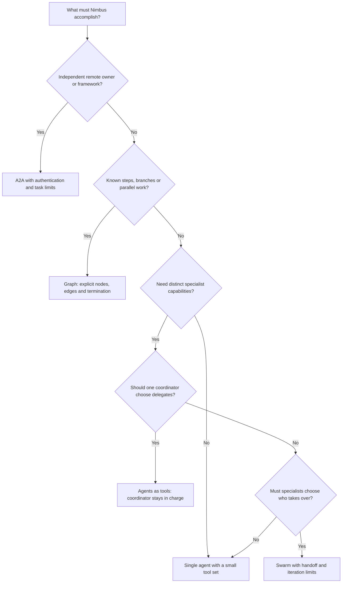
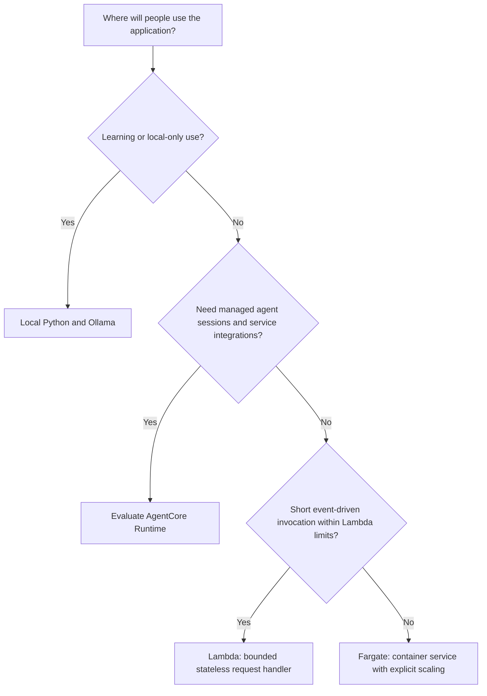

# Choose a pattern and a place to run it

Start with the smallest design that meets a measured requirement. Add agents when they need separate instructions, tools, ownership or execution paths. More agents mean more calls, more failure modes and more work to evaluate.

## How should the work be coordinated?

| Pattern | Nimbus example | Check before adding it |
|---|---|---|
| Single agent | Answer policy questions and look up bookings | Can a smaller tool set meet the task? |
| Agents as tools | A coordinator asks flight and hotel specialists | Are delegation inputs and returned results bounded? |
| Graph | Extract a receipt, validate totals, request approval, store it | What happens if a branch fails or runs twice? |
| Swarm | Specialists hand off a complex support case | Is there a clear completion rule and handoff limit? |
| A2A | Nimbus sends a task to a separately operated partner | Who authenticates the caller and authorizes each task? |

A graph is like a checklist with explicit forks; a swarm is like a team deciding who should speak next. If every step is already fixed and has no need for model judgment, an ordinary Python workflow may be enough.

## Where should it run?

Local execution is easiest to inspect. Lambda fits bounded event-driven handlers; save state outside the process and verify timeout, streaming and concurrency requirements. Fargate gives control over a long-running container, but you must manage service scaling, networking and its idle cost. AgentCore Runtime can reduce agent-specific hosting work; confirm regional features, session behavior, identity integration and pricing before selecting it.

Hosting never replaces application authorization or evaluation. A managed runtime can scale an incorrect refund tool just as efficiently as a correct one. Use the [AWS setup guide](AWS_SETUP.md), [cost guide](COSTS.md), and later deployment lesson's acceptance tests before deploying. Infrastructure examples arrive in their scheduled phases; this decision guide does not claim they have been deployed.
