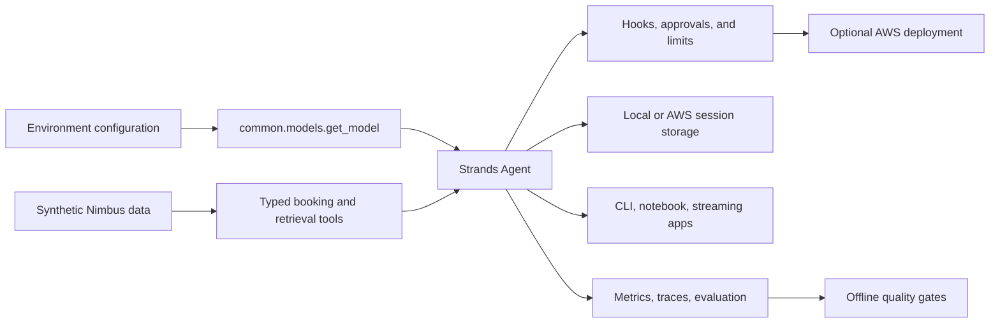

# Nimbus Travel course: implementation plan

Plan prepared October 29, 2026 · Phases 1–5 delivered; later phases pending

This repository teaches a Python learner to build, evaluate, secure, and deploy the Nimbus assistant with Strands Agents. This document retains the original course plan. The foundation and modules 00–14 are implemented; the root README and verification notes track delivered scope.

## Review these deliverables

- [Verified versions, API decisions, and remaining verification](VERIFICATION_NOTES.md)
- [Feature map and planned example paths](FEATURE_MAP.md)
- [Learning path, checkpoints, and schedules](../LEARNING_PATH.md)
- [Complete planned repository tree](REPOSITORY_TREE.txt)
- [Machine-readable package evidence](verification/package_metadata.json)

## Assumptions and scope

1. Work proceeds in the eight requested phases. Each phase ends with a report and waits for `continue`. This instruction takes precedence over the general instruction to build everything when tools are available.
2. Python 3.12 is the recommended interpreter. The planned supported range is `>=3.12,<3.14`, with Windows and Ubuntu checks on 3.12 and 3.13. macOS installation and examples will also be documented; a macOS CI smoke job will verify the core path. Broader Python support will not be advertised without testing.
3. Bedrock is the configured default; Ollama is the local alternative. Offline tests use a scripted model, not a local language model. No credentials, model downloads, telemetry exporters, or AWS metadata-service access are allowed during those tests.
4. The base install includes the foundation path, Ollama provider, and default developer checks so `uv sync` followed by `uv run pytest` works after dependencies are downloaded. Optional dependency groups add retrieval, other providers, apps, multi-agent protocols, AWS infrastructure, evaluation, and bonus lessons. Ordinary dependency installation itself requires network access unless the cache is populated.
5. All datasets represent invented transactions, organizations, and people. Real geographic place names are used for destinations and weather lookup. Dates are fixed relative to a documented synthetic reference date, not today's clock. Emails use reserved example domains. Identifier-like values are visibly synthetic and deliberately unsuitable as real credentials or payment details.
6. Course estimates assume one learner, small prompts, bounded retries, and short lab sessions. “Free locally” means no hosted-model charge; hardware, electricity, and downloads still apply. Paid model bills and AWS infrastructure bills are reported separately.
7. Public GitHub publication is part of the eventual delivery. Phase 1 writes local documents only. The destination account and available repository name will be checked before publication; no owner or URL is invented.

## Architecture and teaching decisions

The Nimbus assistant grows through versions 0–11. Modules that extend an existing version retain its number and explain the new capability. Later lessons reuse named code from `common/`; they never import a directory whose name starts with digits. The capstones compose those pieces rather than copy a large application into every module.

Every module, including setup and the bonus modules, receives a README using the requested template, at least three focused examples, a runnable use case, three runnable exercise starters, matching solutions and exercise tests, a cleared notebook, a quiz with hidden answers, and behavior tests. Larger topics receive more examples. The feature map names those examples now; no empty Python files will be created merely to satisfy coverage counts.

Every concept gets an analogy, a Mermaid diagram, an explanation of the actual SDK behavior, a failure-and-fix example, a use case, and exercises. Learners meet tokens in 00, async in 01 with a fuller treatment in 10, Pydantic in 04, IAM before AWS access, and embeddings in 07. The hand-built model adapter, Converse loop, cosine similarity, and basic retrieval scoring precede their corresponding abstractions.

### Model selection

`common/models.py` is the only model factory, including mock mode and specialized voice adapters. Module 02 may instantiate providers directly while teaching them. `.env.example` holds all model IDs. `MODEL_ID` is an optional explicit override; otherwise the helper selects a provider-specific environment value such as `BEDROCK_MODEL_ID` or `OLLAMA_MODEL_ID`. With the override blank, changing only `MODEL_PROVIDER=ollama` switches providers correctly.

Provider imports are lazy so unused providers do not require their optional packages or keys. Friendly failures identify missing packages, expired SSO, wrong regions, unavailable models, and Ollama connection failures. They point to `scripts/check_env.py`. The checker defaults to offline checks; explicitly requested model probes state their small cost before running.

For local multimodal lessons, a vision-capable Ollama model is required. PDFs are parsed with page provenance when the provider cannot accept document blocks. Native PDF inputs are demonstrated separately on supported models. This is an explicit capability difference, not a promise that every model supports every feature. Temperature is zero for comparisons when the provider supports it; unsupported parameters are omitted and nondeterminism is explained.

### Shared application boundaries

- `common/config.py`, `models.py`, `data.py`, `pretty.py`, and `testing.py` supply configuration, model construction, data access, readable output, and deterministic model events.
- `common/tools/` contains typed booking, policy, weather, and operations tools. Database reads use parameterized queries and read-only connections. Approved mutations use a separate transaction layer with idempotency keys.
- `common/retrieval/`, `schemas.py`, `memory.py`, `safety.py`, `approvals.py`, and `evaluation.py` hold capabilities added in later phases. Each is introduced by the lesson that needs it.
- `common/assistant.py` provides named version builders. Modules retain focused code and explicit configuration; the factory does not hide the concept being taught.
- Local sessions, indexes, generated reports, and changed booking databases live under ignored `.nimbus/`, leaving committed teaching fixtures reproducible.

### Synthetic data contract

The generator will create 30 destinations, 500 flights, 150 hotels, 300 bookings, six numbered policies, a ten-page terms PDF, four runbooks, 100 support tickets, 300 reviews, 20 receipt PNGs, three planted log incidents, 90 days of cost rows, three golden evaluation sets, and one clearly labelled malicious teaching document. Relational data must satisfy foreign keys, totals, refund bounds, and available-seat invariants.

Generation uses a fixed seed and fixed reference date. PDF metadata, image metadata, ordering, and SQLite creation order are controlled. Tests check data invariants and semantic reproducibility; byte comparisons are used only where the format supports them reliably. Golden labels and train/example inputs are separated to prevent evaluation leakage. Images and PDFs receive visual review before delivery.

## AWS safety and cost plan

The course never asks learners to use root or put AWS access keys in `.env`. An existing authorized administrator provisions Identity Center access if the learner cannot. The learner signs in with AWS CLI v2 and a named SSO profile. A budget alert is created before billable lesson calls; identity setup and budget creation are necessarily prerequisites to that rule. Alerts do not impose a hard spending limit.

Tiers 1–4 deploy no resources on the core path. Optional Knowledge Bases, S3 sessions, AgentCore Memory, and Guardrails labs are clearly separate AWS branches. Every branch has infrastructure code, resource inventory, pricing assumptions, tags, teardown, and a leftover check. AgentCore service experiments can be deferred until Tier 5 while the local memory and safety lessons remain complete.

S3 Vectors is the proposed vector store for the small optional Knowledge Base. Its supported integration is verified; “cheapest” will be justified with a dated workload comparison in Phase 4, not treated as universally true. Local Chroma plus Ollama embeddings remains the free path.

All supported resources receive `project=getting-started-with-aws-strands`. Untaggable child resources are associated with their tagged stack and recorded in its resource inventory. The leftover checker combines tagged-resource discovery with CloudFormation and service-specific inventories across selected regions. It reports permission failures and scan limitations; an empty tag query alone must never claim the account is clean.

CDK apps use explicit least-privilege statements and comments explaining every action. Tests inspect synthesized policies, including grants added by constructs. Wildcard actions are prohibited; unavoidable wildcard resources require a documented service limitation and narrow conditions where supported. Deployers and running agents have separate roles. CDK bootstrap assets, ECR images, retained logs, storage objects, vector indexes, evaluation schedules, and identity resources are included in cleanup instructions.

Risky tools remain behind consent and allow-lists. `BYPASS_TOOL_CONSENT` stays unset/false. The replacement vended Python tool must receive an explicit consent gate if it does not supply the old tool's prompt. `use_aws` gets only a scoped read-only role. A text redactor is not represented as a guarantee against prompt injection; tool authorization and output validation remain independent controls.

## Phase delivery and acceptance

| Phase | Deliverables | Exit checks |
|---|---|---|
| 1 | This plan, verification notes, feature map, learning path, tree | Research evidence and internally consistent coverage; then stop |
| 2 | Project metadata and lock, common foundation, scripts, all synthetic data, root documents, AWS setup/cost docs, CI | Resolve groups; offline foundation tests; lint; data invariants; image/PDF review; no fake lockfile |
| 3 | Tier 1, modules 00–06, booking checkpoint | Each example in mock mode; exercises/solutions; notebooks; provider adapter contracts |
| 4 | Tier 2, modules 07–09, policy checkpoint, optional KB/session/memory infra | Citation/page accuracy; retrieval scores; isolation/deletion; moto S3; CDK synth |
| 5 | Tier 3, modules 10–14, support checkpoint, Guardrails infra | Streaming disconnects; approval rejection/timeout/replay; injection corpus; real local MCP protocol lifecycle |
| 6 | Tier 4, modules 15–18, crew checkpoint | Tool trajectories; swarm termination; graph fan-in/branches/limits; authenticated A2A contracts |
| 7 | Tier 5, modules 19–21, production checkpoint and infrastructure | Evaluation gate failure path; offline CDK synth; IAM scan; deployment packaging; teardown coverage |
| 8 | Four bonus modules, five capstones, five printable cheatsheets, glossary, troubleshooting, final audit | Whole-repo lint/tests/example sweep; cleared notebooks; links; supported-platform CI; honest completion checklist |

No AWS deployment will be performed without a later explicit request. Live tests are opt-in and skipped by default. A successful mock test or CDK synthesis does not establish that a paid service deployment works.

### Verification design

The scripted provider follows the pinned upstream model fixture's event sequence, but implements configuration, structured output, and exhaustion behavior fully instead of copying its stub methods. Tests exercise text, tool calls/results, errors, structured validation retries, streaming, interrupts/resume, and usage metrics through the real Strands loop.

The default pytest run blocks external sockets and SDK credential discovery, disables exporters, uses temporary session/database directories, and treats Strands deprecation warnings as errors. A separate local-protocol test group permits loopback only for MCP/A2A process tests. `moto` covers supported AWS services; `botocore.stub.Stubber` covers exact service contracts where moto has no implementation. No test passes by pretending that moto emulates all AgentCore services.

`scripts/run_all_examples.py` uses a manifest of script commands, dependencies, runtime limits, and fixtures. It supplies scripted human responses for approvals, fixture weather responses, and local fake protocol servers. Long-running apps are launched, health-checked, and terminated. Real service branches are reported as untested unless explicitly invoked; they are never silently counted as live successes.

CI separates offline test jobs from networked setup and external link checks. Dependency installation needs access to package registries. CDK synthesis uses explicit account/region configuration and no context lookups; Docker assets use deterministic build inputs. Container builds are a separate check where a runner has Docker. All created CDK apps must synthesize, including optional lessons.

## Known limits and decisions still to verify

- Phase 2 resolved all selected groups into `uv.lock`, installed them on Windows/Python 3.12, and checked the provider constructor contracts. Default-group tests also ran on Python 3.13. Remote CI and other platforms remain unverified.
- AWS account/region permissions, local GPU performance, actual model output quality, public CI results, and deployment cleanup are not yet tested.
- Quick-start targets are measured after prerequisites are ready. A new AWS organization's SSO setup, approvals, subscription activation, and large Ollama downloads cannot honestly be guaranteed within 10 or 20 minutes.
- Current SDK features supersede some names in the brief. The exact swaps and stable/experimental distinctions are recorded in the verification notes; no deprecated API is kept merely to match older wording.
- Each phase rechecks the relevant official docs against the frozen versions. It updates the coverage contract and reports any unsupported item before claiming completion.

## Phase 2 delivery

The foundation now includes the resolved lockfile, configuration and model/data/output helpers, an offline scripted provider, complete synthetic data, operational scripts, root documents, AWS setup and cost guidance, CI definitions and contribution templates. See [verification notes](VERIFICATION_NOTES.md) for results and limits.

At the Phase 2 checkpoint, lessons and infrastructure were still pending. The subsequent delivery records below supersede that historical status.

## Phase 3 delivery

Tier 1 modules 00–06 and the [Booking Helper checkpoint](../checkpoints/01_booking_helper/README.md) are implemented. The feature map now links delivered paths and tests. Notebooks, exercise starters/solutions and offline CLI use cases are included. Tool deprecations discovered during implementation are recorded in the migration guide. Later phases remain pending.

## Phase 4 delivery

Modules 07–09 and the Policy & Preferences checkpoint are implemented, with local Chroma retrieval, citation validation, retrieval/answer evaluation, isolated preferences and sessions, supported memory adapters, and three optional AWS CDK apps. Templates synthesize offline; no deployment is claimed. The comparison records a source-hit tie, not an invented improvement. This historical Phase 4 checkpoint is superseded by the Phase 5 delivery below.

## Phase 5 delivery

Modules 10–14 and Safe Support are implemented: bounded streaming, FastAPI and
Streamlit apps, current lifecycle hooks, individual/batch/tool interrupts,
transactional refund decisions, local policy and injection regression, managed
Guardrails contracts, and actual stdio/HTTP MCP booking servers. The fourth optional
CDK app configures Guardrails. There are 23 new examples, five use cases, 15 exercise
pairs, five cleared notebooks and a checkpoint. Phase 6 (Tier 4, modules 15–18)
remains pending the user's next `continue`. No AWS resources were deployed.
