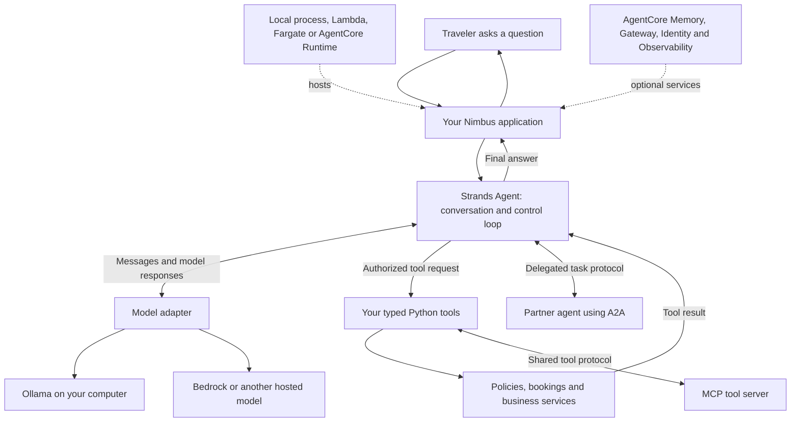

# How the pieces fit together

A model is a text-and-data prediction service. An agent is an application that lets a model choose its next step, then checks and carries out that step. Strands supplies the repeated model/tool conversation, while your application supplies the tools, instructions and authorization.

Think of Nimbus as a service desk. The model suggests what the clerk should do; a tool is an approved desk procedure. A convincing suggestion never grants permission to issue a refund.

The **model provider** sends messages to the selected model. Bedrock is AWS's managed model service; Strands is the application library that can use Bedrock or other providers. **AgentCore** supplies managed hosting and supporting services. You can learn the Strands loop locally without deploying anything.

Under the hood, the model emits a `toolUse` content block when it wants a tool. Strands validates the tool arguments against its schema, runs the tool, appends a `toolResult` message and asks the model again. It continues until an answer or another stopping condition. Your tool must still check permissions, limits, approval state and business rules before a side effect.

**MCP**, the Model Context Protocol, gives applications a shared way to discover and call tools. **A2A**, the Agent-to-Agent protocol, lets independently hosted agents exchange tasks and results. Neither protocol makes an untrusted server safe. A local graph or swarm can coordinate several agents without either protocol.

**Conversation** is the current message history. **State** is application data for the current run. **Sessions** persist a conversation between runs. **Memory** retrieves relevant information from earlier interactions. **RAG** retrieves source passages before answering; it does not retrain the model. **Observability** records what happened, while **evaluation** checks whether the outcome meets a defined standard.

Start with the [foundation demo](../scripts/foundation_demo.py), then follow the [learning path](../LEARNING_PATH.md). The [pattern guide](CHOOSING_THE_RIGHT_PATTERN.md) helps decide when more machinery earns its cost.
