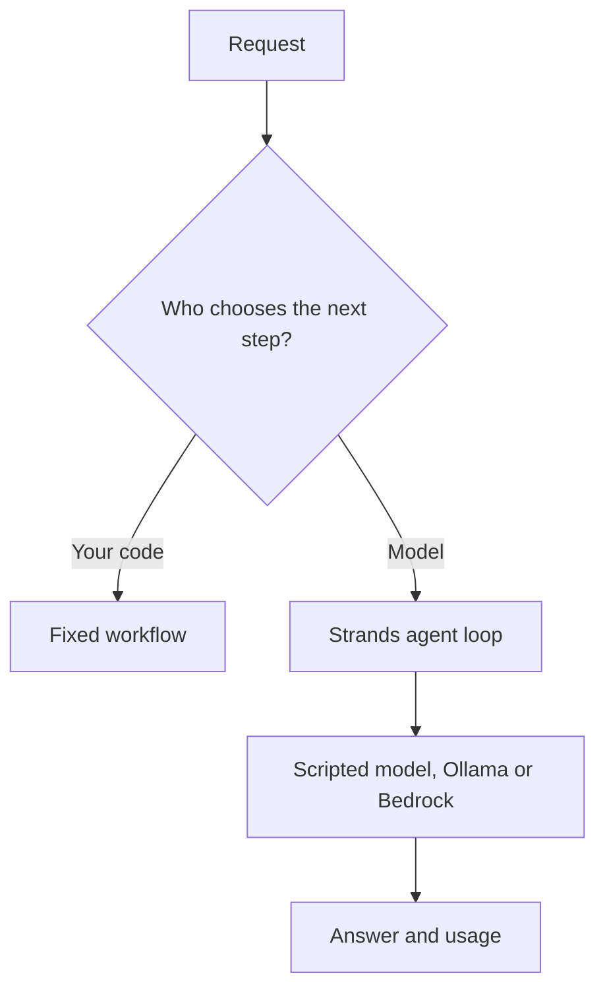

# Module 00: Setup and orientation
> After this module you can run a small agent locally or prepare an SSO-backed Bedrock profile safely.

**Time:** ~90 min · **Level:** Beginner · **Cost:** mock/Ollama $0 hosted inference; Bedrock planning allowance $0.02–$0.15 per walkthrough, more for repeats.

**AWS required:** Optional (local alternative: Ollama; service-specific contracts use offline fixtures). **AWS resources created:** None.

**Assistant version 0:** Run a small agent locally or prepare an sso-backed bedrock profile safely.

## Prerequisites

[Repository quick start](../../README.md). Run commands from the repository root. Use Python 3.12 or 3.13 and `uv sync`. Default examples below use `--mock`; removing it can call the configured provider. Complete [AWS setup](../../docs/AWS_SETUP.md) before hosted calls. [Cost assumptions](../../docs/COSTS.md) are estimates, not a spending cap.

## Learning objectives

- Distinguish a fixed workflow from a model-driven agent.
- Select the local or hosted setup path.
- Explain input tokens, output tokens and latency.
- Run an offline readiness check and one measured agent call.

## The big idea

An agent is like a service-desk worker with a menu of approved procedures. A workflow is a checklist whose order you wrote in advance. A model-driven agent chooses its next step from its instructions and tools; the application must still check whether that step is allowed. A model predicts text and structured requests from a conversation. A token is a small piece of that input or output, not necessarily a word. Providers usually charge for both directions. Latency is elapsed time, while token counts describe usage. Strands runs the conversation loop. You can practice that loop with scripted replies before installing a local model or signing in to AWS.

## How it works



| Concept | Analogy | Under the hood |
|---|---|---|
| Agent versus workflow | A clerk versus a checklist | The workflow branch is Python; the agent response is selected through a model adapter. |
| Provider and tokens | A translator with a metered input/output counter | The adapter moves messages; returned usage is accumulated by the SDK. |
| SSO and IAM | A temporary badge and its allowed doors | Identity Center supplies temporary credentials; policies authorize specific operations. |
| Local readiness | Checking the address before visiting | Parsing configuration does not prove that Ollama or Bedrock is reachable. |

## Key APIs at a glance

| API | What it does | When to use it |
|---|---|---|
| `load_settings` | Read public defaults and local configuration | Before selecting a model |
| `get_model` | Create the configured adapter | Every normal example |
| `Agent(...)` | Run a model-driven conversation | When model judgment is needed |
| `result.metrics` | Read usage and cycle duration | After a call |

## Walkthrough

### Choose your setup route

From the repository root run `uv sync`, copy `.env.example` to `.env` if it does not exist, then run `uv run python scripts/check_env.py`. Python/venv alternatives and Windows activation are in the [root quick start](../../README.md). The repository is local until public publication; use your actual checkout location rather than an invented clone URL.

For local inference install Ollama, run `ollama pull qwen3:4b`, and change only `MODEL_PROVIDER=ollama` while `MODEL_ID` stays blank. This model supports tools; image examples require the separate `qwen3-vl:4b` download. A download's disk size is not its full RAM requirement.

For AWS, follow [AWS setup](../../docs/AWS_SETUP.md) in order: Identity Center user/permission set, AWS CLI v2, named SSO profile, budget, region/model access, then a short probe. Identity/budget provisioning are necessary prerequisites to the budget-before-billing rule. Root is never a lesson identity. No module in this tier deploys infrastructure.

### Ecosystem in one minute

The Python and TypeScript SDKs build applications in their respective languages. The tools package supplies integrations; verify each tool's lifecycle before using it. Strands Evals measures task quality against a rubric. The old builder project is archived and excluded from the runtime. MCP standardizes tool connections; A2A standardizes communication with independent agents. AgentCore supplies managed hosting and supporting services. These are separate choices, not prerequisites for your first local call. See the [ecosystem diagram](../../docs/MENTAL_MODEL.md).

### 01. Agent or workflow

[01_agent_or_workflow.py](examples/01_agent_or_workflow.py) shows Model-driven agents versus fixed workflows; tokens; ecosystem map (Python, TypeScript, tools, Evals, builder, Bedrock, AgentCore, MCP, A2A). AWS status: **No**.

```text
uv run python modules/00_setup/examples/01_agent_or_workflow.py --mock
```

Expected fragment:

```text
Workflow: Choose a destination.
```

### 02. Local readiness

[02_local_readiness.py](examples/02_local_readiness.py) shows Python, uv, pip/venv fallback, Ollama tool-capable model and configuration checks. AWS status: **No**.

```text
uv run python modules/00_setup/examples/02_local_readiness.py --mock
```

Expected fragment:

```text
Offline configuration check
```

### 03. Aws readiness

[03_aws_readiness.py](examples/03_aws_readiness.py) shows Identity Center, CLI v2 SSO, budget-before-billing gate, region and model-access checks. AWS status: **Yes; local readiness instead**.

```text
uv run python modules/00_setup/examples/03_aws_readiness.py --mock
```

Expected fragment:

```text
SSO -> named profile -> budget
```

### 04. First call metrics

[04_first_call_metrics.py](examples/04_first_call_metrics.py) shows First configured agent call and token/latency inspection. AWS status: **No**.

```text
uv run python modules/00_setup/examples/04_first_call_metrics.py --mock
```

Expected fragment:

```text
inputTokens
```

## Real-world use case

A training coordinator needs to confirm that a new learner can complete one agent call before troubleshooting business logic. The orientation use case prints the setup route and then a result with token counts and elapsed cycle time.

Open [orientation.py](use_case/orientation.py).

```text
uv run python modules/00_setup/use_case/orientation.py --mock
```

Expected: a readable Nimbus result and `Lesson complete.` The comparison and triage use cases write CSV reports in `.nimbus/`. The booking tools operate on read-only source data. Review the outputs against the inputs; mock answers are predetermined integration fixtures.

## Common mistakes

Tool failures appear in `toolResult`; command-line setup failures use the friendly wrapper. These are recognizable error fragments, not promises that provider messages never change.

| Error text | Fix |
|---|---|
| `Invalid configuration fields: provider. Check .env.example.` | Use one of the documented provider names. |
| `Configure your named AWS SSO profile, then sign in with aws sso login.` | Create the profile using AWS CLI v2 and sign in. |
| `Cannot connect. Check the service address; for Ollama, start its local service.` | Start Ollama and check OLLAMA_HOST. |
| `Use Python 3.12 (recommended) or 3.13.` | Select a supported interpreter before uv sync. |

## Exercises

Each starter runs as a baseline. Replace its `# YOUR CODE HERE` section, then run the acceptance checks. Baseline failures are expected until you finish.

- **Practice:** Normalize a provider name and accept only the five supported live providers. [Starter](exercises/01_provider.py) · [Solution](solutions/01_provider.py). Run `uv run python modules/00_setup/exercises/01_provider.py`.
- **Apply:** Calculate USD from input/output counts and per-million prices; round to six decimals. [Starter](exercises/02_tokens.py) · [Solution](solutions/02_tokens.py). Run `uv run python modules/00_setup/exercises/02_tokens.py`.
- **Stretch:** Return missing setup steps in order: profile, budget, region; Ollama requires none of these. [Starter](exercises/03_readiness.py) · [Solution](solutions/03_readiness.py). Run `uv run python modules/00_setup/exercises/03_readiness.py`.

```text
uv run pytest modules/00_setup/tests --exercise-starters
uv run pytest modules/00_setup/tests
```

The first command checks your edits; the second checks reference solutions and module behavior. [notebook.ipynb](notebook.ipynb) mirrors the scripts in offline mode with editable cells and cleared outputs. Install `uv sync --group notebooks` to open it in Jupyter.

## Quiz

1. Does parsing .env verify a model call?

<details><summary>Answer</summary>

No. Service readiness and actual inference are separate checks.

</details>

2. Does a budget alert cap spending?

<details><summary>Answer</summary>

No. It is a delayed notification, so use small workloads and clean up.

</details>

3. Are 100 tokens always 100 words?

<details><summary>Answer</summary>

No. Tokenization breaks text into model-specific pieces.

</details>

4. Which path needs no AWS account?

<details><summary>Answer</summary>

Ollama for local inference; scripted mode also needs no downloaded model.

</details>

5. What is the difference between Bedrock and Strands?

<details><summary>Answer</summary>

Bedrock hosts models; Strands is the application library that orchestrates model/tool conversations.

</details>

6. Why use SSO?

<details><summary>Answer</summary>

It supplies temporary credentials without putting long-lived AWS keys in this repository.

</details>

## Key takeaways

- Run a small agent locally or prepare an sso-backed bedrock profile safely.
- Keep model selection explicit and tool capabilities narrow.
- Inspect stop reasons, structured validation and tool errors before accepting results.
- Use scripted runs to check integration; use live evaluations to measure model behavior.
- Keep inputs synthetic, bound calls and record any untested provider behavior.

## Go deeper

- [Official SDK guide](https://strandsagents.com/docs/user-guide/sdk/agents/)
- [Pinned Python SDK source](https://github.com/strands-agents/harness-sdk/tree/python/v1.62.0/strands-py)
- [Amazon Bedrock Converse](https://docs.aws.amazon.com/bedrock/latest/userguide/conversation-inference-call.html)

## Next: Module 01

Continue to [Your first agent](../01_first_agent/README.md).
