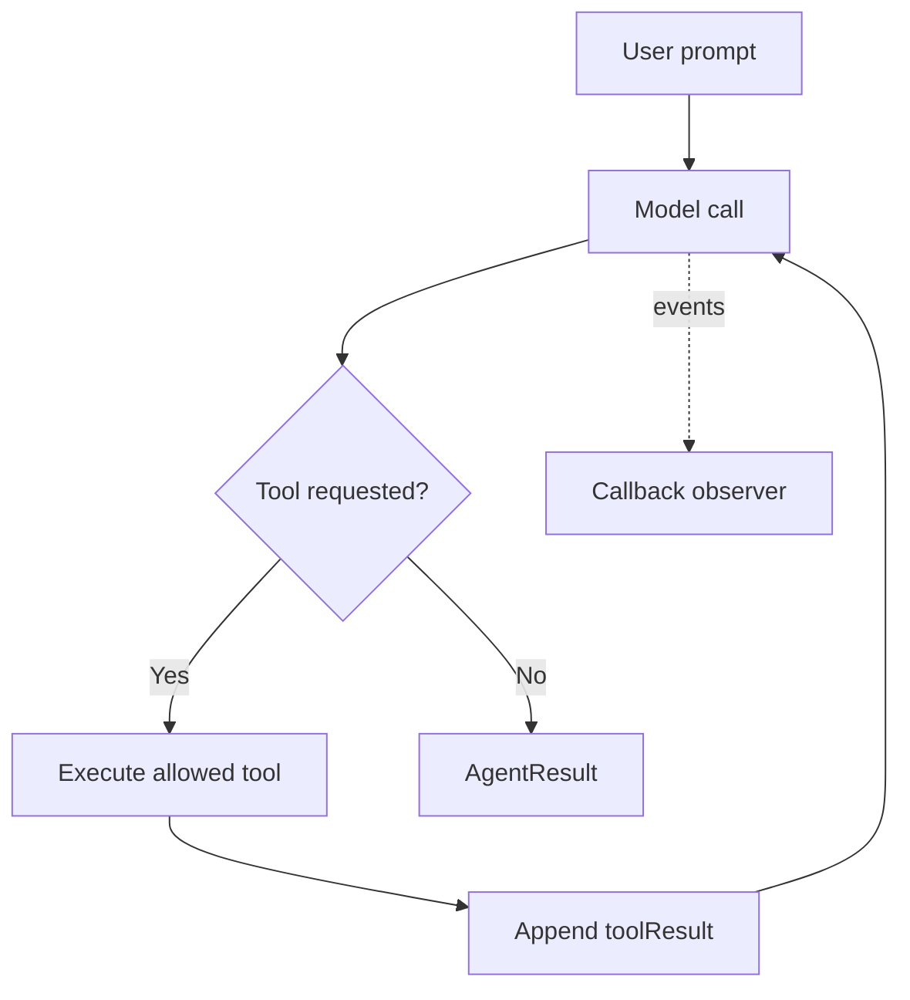

# Module 01: Your first agent
> After this module you can build a grounded FAQ agent and inspect its result and conversation.

**Time:** ~60 min · **Level:** Beginner · **Cost:** mock/Ollama $0 hosted inference; Bedrock planning allowance $0.02–$0.15 per walkthrough, more for repeats.

**AWS required:** Optional (local alternative: Ollama; service-specific contracts use offline fixtures). **AWS resources created:** None.

**Assistant version 1:** Build a grounded faq agent and inspect its result and conversation.

## Prerequisites

[Module 00](../00_setup/README.md). Run commands from the repository root. Use Python 3.12 or 3.13 and `uv sync`. Default examples below use `--mock`; removing it can call the configured provider. Complete [AWS setup](../../docs/AWS_SETUP.md) before hosted calls. [Cost assumptions](../../docs/COSTS.md) are estimates, not a spending cap.

## Learning objectives

- Configure a system prompt and explicit model.
- Inspect result blocks, stop reason and history.
- Choose a callback for printed or collected output.
- Invoke an agent from an async function.

## The big idea

Think of the agent as a conversation clerk. The system prompt describes the clerk's role, the user supplies a request, and the model suggests an answer or a tool request. Strands carries the messages between these steps. The final result is a delivery envelope: text is one part, while the stop reason and usage tell you how the work ended. A callback is an observer standing beside the clerk; it sees events as they happen without choosing the answer. Async code lets the application do other work while waiting for the provider, like taking another customer's details while a database query runs.

## How it works



| Concept | Analogy | Under the hood |
|---|---|---|
| Agent defaults | A rental car with a preset engine | Bare Agent selects the SDK's Bedrock default; inspect it without invoking it. |
| System prompt and history | Standing instructions and the case file | The system prompt guides behavior; agent.messages stores conversation turns. |
| Result and callbacks | Delivered envelope and live observer | The result contains stop reason/metrics; callbacks receive streamed event dictionaries. |
| Async/await | Waiting without blocking the desk | An async function returns a coroutine; await invoke_async inside an event loop. |

## Key APIs at a glance

| API | What it does | When to use it |
|---|---|---|
| `Agent(model=..., system_prompt=...)` | Set role and adapter | At construction |
| `agent(prompt)` | Synchronous call | Command-line programs |
| `result.message / stop_reason / metrics` | Inspect answer and execution | After a call |
| `null_callback_handler` | Suppress event printing | When rendering your own output |
| `await agent.invoke_async(...)` | Await the result | Inside an async application |

## Walkthrough

### Reading the first result

In this pin, `Agent()` chooses Bedrock and the default model constant is `global.anthropic.claude-sonnet-4-6`. Example 01 prints that constant without constructing an unconfigured paid agent. The course selects its own configurable low-cost model through `get_model()`.

The loop can return `end_turn` for an answer or a limit-related stop reason when a budget ends. Do not treat every returned result as task success. Text may end with a newline; tests compare semantic content rather than incidental formatting. The mock provider's usage counts are synthetic.

`async def` defines a coroutine. `await` pauses that coroutine while the provider works. The CLI calls `asyncio.run` once to create an event loop. A notebook already has an event loop; calling `asyncio.run` directly there raises an error. The supplied notebook runs CLI-shaped main functions on a worker thread.

### 01. Hello agent

[01_hello_agent.py](examples/01_hello_agent.py) shows Agent defaults inspected safely; configured Agent, system_prompt and synchronous invocation. AWS status: **No**.

```text
uv run python modules/01_first_agent/examples/01_hello_agent.py --mock
```

Expected fragment:

```text
SDK default provider: Bedrock
```

### 02. Result and messages

[02_result_and_messages.py](examples/02_result_and_messages.py) shows AgentResult message, stop_reason, metrics, and agent.messages. AWS status: **No**.

```text
uv run python modules/01_first_agent/examples/02_result_and_messages.py --mock
```

Expected fragment:

```text
stop_reason: end_turn
```

### 03. Callbacks

[03_callbacks.py](examples/03_callbacks.py) shows Default printing, null_callback_handler, and custom callback handler. AWS status: **No**.

```text
uv run python modules/01_first_agent/examples/03_callbacks.py --mock
```

Expected fragment:

```text
Captured text: Nimbus can help.
```

### 04. Async call

[04_async_call.py](examples/04_async_call.py) shows Async/await primer and invoke_async. AWS status: **No**.

```text
uv run python modules/01_first_agent/examples/04_async_call.py --mock
```

Expected fragment:

```text
Nimbus async reply.
```

### 05. Follow the loop

[05_follow_the_loop.py](examples/05_follow_the_loop.py) shows Agent/event loop; model decision, tool execution, continuation and stop. AWS status: **No**.

```text
uv run python modules/01_first_agent/examples/05_follow_the_loop.py --mock
```

Expected fragment:

```text
2. Tool executed
```

## Real-world use case

Nimbus support receives repeated cancellation questions. The FAQ responder puts one synthetic refund policy in the system prompt, answers an in-scope question, then asks a visa question to demonstrate abstention. A real team would evaluate many supported and unsupported questions before exposing it to customers.

Open [faq_responder.py](use_case/faq_responder.py).

```text
uv run python modules/01_first_agent/use_case/faq_responder.py --mock
```

Expected: a readable Nimbus result and `Lesson complete.` The comparison and triage use cases write CSV reports in `.nimbus/`. The booking tools operate on read-only source data. Review the outputs against the inputs; mock answers are predetermined integration fixtures.

## Common mistakes

Tool failures appear in `toolResult`; command-line setup failures use the friendly wrapper. These are recognizable error fragments, not promises that provider messages never change.

| Error text | Fix |
|---|---|
| `Mock models require an explicit response script.` | Supply enough scripted responses through get_model for every expected turn. |
| `ScriptedModel exhausted: supply another expected model response.` | Inspect the requested tool trajectory, then add the missing expected reply. |
| `asyncio.run() cannot be called from a running event loop` | In Jupyter use await, or the notebook's worker helper; reserve asyncio.run for the CLI entry point. |
| `Configure your named AWS SSO profile, then sign in with aws sso login.` | Choose Ollama for local work or finish SSO setup before a hosted call. |

## Exercises

Each starter runs as a baseline. Replace its `# YOUR CODE HERE` section, then run the acceptance checks. Baseline failures are expected until you finish.

- **Practice:** Compose an explicit role, constraint, tone and output format from the supplied fields. [Starter](exercises/01_prompt.py) · [Solution](solutions/01_prompt.py). Run `uv run python modules/01_first_agent/exercises/01_prompt.py`.
- **Apply:** Concatenate only text content blocks from an assistant message. [Starter](exercises/02_message.py) · [Solution](solutions/02_message.py). Run `uv run python modules/01_first_agent/exercises/02_message.py`.
- **Stretch:** Sum inputTokens and outputTokens across model turns; missing counts are zero. [Starter](exercises/03_usage.py) · [Solution](solutions/03_usage.py). Run `uv run python modules/01_first_agent/exercises/03_usage.py`.

```text
uv run pytest modules/01_first_agent/tests --exercise-starters
uv run pytest modules/01_first_agent/tests
```

The first command checks your edits; the second checks reference solutions and module behavior. [notebook.ipynb](notebook.ipynb) mirrors the scripts in offline mode with editable cells and cleared outputs. Install `uv sync --group notebooks` to open it in Jupyter.

## Quiz

1. Which model does bare Agent use in this pin?

<details><summary>Answer</summary>

The Bedrock default constant is global.anthropic.claude-sonnet-4-6. The course overrides it; future pins can change it.

</details>

2. Is str(result) the entire result?

<details><summary>Answer</summary>

No. Inspect message, stop_reason and metrics too.

</details>

3. Does a callback select tools?

<details><summary>Answer</summary>

No. It observes events; the model selects and the framework executes tools.

</details>

4. Where does a tool result appear?

<details><summary>Answer</summary>

In a user-role message containing a toolResult content block before the next model call.

</details>

5. Why use callback_handler=None?

<details><summary>Answer</summary>

To avoid the default printer when the application renders the final result itself.

</details>

6. Does a policy prompt guarantee grounding?

<details><summary>Answer</summary>

No. Test supported and unanswerable questions; a model can still ignore its instructions.

</details>

## Key takeaways

- Build a grounded faq agent and inspect its result and conversation.
- Keep model selection explicit and tool capabilities narrow.
- Inspect stop reasons, structured validation and tool errors before accepting results.
- Use scripted runs to check integration; use live evaluations to measure model behavior.
- Keep inputs synthetic, bound calls and record any untested provider behavior.

## Go deeper

- [Official SDK guide](https://strandsagents.com/docs/user-guide/sdk/agents/)
- [Pinned Python SDK source](https://github.com/strands-agents/harness-sdk/tree/python/v1.62.0/strands-py)
- [Amazon Bedrock Converse](https://docs.aws.amazon.com/bedrock/latest/userguide/conversation-inference-call.html)

## Next: Module 02

Continue to [Model providers](../02_model_providers/README.md).
