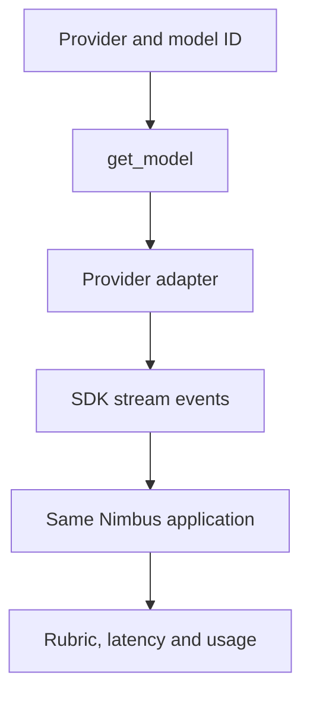

# Module 02: Model providers
> After this module you can switch providers, inspect capability-specific settings and compare a small workload.

**Time:** ~90 min · **Level:** Beginner · **Cost:** mock/Ollama $0 hosted inference; Bedrock planning allowance $0.02–$0.15 per walkthrough, more for repeats.

**AWS required:** Optional (local alternative: Ollama; service-specific contracts use offline fixtures). **AWS resources created:** None.

**Assistant version 1:** Switch providers, inspect capability-specific settings and compare a small workload.

## Prerequisites

[Module 01](../01_first_agent/README.md). Run commands from the repository root. Use Python 3.12 or 3.13 and `uv sync`. Default examples below use `--mock`; removing it can call the configured provider. Complete [AWS setup](../../docs/AWS_SETUP.md) before hosted calls. [Cost assumptions](../../docs/COSTS.md) are estimates, not a spending cap.

## Learning objectives

- Select providers without changing business tools.
- Configure a Bedrock session and inference profile.
- Calculate a dated token-cost estimate.
- Implement the Model streaming interface.
- Apply caching/reasoning only where supported.

## The big idea

A model adapter is like an electrical plug adapter: the application uses one interface while each provider has its own connector. Matching the connector does not make every appliance identical. Models differ in tools, vision, context limits, caching and reasoning parameters. A provider comparison therefore needs the same prompts, declared scoring rules and measured latency, with prices tied to each selected model. Caching resembles reusing a prepared packet of repeated instructions. Reasoning settings allocate additional computation; they are not a guarantee of correctness and may increase output charges.

## How it works



| Concept | Analogy | Under the hood |
|---|---|---|
| Adapter interface | Different plugs on one appliance | Providers expose configuration and a stream of message/content/usage events. |
| Profile and region | A routing desk with authorized destinations | A Bedrock profile can route to several regions; authorize the profile and destination model ARNs. |
| Cache checkpoints | A reusable prepared packet | A stable prefix must meet model-specific token thresholds and TTL rules before reuse can help. |
| Reasoning | Giving a worker more scratch time | Provider-specific fields change compute behavior; do not print hidden reasoning as an audit trail. |
| Cost/quality comparison | A controlled tasting panel | Hold prompts and rubric fixed; distinguish script-replay checks from real model measurements. |

## Key APIs at a glance

| API | What it does | When to use it |
|---|---|---|
| `BedrockModel(boto_session=...)` | Use a profile/region from boto3 | When teaching AWS-specific construction |
| `model.update_config(...)` | Change settings for future calls | Before the next invocation |
| `Model.stream` | Translate provider output to events | Writing a custom adapter |
| `CacheConfig(strategy="auto")` | Enable supported automatic caching | For IDs recognized by the pinned adapter |
| `additional_request_fields` | Pass Nova reasoning settings | Only after checking model capability |

## Walkthrough

### Provider settings and limitations

`uv sync --group providers` installs Anthropic, OpenAI and LiteLLM adapters. Bedrock and Ollama are in the base install. The common helper uses named boto3 profiles, keeps optional imports lazy, bounds timeouts, and gives friendly missing-key errors. Keep `MODEL_ID` blank when comparing distinct provider defaults. The SDK also contains integrations such as Gemini, llama.cpp, Llama API, SageMaker and Writer; their extras and capabilities need their own verification before use. They are not required for this tier.

For OpenAI's configured GPT-6 default, Chat Completions tool use requires `reasoning_effort="none"`. Anthropic's adaptive models may reject temperature, so the helper omits it there. The examples compare scripted deterministic data; temperature zero on a live model is not a reproducibility guarantee.

### Cache and reasoning failure before the fix

Using deprecated `cache_prompt` is unnecessary. The example constructs supported `CacheConfig` and demonstrates explicit Nova `cachePoint` blocks instead. Nova 2 Lite requires at least 1K prefix tokens, has a 20K caching maximum and a five-minute TTL in the checked documentation. A small prompt or changed prefix may yield no hit; inspect returned cache usage instead of asserting savings. Mock usage does not simulate cache billing.

Example 06 adds Nova's low-effort `reasoningConfig` through `additional_request_fields`; it rejects other providers/models rather than forwarding a guessed universal setting. The custom adapter lesson implements the event protocol first; `common/testing.py` then shows the richer text/tool replay implementation.

Provider prices in the comparison are known only for the currently configured provider's dated rates. Other hosted provider prices remain unknown until separately configured; the comparison never silently reuses one provider's price for another.

### 01. Bedrock settings

[01_bedrock_settings.py](examples/01_bedrock_settings.py) shows BedrockModel; model ID, region, boto3 profile/session, temperature, max tokens and inference profiles. AWS status: **Yes; other providers instead**.

```text
uv run python modules/02_model_providers/examples/01_bedrock_settings.py --mock
```

Expected fragment:

```text
model_id
```

### 02. Provider switch

[02_provider_switch.py](examples/02_provider_switch.py) shows Anthropic, OpenAI, Ollama and LiteLLM; overview of other supported providers. AWS status: **No**.

```text
uv run python modules/02_model_providers/examples/02_provider_switch.py --mock
```

Expected fragment:

```text
ollama ->
```

### 03. Runtime settings and cost

[03_runtime_settings_and_cost.py](examples/03_runtime_settings_and_cost.py) shows Runtime configuration changes; token usage to dated cost estimate. AWS status: **No**.

```text
uv run python modules/02_model_providers/examples/03_runtime_settings_and_cost.py --mock
```

Expected fragment:

```text
Illustrative uncached Nova estimate
```

### 04. Custom model

[04_custom_model.py](examples/04_custom_model.py) shows Build it yourself: Model interface with scripted text and tool events. AWS status: **No**.

```text
uv run python modules/02_model_providers/examples/04_custom_model.py --mock
```

Expected fragment:

```text
Nimbus asks for your destination.
```

### 05. Prompt cache

[05_prompt_cache.py](examples/05_prompt_cache.py) shows CacheConfig and supported Bedrock prompt-cache settings. AWS status: **Yes; uncached local comparison**.

```text
uv run python modules/02_model_providers/examples/05_prompt_cache.py --mock
```

Expected fragment:

```text
Cache/usage metrics
```

### 06. Reasoning

[06_reasoning.py](examples/06_reasoning.py) shows Model-specific reasoning configuration and capability validation. AWS status: **Optional; capable local model**.

```text
uv run python modules/02_model_providers/examples/06_reasoning.py --mock
```

Expected fragment:

```text
Low effort configuration
```

## Real-world use case

An engineering team needs to choose a provider for concise travel support. Run the same two questions on three configured providers, score explicit keyword requirements, and save a CSV of latency and estimated inference cost. This tiny rubric catches obvious omissions; it is not a comprehensive model benchmark.

Open [provider_comparison.py](use_case/provider_comparison.py).

```text
uv run python modules/02_model_providers/use_case/provider_comparison.py --mock
```

Expected: a readable Nimbus result and `Lesson complete.` The comparison and triage use cases write CSV reports in `.nimbus/`. The booking tools operate on read-only source data. Review the outputs against the inputs; mock answers are predetermined integration fixtures.

## Common mistakes

Tool failures appear in `toolResult`; command-line setup failures use the friendly wrapper. These are recognizable error fragments, not promises that provider messages never change.

| Error text | Fix |
|---|---|
| `Missing provider dependency. Run uv sync --group providers.` | Install the provider group and retry. |
| `Set OPENAI_API_KEY or select Ollama for the free local path.` | Set the selected provider key locally or change MODEL_PROVIDER. |
| `This reasoning configuration is specific to Nova 2 Lite.` | Use the documented Nova ID or choose another provider-specific example. |
| `Check MODEL_ID, its inference profile, region and supported model parameters.` | Check the model card and remove parameters unsupported by that model. |

## Exercises

Each starter runs as a baseline. Replace its `# YOUR CODE HERE` section, then run the acceptance checks. Baseline failures are expected until you finish.

- **Practice:** Use a nonempty explicit MODEL_ID; otherwise select the provider-specific ID. [Starter](exercises/01_model_id.py) · [Solution](solutions/01_model_id.py). Run `uv run python modules/02_model_providers/exercises/01_model_id.py`.
- **Apply:** Return None for unpriced hosted inference and zero for Ollama/mock. [Starter](exercises/02_price.py) · [Solution](solutions/02_price.py). Run `uv run python modules/02_model_providers/exercises/02_price.py`.
- **Stretch:** Enable the Nova low-effort settings only when the model ID contains nova-2-lite. [Starter](exercises/03_capability.py) · [Solution](solutions/03_capability.py). Run `uv run python modules/02_model_providers/exercises/03_capability.py`.

```text
uv run pytest modules/02_model_providers/tests --exercise-starters
uv run pytest modules/02_model_providers/tests
```

The first command checks your edits; the second checks reference solutions and module behavior. [notebook.ipynb](notebook.ipynb) mirrors the scripts in offline mode with editable cells and cleared outputs. Install `uv sync --group notebooks` to open it in Jupyter.

## Quiz

1. Does switching provider guarantee vision support?

<details><summary>Answer</summary>

No. Capability depends on the selected model and adapter.

</details>

2. Why leave MODEL_ID blank for the one-line switch?

<details><summary>Answer</summary>

A nonempty override wins over every provider-specific default.

</details>

3. Why is an unknown price displayed as unknown?

<details><summary>Answer</summary>

Treating it as zero would hide billable usage.

</details>

4. Does CacheConfig auto add Nova checkpoints in SDK 1.62?

<details><summary>Answer</summary>

No. Auto recognizes Anthropic IDs; the Nova lesson adds an explicit system checkpoint.

</details>

5. Why exclude high-effort Nova reasoning here?

<details><summary>Answer</summary>

It requires removing token/temperature settings and can produce very large outputs; the beginner example uses low effort.

</details>

6. What does the custom model implement?

<details><summary>Answer</summary>

Configuration access/update, streamed content events, and the required structured-output interface; unsupported features fail explicitly.

</details>

## Key takeaways

- Switch providers, inspect capability-specific settings and compare a small workload.
- Keep model selection explicit and tool capabilities narrow.
- Inspect stop reasons, structured validation and tool errors before accepting results.
- Use scripted runs to check integration; use live evaluations to measure model behavior.
- Keep inputs synthetic, bound calls and record any untested provider behavior.

## Go deeper

- [Official SDK guide](https://strandsagents.com/docs/user-guide/sdk/model-providers/)
- [Pinned Python SDK source](https://github.com/strands-agents/harness-sdk/tree/python/v1.62.0/strands-py)
- [Amazon Bedrock Converse](https://docs.aws.amazon.com/bedrock/latest/userguide/conversation-inference-call.html)

## Next: Module 03

Continue to [Conversations, messages and multimodal input](../03_conversations/README.md).
