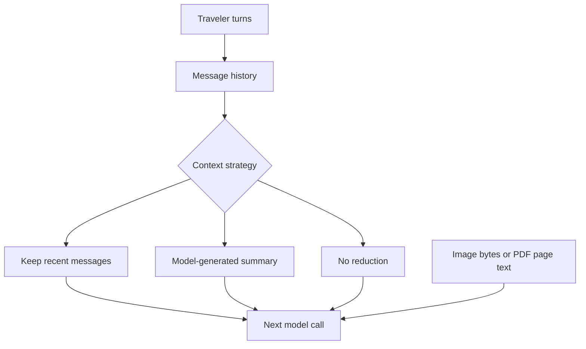

# Module 03: Conversations, messages and multimodal input
> After this module you can manage multi-turn history and send images or page-attributed PDF text.

**Time:** ~90 min · **Level:** Beginner · **Cost:** mock/Ollama $0 hosted inference; Bedrock planning allowance $0.02–$0.15 per walkthrough, more for repeats.

**AWS required:** Optional (local alternative: Ollama; service-specific contracts use offline fixtures). **AWS resources created:** None.

**Assistant version 2:** Manage multi-turn history and send images or page-attributed pdf text.

## Prerequisites

[Module 02](../02_model_providers/README.md). Run commands from the repository root. Use Python 3.12 or 3.13 and `uv sync`. Default examples below use `--mock`; removing it can call the configured provider. Complete [AWS setup](../../docs/AWS_SETUP.md) before hosted calls. [Cost assumptions](../../docs/COSTS.md) are estimates, not a spending cap.

## Learning objectives

- Construct text, image and document blocks.
- Inspect retained conversation history.
- Compare trimming, summarization and no management.
- Preserve PDF page provenance.
- Choose a vision-capable local model.

## The big idea

Conversation history is a case file that must fit on a small desk. A sliding window removes older pages; a summarizer replaces them with a shorter note; a null manager leaves the pile untouched until the model refuses it. Removing pages can lose preferences, while a summary can introduce mistakes. Images and documents are attachments to this case file, not magic filenames. A model cannot see a receipt merely because you mention its path. Your application must send the bytes or extract the text and retain where it came from.

## How it works



| Concept | Analogy | Under the hood |
|---|---|---|
| Roles and blocks | Speakers and attachments | Each message has a role and content blocks; tools also use structured blocks. |
| Sliding window | Discard old pages | Management trims older history while respecting SDK tool-call/result handling. |
| Summarization | Write a compact handover note | The summarizer calls a model; it can incur cost and lose facts. |
| Null manager | Keep every page | It does not resolve context overflow; the exception can reach the caller. |
| Multimodal input | Send the actual attachment | Use byte sources for supported image/document formats; extraction needs page labels. |

## Key APIs at a glance

| API | What it does | When to use it |
|---|---|---|
| `agent.messages` | Read conversation state | Debug multi-turn behavior |
| `SlidingWindowConversationManager` | Bound recent history | Short conversations |
| `SummarizingConversationManager` | Compress older context | When losing all old facts is unacceptable |
| `NullConversationManager` | Disable reduction | Externally managed history |
| `image/document content blocks` | Send supported attachments | Vision or native PDF input |
| `PdfReader` | Extract text with page provenance | Provider-independent document path |

## Walkthrough

### Image and document paths

For Ollama, example 03 selects `OLLAMA_VISION_MODEL_ID` from configuration; download that model separately. Mock mode exercises byte/block plumbing and returns a scripted total; it does not prove optical recognition. Compare the live answer against the visible receipt, then use the later document pipeline for validated extraction.

Example 04 extracts all ten PDF pages and prefixes each with its one-based page number. Add `--native` to demonstrate a Bedrock document block; this path is capability-specific. Keep the document name neutral because names themselves are model input. User documents and their text are untrusted evidence, not instructions that can override your application's rules.

The window exercise uses text-only pairs so the mechanism is visible. Do not use naive list slicing on production tool histories: splitting a toolUse/toolResult pair can make the next request invalid. Use the SDK manager.

### 01. Multi turn

[01_multi_turn.py](examples/01_multi_turn.py) shows Text content blocks, agent.messages, multi-turn state and role/constraints/tone/output prompts. AWS status: **No**.

```text
uv run python modules/03_conversations/examples/01_multi_turn.py --mock
```

Expected fragment:

```text
Message roles
```

### 02. Conversation windows

[02_conversation_windows.py](examples/02_conversation_windows.py) shows SlidingWindowConversationManager, SummarizingConversationManager, NullConversationManager and overflow. AWS status: **No**.

```text
uv run python modules/03_conversations/examples/02_conversation_windows.py --mock
```

Expected fragment:

```text
messages remaining
```

### 03. Receipt image

[03_receipt_image.py](examples/03_receipt_image.py) shows Image content blocks and vision capability checks on a synthetic receipt. AWS status: **No; vision model needed**.

```text
uv run python modules/03_conversations/examples/03_receipt_image.py --mock
```

Expected fragment:

```text
Receipt RCP-001 displays USD 160.60.
```

### 04. Policy document

[04_policy_document.py](examples/04_policy_document.py) shows Document blocks on supported models; local PDF text extraction with page provenance. AWS status: **Optional; local extraction**.

```text
uv run python modules/03_conversations/examples/04_policy_document.py --mock
```

Expected fragment:

```text
Refunds over $500 need approval (page 3).
```

## Real-world use case

The trip chat asks for destination, budget and party size, while showing the current message count. A travel support team could use this to detect lost preferences. The companion receipt example reads an actual synthetic PNG; use it as the spending-summary branch of the same conversation workflow.

Open [trip_chat.py](use_case/trip_chat.py).

```text
uv run python modules/03_conversations/use_case/trip_chat.py --mock
```

Expected: a readable Nimbus result and `Lesson complete.` The comparison and triage use cases write CSV reports in `.nimbus/`. The booking tools operate on read-only source data. Review the outputs against the inputs; mock answers are predetermined integration fixtures.

## Common mistakes

Tool failures appear in `toolResult`; command-line setup failures use the friendly wrapper. These are recognizable error fragments, not promises that provider messages never change.

| Error text | Fix |
|---|---|
| `Context too large` | The null-manager demo deliberately re-raises this overflow; use a bounded manager. |
| `Cannot summarize: insufficient messages for summarization` | Keep fewer recent messages or summarize after more turns. |
| `Data paths must stay inside the data directory.` | Use a documented fixture-relative path without ../ traversal. |
| `Ollama is running. Pull the configured model: ollama pull qwen3-vl:4b` | Download the vision model and check its ID before the image lesson. |

## Exercises

Each starter runs as a baseline. Replace its `# YOUR CODE HERE` section, then run the acceptance checks. Baseline failures are expected until you finish.

- **Practice:** Keep the last two complete text-only user/assistant pairs. This exercise excludes tool messages. [Starter](exercises/01_window.py) · [Solution](solutions/01_window.py). Run `uv run python modules/03_conversations/exercises/01_window.py`.
- **Apply:** Attach one-based page provenance to each extracted PDF page. [Starter](exercises/02_pages.py) · [Solution](solutions/02_pages.py). Run `uv run python modules/03_conversations/exercises/02_pages.py`.
- **Stretch:** Convert a list of traveler strings into SDK text content blocks. [Starter](exercises/03_content.py) · [Solution](solutions/03_content.py). Run `uv run python modules/03_conversations/exercises/03_content.py`.

```text
uv run pytest modules/03_conversations/tests --exercise-starters
uv run pytest modules/03_conversations/tests
```

The first command checks your edits; the second checks reference solutions and module behavior. [notebook.ipynb](notebook.ipynb) mirrors the scripts in offline mode with editable cells and cleared outputs. Install `uv sync --group notebooks` to open it in Jupyter.

## Quiz

1. Is agent.messages durable memory?

<details><summary>Answer</summary>

No. It is current in-process conversation history unless a later persistence mechanism saves it.

</details>

2. Does a sliding window guarantee a token count?

<details><summary>Answer</summary>

No. It primarily bounds messages; individual attachments or tool outputs can still be large.

</details>

3. Can a summary lose the budget?

<details><summary>Answer</summary>

Yes. Test important facts and use explicit application state for authoritative values.

</details>

4. How does the image reach the model?

<details><summary>Answer</summary>

As an image block containing format and bytes.

</details>

5. Why label extracted PDF pages?

<details><summary>Answer</summary>

So a cited answer can be checked against the original page.

</details>

6. Can every provider accept a native PDF?

<details><summary>Answer</summary>

No. Use text extraction as the common path and the native flag only with a supported model.

</details>

## Key takeaways

- Manage multi-turn history and send images or page-attributed pdf text.
- Keep model selection explicit and tool capabilities narrow.
- Inspect stop reasons, structured validation and tool errors before accepting results.
- Use scripted runs to check integration; use live evaluations to measure model behavior.
- Keep inputs synthetic, bound calls and record any untested provider behavior.

## Go deeper

- [Official SDK guide](https://strandsagents.com/docs/user-guide/sdk/agents/conversation-management/)
- [Pinned Python SDK source](https://github.com/strands-agents/harness-sdk/tree/python/v1.62.0/strands-py)
- [Amazon Bedrock Converse](https://docs.aws.amazon.com/bedrock/latest/userguide/conversation-inference-call.html)

## Next: Module 04

Continue to [Structured output](../04_structured_output/README.md).
