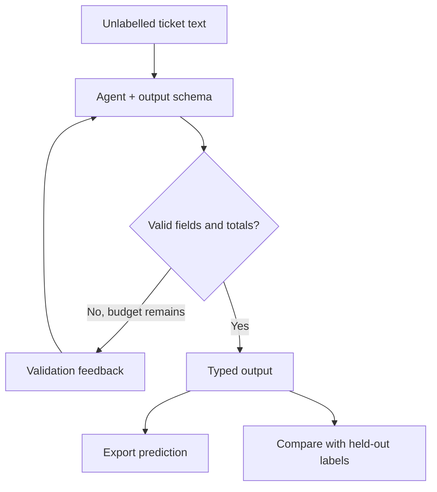

# Module 04: Structured output
> After this module you can obtain validated nested objects and score ticket classifications without leaking labels.

**Time:** ~75 min · **Level:** Beginner · **Cost:** mock/Ollama $0 hosted inference; Bedrock planning allowance $0.02–$0.15 per walkthrough, more for repeats.

**AWS required:** Optional (local alternative: Ollama; service-specific contracts use offline fixtures). **AWS resources created:** None.

**Assistant version 3:** Obtain validated nested objects and score ticket classifications without leaking labels.

## Prerequisites

[Module 03](../03_conversations/README.md). Run commands from the repository root. Use Python 3.12 or 3.13 and `uv sync`. Default examples below use `--mock`; removing it can call the configured provider. Complete [AWS setup](../../docs/AWS_SETUP.md) before hosted calls. [Cost assumptions](../../docs/COSTS.md) are estimates, not a spending cap.

## Learning objectives

- Define constrained Pydantic output models.
- Read result.structured_output.
- Reject inconsistent nested totals.
- Bound validation repairs.
- Export and score held-out ticket predictions.

## The big idea

Structured output is a form with labeled boxes. Pydantic checks that the boxes contain the right kinds of values and that relationships between them make sense. A typed itinerary can require positive flight prices and a total equal to their sum. The form does not establish that a flight exists: the application must check that against inventory. When a model fills a box incorrectly, Strands can return validation feedback and request a repair. Repairs consume turns, so the application needs a stopping budget and a clear failure result.

## How it works



| Concept | Analogy | Under the hood |
|---|---|---|
| Pydantic and constraints | A form with checking rules | BaseModel validates types, enums, patterns and domain constraints. |
| Nested output | A form containing a list of smaller forms | Itinerary validates each TripLeg and then the total relationship. |
| Repair budgets | A limited number of correction attempts | limits turns stops repeated invalid outputs; callers check structured_output for None. |
| Tools then structure | Look up evidence before filling the form | Ordinary tool results can precede the final schema tool call. |
| Held-out scoring | An answer key kept behind the desk | Only the scorer receives expected labels; the model sees ticket text. |

## Key APIs at a glance

| API | What it does | When to use it |
|---|---|---|
| `BaseModel / Field` | Define typed constrained data | Schema definitions |
| `model_validator` | Check cross-field invariants | Flight total consistency |
| `structured_output_model=...` | Request typed output | On the Agent or individual call |
| `result.structured_output` | Read the validated object | After checking completion |
| `limits={"turns": ...}` | Bound repairs and tools | Every potentially looping call |

## Walkthrough

### Read the schemas before running

`common/schemas.py` introduces `BaseModel` (a validated Python object), `Field` (a field's constraints), `StrEnum` (a fixed set of string choices), and a `model_validator` (a relationship checked across fields). `TicketTriage` accepts five dataset categories and normal/high urgency; `booking_id` is optional. `Itinerary` contains a list of `TripLeg` objects. Prices use integer cents.

The validation-retry example deliberately proposes an unknown category, then corrects it. Its test also supplies repeated invalid responses and proves that the two-turn budget stops the attempt. No deprecated structured-output method is used.

The CSV scorer passes only each item's input text to the model. The mock predictor reads that text using a tiny teaching rule set; expected labels are consulted afterward. A perfect replay score is not evidence that a real model is accurate. In live mode, review misclassifications and false urgency escalations before relying on the queue.

### 01. Typed ticket

[01_typed_ticket.py](examples/01_typed_ticket.py) shows Pydantic primer; structured_output_model on Agent/call and result.structured_output. AWS status: **No**.

```text
uv run python modules/04_structured_output/examples/01_typed_ticket.py --mock
```

Expected fragment:

```text
category
```

### 02. Nested itinerary

[02_nested_itinerary.py](examples/02_nested_itinerary.py) shows Nested schemas, enums and optional fields; extract a confirmation email. AWS status: **No**.

```text
uv run python modules/04_structured_output/examples/02_nested_itinerary.py --mock
```

Expected fragment:

```text
traveler
```

### 03. Validation retry

[03_validation_retry.py](examples/03_validation_retry.py) shows Validation failure, correction, retry limits and malformed output tests. AWS status: **No**.

```text
uv run python modules/04_structured_output/examples/03_validation_retry.py --mock
```

Expected fragment:

```text
Invalid category rejected, then corrected.
```

### 04. Structure with tools

[04_structure_with_tools.py](examples/04_structure_with_tools.py) shows Structured answers after tool use; labelled ticket accuracy and CSV export. AWS status: **No**.

```text
uv run python modules/04_structured_output/examples/04_structure_with_tools.py --mock
```

Expected fragment:

```text
Refund policy needs review.
```

## Real-world use case

Nimbus support wants a CSV queue with category, urgency and a brief summary. The triage use case processes the 20 held-out tickets, validates each result, exports predictions and reports exact category-plus-urgency accuracy. The nested-itinerary example separately extracts a fictional confirmation email into a typed flight itinerary.

Open [ticket_triage.py](use_case/ticket_triage.py).

```text
uv run python modules/04_structured_output/use_case/ticket_triage.py --mock
```

Expected: a readable Nimbus result and `Lesson complete.` The comparison and triage use cases write CSV reports in `.nimbus/`. The booking tools operate on read-only source data. Review the outputs against the inputs; mock answers are predetermined integration fixtures.

## Common mistakes

Tool failures appear in `toolResult`; command-line setup failures use the friendly wrapper. These are recognizable error fragments, not promises that provider messages never change.

| Error text | Fix |
|---|---|
| `Input should be` | Pydantic reports the allowed enum values; choose one of the declared categories. |
| `Itinerary total must equal the sum of flight prices` | Recompute the flight-only total rather than accepting inconsistent output. |
| `No valid classification within the turn budget` | Review the input/schema mismatch; do not silently export None as a valid prediction. |
| `Itinerary flight does not match Nimbus inventory` | Reject an invented ID/destination and request grounded data. |

## Exercises

Each starter runs as a baseline. Replace its `# YOUR CODE HERE` section, then run the acceptance checks. Baseline failures are expected until you finish.

- **Practice:** Validate a ticket with the real TicketTriage schema and return whether it is valid. [Starter](exercises/01_ticket.py) · [Solution](solutions/01_ticket.py). Run `uv run python modules/04_structured_output/exercises/01_ticket.py`.
- **Apply:** Validate nested flight legs and their total with the Itinerary schema. [Starter](exercises/02_itinerary.py) · [Solution](solutions/02_itinerary.py). Run `uv run python modules/04_structured_output/exercises/02_itinerary.py`.
- **Stretch:** Return exact-match accuracy over category AND urgency; empty input scores zero. [Starter](exercises/03_score.py) · [Solution](solutions/03_score.py). Run `uv run python modules/04_structured_output/exercises/03_score.py`.

```text
uv run pytest modules/04_structured_output/tests --exercise-starters
uv run pytest modules/04_structured_output/tests
```

The first command checks your edits; the second checks reference solutions and module behavior. [notebook.ipynb](notebook.ipynb) mirrors the scripts in offline mode with editable cells and cleared outputs. Install `uv sync --group notebooks` to open it in Jupyter.

## Quiz

1. Which API replaces Agent.structured_output()?

<details><summary>Answer</summary>

Use structured_output_model on the Agent or call, then result.structured_output.

</details>

2. What does an optional hotel_id mean?

<details><summary>Answer</summary>

It may be absent/None; a present value must match the declared pattern.

</details>

3. Do positive prices prove a correct itinerary?

<details><summary>Answer</summary>

No. Validate IDs and prices against authoritative inventory.

</details>

4. What happens when repairs never succeed?

<details><summary>Answer</summary>

A bounded call stops; the application must reject missing structured output.

</details>

5. What does mock triage accuracy measure?

<details><summary>Answer</summary>

The fixture prediction/scoring pipeline, not real model quality.

</details>

6. Should golden labels be included in the prompt?

<details><summary>Answer</summary>

No. Predict first, compare afterward.

</details>

## Key takeaways

- Obtain validated nested objects and score ticket classifications without leaking labels.
- Keep model selection explicit and tool capabilities narrow.
- Inspect stop reasons, structured validation and tool errors before accepting results.
- Use scripted runs to check integration; use live evaluations to measure model behavior.
- Keep inputs synthetic, bound calls and record any untested provider behavior.

## Go deeper

- [Official SDK guide](https://strandsagents.com/docs/user-guide/sdk/agents/structured-output/)
- [Pinned Python SDK source](https://github.com/strands-agents/harness-sdk/tree/python/v1.62.0/strands-py)
- [Amazon Bedrock Converse](https://docs.aws.amazon.com/bedrock/latest/userguide/conversation-inference-call.html)

## Next: Module 05

Continue to [Building tools](../05_building_tools/README.md).
