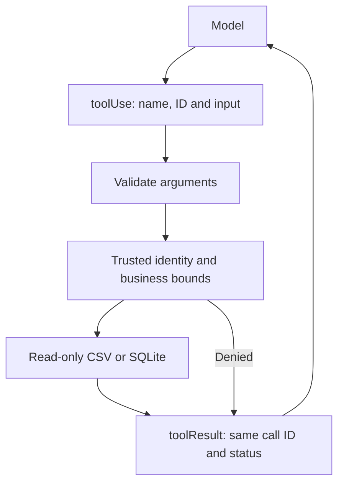

# Module 05: Building tools
> After this module you can build bounded booking tools and trace their execution through the model loop.

**Time:** ~120 min · **Level:** Beginner · **Cost:** mock/Ollama $0 hosted inference; Bedrock planning allowance $0.02–$0.15 per walkthrough, more for repeats.

**AWS required:** Optional (local alternative: Ollama; service-specific contracts use offline fixtures). **AWS resources created:** None.

**Assistant version 4:** Build bounded booking tools and trace their execution through the model loop.

## Prerequisites

[Module 04](../04_structured_output/README.md). Run commands from the repository root. Use Python 3.12 or 3.13 and `uv sync`. Default examples below use `--mock`; removing it can call the configured provider. Complete [AWS setup](../../docs/AWS_SETUP.md) before hosted calls. [Cost assumptions](../../docs/COSTS.md) are estimates, not a spending cap.

## Learning objectives

- Create model-visible tool schemas from typed functions.
- Return explicit errors and inspect exception feedback.
- Use trusted context for customer isolation.
- Consume async tool progress.
- Compare tool execution strategies.
- Build a bounded Converse loop before using Strands.

## The big idea

A tool is an approved business procedure with a named input form. The model can request it, but the application decides what the procedure may do. Think of a booking desk: asking for a reservation number does not grant access to every customer. The authenticated identity comes from the application, while the requested booking ID is untrusted input. Strands turns a function's annotations and docstring into the input form, executes a requested tool, and returns the result to the model. Shared resources and concurrency are ordinary software problems even when a model chooses the call.

## How it works



| Concept | Analogy | Under the hood |
|---|---|---|
| Typed tools | An approved procedure and input form | Annotations/docstrings become JSON input schemas; validate business constraints too. |
| Tool status and exceptions | A receipt saying success or failure | Exceptions are returned as error feedback instead of becoming successful facts. |
| ToolContext | A sealed staff badge | Application-supplied invocation state is not a model-selectable tool argument. |
| Async progress | Progress updates from a worker | An async generator yields progress events; its final item becomes the tool result. |
| Class/module tools | A shared desk versus a procedure manual | Classes own resources; module tools expose TOOL_SPEC and a matching function. |
| Executors and reload | Several clerks and a reviewed manual update | Independent reads can overlap; importing changed Python executes code and requires trust. |
| Manual loop | Carrying request slips yourself | Converse returns toolUse; code executes an allow-listed tool and appends toolResult before repeating. |

## Key APIs at a glance

| API | What it does | When to use it |
|---|---|---|
| `@tool` | Create a tool from a function | Typed custom operations |
| `@tool(context=True) / ToolContext` | Inject agent/invocation state | Authentication and private data |
| `TOOL_SPEC` | Declare a module tool schema | Legacy-style module integration supported by this pin |
| `agent.tool.name(...)` | Call a registered tool directly | Deterministic orchestration or debugging |
| `SequentialToolExecutor / ConcurrentToolExecutor` | Choose scheduling | When sharing resources or overlapping reads |
| `load_tools_from_directory / reload_tool` | Load reviewed local code | Development only |
| `boto3 client.converse` | Send messages and toolConfig | The build-it-yourself explanation |

## Walkthrough

### Build the mechanism, then use the shortcut

Start by reading the manual loop in example 09 before running its Strands equivalent. `toolConfig` tells Bedrock the allowed procedure. A returned `toolUse` contains a call ID, name and arguments. The code validates the name, executes the tool and appends a user-role `toolResult` with the same ID. The loop stops at an answer or three turns. `Stubber` supplies real botocore-validated response shapes without contacting AWS. The final Agent call performs that orchestration through Strands.

The reusable booking tools use parameterized SQL, read-only connections, bounded result counts and seat/price ranges. `get_booking` reveals only a booking belonging to the trusted traveler. `agent.state` is private application state until a tool deliberately returns it; never return secrets simply to demonstrate context.

Example 05 shares one read-only SQLite connection inside a class and protects it with a lock, because even a direct SDK tool call can cross a thread boundary. Normal booking tools open their connection inside the call instead. Example 07 overlaps independent async reads; elapsed times are illustrative, not timing assertions.

The directory example creates one known source file under `.nimbus/tool_reload/tools`, starts directory loading and explicitly reloads a reviewed edit for deterministic verification. The SDK also watches changes. Never point this mechanism at downloaded or model-generated code. The demo does not use deprecated `load_tool_from_filepath`.

### 01. Typed search

[01_typed_search.py](examples/01_typed_search.py) shows @tool; docstrings, parameter descriptions and type hints becoming tool specifications. AWS status: **No**.

```text
uv run python modules/05_building_tools/examples/01_typed_search.py --mock
```

Expected fragment:

```text
inputSchema
```

### 02. Results and errors

[02_results_and_errors.py](examples/02_results_and_errors.py) shows toolUse, toolResult, status and tool exception feedback. AWS status: **No**.

```text
uv run python modules/05_building_tools/examples/02_results_and_errors.py --mock
```

Expected fragment:

```text
Tool statuses
```

### 03. Tool context

[03_tool_context.py](examples/03_tool_context.py) shows @tool(context=True), ToolContext, private agent state and invocation state. AWS status: **No**.

```text
uv run python modules/05_building_tools/examples/03_tool_context.py --mock
```

Expected fragment:

```text
CUS-001
```

### 04. Async progress

[04_async_progress.py](examples/04_async_progress.py) shows Async tools, streamed tool progress and consumption. AWS status: **No**.

```text
uv run python modules/05_building_tools/examples/04_async_progress.py --mock
```

Expected fragment:

```text
Progress
```

### 05. Resource sharing

[05_resource_sharing.py](examples/05_resource_sharing.py) shows Class-based tools sharing a database connection; read-only queries. AWS status: **No**.

```text
uv run python modules/05_building_tools/examples/05_resource_sharing.py --mock
```

Expected fragment:

```text
70800
```

### 06. Module tools

[06_module_tools.py](examples/06_module_tools.py) shows TOOL_SPEC modules and direct agent.tool calls. AWS status: **No**.

```text
uv run python modules/05_building_tools/examples/06_module_tools.py --mock
```

Expected fragment:

```text
POL-REF-001
```

### 07. Tool executors

[07_tool_executors.py](examples/07_tool_executors.py) shows Sequential and concurrent execution; race and resource limits. AWS status: **No**.

```text
uv run python modules/05_building_tools/examples/07_tool_executors.py --mock
```

Expected fragment:

```text
ConcurrentToolExecutor
```

### 08. Tool directory

[08_tool_directory.py](examples/08_tool_directory.py) shows Trusted folder loading, hot reload and review before registration. AWS status: **No**.

```text
uv run python modules/05_building_tools/examples/08_tool_directory.py --mock
```

Expected fragment:

```text
updated and reviewed
```

### 09. Manual converse loop

[09_manual_converse_loop.py](examples/09_manual_converse_loop.py) shows Build it yourself: bounded boto3 Converse loop with toolConfig/toolUse/toolResult, then Strands equivalent. AWS status: **Yes; offline Stubber replay**.

```text
uv run python modules/05_building_tools/examples/09_manual_converse_loop.py --mock
```

Expected fragment:

```text
Manual:
```

## Real-world use case

A support representative needs flight/hotel candidates, a seat check and the status of an existing booking. The booking assistant exposes four read-only tools. It supplies a fixed trusted demo identity separately from the prompt and makes no reservation. A real company would replace that demo identity with authenticated session claims.

Open [booking_assistant.py](use_case/booking_assistant.py).

```text
uv run python modules/05_building_tools/use_case/booking_assistant.py --mock
```

Expected: a readable Nimbus result and `Lesson complete.` The comparison and triage use cases write CSV reports in `.nimbus/`. The booking tools operate on read-only source data. Review the outputs against the inputs; mock answers are predetermined integration fixtures.

## Common mistakes

Tool failures appear in `toolResult`; command-line setup failures use the friendly wrapper. These are recognizable error fragments, not promises that provider messages never change.

| Error text | Fix |
|---|---|
| `Booking unavailable for this traveler` | Check the trusted customer identity and booking ownership; do not reveal another customer's existence. |
| `A trusted customer identity is required` | Supply customer_id in application invocation_state, not the user prompt. |
| `max_price_usd must be between 1 and 2000` | Reject or repair out-of-range search parameters. |
| `SQLite objects created in a thread can only be used in that same thread.` | Open a connection per tool call, or deliberately share a read-only connection with serialized access as example 05 does. |
| `Tool not allowed` | The manual loop rejects unknown tool names before execution. |

## Exercises

Each starter runs as a baseline. Replace its `# YOUR CODE HERE` section, then run the acceptance checks. Baseline failures are expected until you finish.

- **Practice:** Filter supplied flights by case-insensitive destination and maximum USD price; return their IDs. [Starter](exercises/01_search.py) · [Solution](solutions/01_search.py). Run `uv run python modules/05_building_tools/exercises/01_search.py`.
- **Apply:** Authorize a booking only when a trusted, nonempty customer ID matches the owner. [Starter](exercises/02_identity.py) · [Solution](solutions/02_identity.py). Run `uv run python modules/05_building_tools/exercises/02_identity.py`.
- **Stretch:** Allow one through nine travelers only when enough seats remain. [Starter](exercises/03_seats.py) · [Solution](solutions/03_seats.py). Run `uv run python modules/05_building_tools/exercises/03_seats.py`.

```text
uv run pytest modules/05_building_tools/tests --exercise-starters
uv run pytest modules/05_building_tools/tests
```

The first command checks your edits; the second checks reference solutions and module behavior. [notebook.ipynb](notebook.ipynb) mirrors the scripts in offline mode with editable cells and cleared outputs. Install `uv sync --group notebooks` to open it in Jupyter.

## Quiz

1. Is a type hint enough to authorize a booking lookup?

<details><summary>Answer</summary>

No. Check ownership using a trusted application identity.

</details>

2. Who supplies tool_context?

<details><summary>Answer</summary>

The framework injects it; it is omitted from the model-visible input schema.

</details>

3. What does the last async tool yield mean?

<details><summary>Answer</summary>

It becomes the final tool result; preceding yields can be consumed as progress.

</details>

4. Are direct agent.tool calls guaranteed to use the calling thread?

<details><summary>Answer</summary>

No. The pinned SDK can execute them across an async/thread boundary.

</details>

5. Can concurrent tools share a writable SQLite handle without coordination?

<details><summary>Answer</summary>

No. Use suitable transaction/concurrency design; these lessons use read-only queries.

</details>

6. Why is folder loading risky?

<details><summary>Answer</summary>

Importing Python runs it. A model-written file must not be registered without independent review.

</details>

## Key takeaways

- Build bounded booking tools and trace their execution through the model loop.
- Keep model selection explicit and tool capabilities narrow.
- Inspect stop reasons, structured validation and tool errors before accepting results.
- Use scripted runs to check integration; use live evaluations to measure model behavior.
- Keep inputs synthetic, bound calls and record any untested provider behavior.

## Go deeper

- [Official SDK guide](https://strandsagents.com/docs/user-guide/sdk/tools/custom-tools/)
- [Pinned Python SDK source](https://github.com/strands-agents/harness-sdk/tree/python/v1.62.0/strands-py)
- [Amazon Bedrock Converse](https://docs.aws.amazon.com/bedrock/latest/userguide/conversation-inference-call.html)

## Next: Module 06

Continue to [Community and vended tools](../06_community_tools/README.md).
