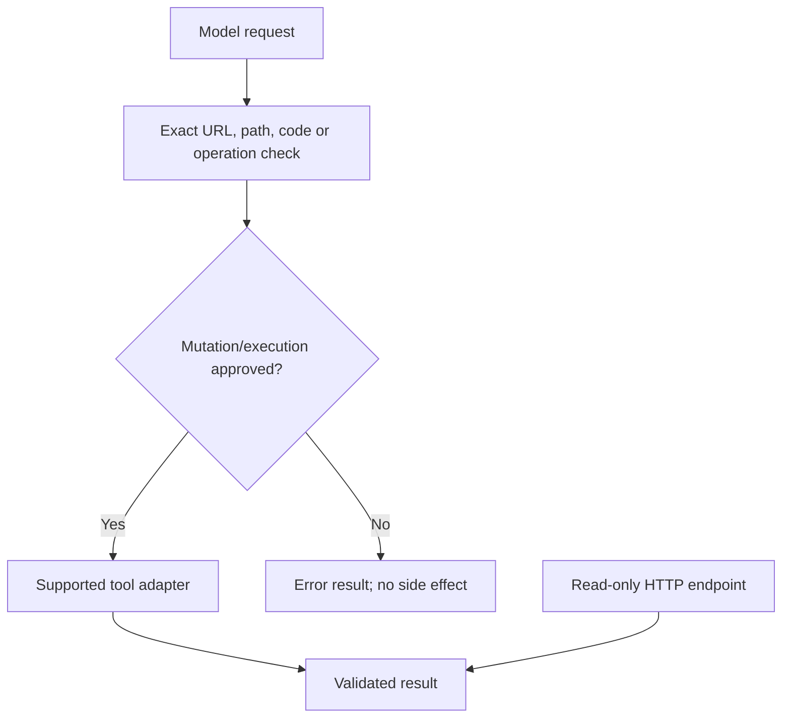

# Module 06: Community and vended tools
> After this module you can combine supported tools with explicit consent and constrained external access.

**Time:** ~75 min · **Level:** Beginner · **Cost:** mock/Ollama $0 hosted inference; Bedrock planning allowance $0.02–$0.15 per walkthrough, more for repeats.

**AWS required:** Optional (local alternative: Ollama; service-specific contracts use offline fixtures). **AWS resources created:** None.

**Assistant version 4:** Combine supported tools with explicit consent and constrained external access.

## Prerequisites

[Module 05](../05_building_tools/README.md). Run commands from the repository root. Use Python 3.12 or 3.13 and `uv sync`. Default examples below use `--mock`; removing it can call the configured provider. Complete [AWS setup](../../docs/AWS_SETUP.md) before hosted calls. [Cost assumptions](../../docs/COSTS.md) are estimates, not a spending cap.

## Learning objectives

- Identify deprecated community tools and supported replacements.
- Constrain an HTTP tool below the model layer.
- Convert a budget using Decimal and an assumed rate.
- Test approval and rejection of file/code operations.
- Use read-only AWS discovery with a denied-write case.

## The big idea

A tool catalog is like a hardware store: a familiar label does not tell you whether a tool is still supported or safe for your job. Some older tools now have vended SDK replacements, while a narrow custom function is safer than adding a general shell just to multiply two prices. Consent is a person's decision about a concrete operation, not a prompt that tells a model to behave. Put path, method and operation restrictions below the model so an instruction hidden in retrieved content cannot expand its authority.

## How it works



| Concept | Analogy | Under the hood |
|---|---|---|
| Community versus vended | A retired tool and its maintained replacement | Pinned source warnings determine supported imports; names alone are not compatibility evidence. |
| HTTP and time | A permitted destination and an explicit clock | The supplied AsyncClient permits only one forecast GET; time is injected by application code. |
| Currency | A calculator with one approved operation | Decimal converts a stated rate; it does not fetch financial advice or live exchange prices. |
| Consent and workspace | A locked workbench with reviewed jobs | The backend checks virtual paths and exact snippets, then asks the operator. |
| Delegation and notes | A specialist and a private notebook | use_agent inherits the configured model; vended notebook stores session-scoped notes. |
| Read-only AWS | A badge that opens only observation doors | The wrapper rejects other operations; a scoped IAM role is the independent cloud boundary. |

## Key APIs at a glance

| API | What it does | When to use it |
|---|---|---|
| `make_http_request(client=...)` | Use a controlled HTTP transport | Open-Meteo GET |
| `make_file_editor / make_shell` | Bind a reviewed execution backend | File and fixed-command demonstrations |
| `make_python_repl` | Run approved code through a backend | One reviewed calculation |
| `notebook` | Maintain session-scoped text notes | Replacement for deprecated journal |
| `use_agent` | Delegate to a temporary specialist | Replacement for deprecated use_llm |
| `file_read / file_write / image_reader / handoff_to_user` | Supported community integrations in this pin | Selected direct-tool demonstrations |
| `use_aws` | Call AWS through a scoped wrapper | Optional read-only role |

## Walkthrough

### Read the migration guide first

The initial requested tool list comes from older tutorials. [MIGRATIONS.md](MIGRATIONS.md) records the names, pinned-source deprecations and exact course replacements. The runnable lessons do not call deprecated calculator, current_time, http_request, shell, editor, python_repl, retrieve, memory, think, journal or use_llm implementations.

Mock mode supplies a scripted human answer to the consent function; it never sets `BYPASS_TOOL_CONSENT=true`. The community file writer is demonstrated on its refusal path only. Vended file editing, shell and Python operations use `ReviewedWorkspace`, which maps virtual paths into a temporary folder and accepts only two exact reviewed operations. It is deliberately not a production arbitrary-code sandbox. This backend makes the fixed exercise portable to Windows without relying on Unix PTY imports. In live mode a real person answers the prompt; code and file restrictions still apply.

The HTTP tool uses an explicit client with redirects disabled, a timeout and an exact GET endpoint check. In mock mode `httpx.MockTransport` returns a synthetic forecast-shaped response. No account, external endpoint or current weather is contacted. Live Open-Meteo use is subject to its service conditions; review the official documentation before using it for a business application.

### Optional AWS required discovery

Example 05 lists EC2 region metadata through `use_aws`. Before live execution, complete SSO and budget setup and ask an administrator for a role whose only required action for this lab is `ec2:DescribeRegions`. That list operation needs `Resource: "*"`; the action itself is explicit. It is read-only and creates nothing. Do not attach AdministratorAccess. The application wrapper allows only `describe_regions` and rejects the demonstrated write before calling AWS. Offline mode uses Stubber and never signs in.

Deprecated `retrieve`/`memory` migration targets are explained here; real local retrieval and persistent memory are taught in Tier 2 rather than introduced as unexplained cloud prerequisites.

### 01. Calculator time weather

[01_calculator_time_weather.py](examples/01_calculator_time_weather.py) shows calculator, current_time, http_request and Open-Meteo; recorded offline weather. AWS status: **No; live weather needs internet**. For module 06 names, use the migration table to distinguish old names from executed replacements.

```text
uv run python modules/06_community_tools/examples/01_calculator_time_weather.py --mock
```

Expected fragment:

```text
Weather source
```

### 02. Files and consent

[02_files_and_consent.py](examples/02_files_and_consent.py) shows file_read, file_write, editor and shell with explicit consent and path restrictions. AWS status: **No**. For module 06 names, use the migration table to distinguish old names from executed replacements.

```text
uv run python modules/06_community_tools/examples/02_files_and_consent.py --mock
```

Expected fragment:

```text
Community file_write consent refusal
```

### 03. Python with consent

[03_python_with_consent.py](examples/03_python_with_consent.py) shows Vended python_repl replacement, consent gate and BYPASS_TOOL_CONSENT explanation. AWS status: **No; execution environment capability check**. For module 06 names, use the migration table to distinguish old names from executed replacements.

```text
uv run python modules/06_community_tools/examples/03_python_with_consent.py --mock
```

Expected fragment:

```text
92.0
```

### 04. Tool catalog

[04_tool_catalog.py](examples/04_tool_catalog.py) shows retrieve, memory, think, use_llm, image_reader, journal, handoff_to_user; mix with custom tools. AWS status: **Optional; AWS tool adapters use fixtures locally**. For module 06 names, use the migration table to distinguish old names from executed replacements.

```text
uv run python modules/06_community_tools/examples/04_tool_catalog.py --mock
```

Expected fragment:

```text
Two travelers
```

### 05. Read only aws

[05_read_only_aws.py](examples/05_read_only_aws.py) shows use_aws with scoped read-only role; denied write demonstration. AWS status: **Yes; recorded contract locally**. For module 06 names, use the migration table to distinguish old names from executed replacements.

```text
uv run python modules/06_community_tools/examples/05_read_only_aws.py --mock
```

Expected fragment:

```text
Write denied
```

## Real-world use case

A departure-day helper needs a timestamp, weather and a budget conversion. The use case injects time, calls the supported vended HTTP tool through a fixed-endpoint client, and uses a custom Decimal tool. A real travel team would label data freshness, handle unavailable forecasts and source an approved exchange-rate feed separately.

Open [travel_day_helper.py](use_case/travel_day_helper.py).

```text
uv run python modules/06_community_tools/use_case/travel_day_helper.py --mock
```

Expected: a readable Nimbus result and `Lesson complete.` The comparison and triage use cases write CSV reports in `.nimbus/`. The booking tools operate on read-only source data. Review the outputs against the inputs; mock answers are predetermined integration fixtures.

## Common mistakes

Tool failures appear in `toolResult`; command-line setup failures use the friendly wrapper. These are recognizable error fragments, not promises that provider messages never change.

| Error text | Fix |
|---|---|
| `Only the fixed Lisbon forecast GET is allowed` | Use the exact approved URL and GET method; do not loosen the policy to satisfy model output. |
| `Path outside the reviewed workspace` | Reject traversal and keep generated files within the disposable directory. |
| `Human declined the operation` | Treat refusal as a normal outcome; do not retry with consent disabled. |
| `Only the reviewed currency snippet is allowed` | This backend intentionally rejects arbitrary code, even if the model asks confidently. |
| `Only ec2.describe_regions is allowed` | A write operation is outside this lesson's allow-list and must remain denied. |

## Exercises

Each starter runs as a baseline. Replace its `# YOUR CODE HERE` section, then run the acceptance checks. Baseline failures are expected until you finish.

- **Practice:** Use the checked convert_budget tool and return its displayed conversion. [Starter](exercises/01_budget.py) · [Solution](solutions/01_budget.py). Run `uv run python modules/06_community_tools/exercises/01_budget.py`.
- **Apply:** Approve only an exact GET to WEATHER_URL; reject writes and alternate URLs. [Starter](exercises/02_allow_list.py) · [Solution](solutions/02_allow_list.py). Run `uv run python modules/06_community_tools/exercises/02_allow_list.py`.
- **Stretch:** Accept only an explicit case-insensitive yes after stripping whitespace; missing input denies. [Starter](exercises/03_consent.py) · [Solution](solutions/03_consent.py). Run `uv run python modules/06_community_tools/exercises/03_consent.py`.

```text
uv run pytest modules/06_community_tools/tests --exercise-starters
uv run pytest modules/06_community_tools/tests
```

The first command checks your edits; the second checks reference solutions and module behavior. [notebook.ipynb](notebook.ipynb) mirrors the scripts in offline mode with editable cells and cleared outputs. Install `uv sync --group notebooks` to open it in Jupyter.

## Quiz

1. Why not call every tool named in older tutorials?

<details><summary>Answer</summary>

Several are deprecated in the pinned package; inspect the migration table and use supported replacements.

</details>

2. Does BYPASS_TOOL_CONSENT authorize an action?

<details><summary>Answer</summary>

No. It skips a prompt in some tools and stays false here; authorization belongs below the model.

</details>

3. Is the reviewed workspace a general sandbox?

<details><summary>Answer</summary>

No. It accepts two fixed operations and bounded virtual paths; general untrusted code requires an OS/container boundary.

</details>

4. Is the 0.92 EUR rate live?

<details><summary>Answer</summary>

No. It is a declared teaching assumption.

</details>

5. Does the weather fixture prove today's forecast?

<details><summary>Answer</summary>

No. It validates HTTP/tool integration with synthetic data.

</details>

6. Can an allow-list replace IAM?

<details><summary>Answer</summary>

No. Application checks and scoped cloud permissions are separate enforcement layers.

</details>

## Key takeaways

- Combine supported tools with explicit consent and constrained external access.
- Keep model selection explicit and tool capabilities narrow.
- Inspect stop reasons, structured validation and tool errors before accepting results.
- Use scripted runs to check integration; use live evaluations to measure model behavior.
- Keep inputs synthetic, bound calls and record any untested provider behavior.

## Go deeper

- [Official SDK guide](https://strandsagents.com/docs/user-guide/sdk/tools/community-tools-package/)
- [Pinned Python SDK source](https://github.com/strands-agents/harness-sdk/tree/python/v1.62.0/strands-py)
- [Amazon Bedrock Converse](https://docs.aws.amazon.com/bedrock/latest/userguide/conversation-inference-call.html)

## Next: Tier 1 checkpoint

Build the [Nimbus Booking Helper](../../checkpoints/01_booking_helper/README.md). Module 07 follows in Phase 4.
