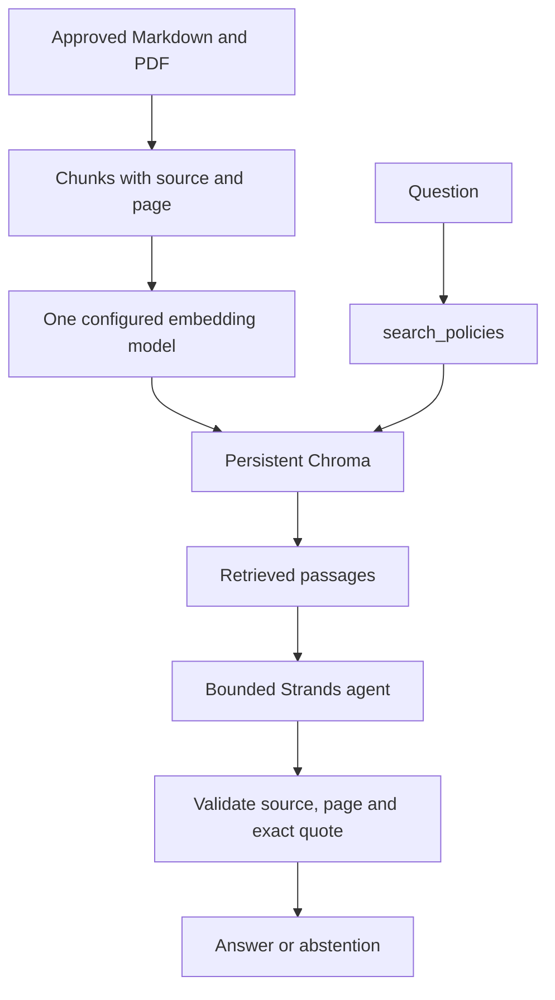

# Module 07: Retrieval-augmented generation
> After this module you can build a local policy search tool whose answers carry checked source and page citations.

**Time:** ~210 min · **Level:** Intermediate · **Cost:** offline/Ollama $0 hosted inference; plan roughly $0.05–$0.20 for small hosted experiments, with embeddings/reranking extra.

**AWS required:** Optional; local alternatives are provided. **AWS resources created:** none by default; optional labs and teardown are linked below.

**Assistant version 5:** Build a local policy search tool whose answers carry checked source and page citations.

## Prerequisites

Complete [Module 06](../06_community_tools/README.md). Run commands from the repository root. [AWS setup](../../docs/AWS_SETUP.md) is required before live AWS branches. [Costs](../../docs/COSTS.md) are dated estimates. Remove `--mock` only after installing/configuring the needed local model or cloud service.

## Learning objectives

- Preserve source and PDF page metadata while chunking.
- Compute cosine similarity and explain its limits.
- Persist and query explicit embeddings in Chroma.
- Validate exact citations and abstain without evidence.
- Inspect optional Knowledge Base infrastructure without deploying it.

## The big idea

Retrieval-augmented generation is an open-book exam. The retriever finds relevant pages, and the model writes an answer using those pages. Chunking cuts a book into manageable passages; overlap keeps a sentence near an edge from losing all its context. An embedding is a list of numbers learned to represent text. Cosine similarity compares vector directions, like asking whether two arrows point the same way. Similarity is evidence of relevance, not proof of truth. The answer still needs a source, a page and a quotation that your application can check. A plausible filename invented by a model is not a citation.

## How it works



| Concept | Analogy | Under the hood |
|---|---|---|
| Chunks and overlap | Overlapping photocopies of a book | Word windows advance by size minus overlap; PDF pages are chunked separately. |
| Embeddings and cosine | Directions of arrows | The same embedding model maps both questions and documents; zero vectors need explicit handling. |
| Chroma persistence | An indexed filing cabinet | Explicit vectors, IDs and metadata are stored on disk and reused after reopening. |
| Agentic search | A clerk chooses which page to request | The model selects search_policies; Strands returns its evidence before the typed answer. |
| Citations | A receipt for each claim | A postcondition checks exact retrieved IDs, source/page pairs and quotes, but cannot prove the answer follows logically. |
| Knowledge Base | A managed filing service | Bedrock Retrieve generates/query embeddings against a configured vector index; the supported store adapts results. |

## Key APIs at a glance

| API | What it does | When to use it |
|---|---|---|
| `Client.embed` | Generate Ollama embeddings | Indexing and querying with the same model |
| `chromadb.PersistentClient` | Open a local persistent collection | Local vector retrieval |
| `collection.add / query` | Store/query explicit vectors and metadata | Avoid implicit model downloads |
| `BedrockKnowledgeBaseStore.search` | Supported read-only Knowledge Base adapter | Optional AWS retrieval with filters |
| `validate_citations` | Check returned provenance | Before displaying an answer |

## Walkthrough

### Local setup and the two kinds of embeddings

Install `uv sync --group rag`. For real local embeddings run `ollama pull embeddinggemma`; keep the chat model (`qwen3:4b`) separate. `OLLAMA_EMBEDDING_MODEL_ID` selects the embedder and `MODEL_PROVIDER` selects chat inference. Leave `MODEL_ID` blank when switching chat providers. `common.models.get_embeddings()` is the shared embedding factory.

Mock mode uses stable hashed word counts, explicitly labeled **lexical fixtures**. They test persistence and vector plumbing without downloading a model; they do not demonstrate semantic understanding. The real path calls Ollama's current `embed` API with `truncate=False`. Oversized text should fail instead of silently dropping evidence.

The loader includes only the approved policy directory; poisoned security fixtures are excluded. Markdown citations use page `0`, meaning not applicable. PDF citations use real one-based pages. Index directories are separated for mock and live embeddings, and an identity mismatch fails before mixing vectors. The small replace operation is deliberately not an atomic production index migration.

### Failure before the fix

Example 01 rejects overlap equal to chunk size before showing valid windows. Example 04 validates citations from the evidence actually returned by the tool. An empty corpus permits an abstention; nearest-neighbor retrieval alone cannot establish that a question is answerable. A live model must still be evaluated on unsupported questions.

### Optional AWS branch

Examples 05 and 06 require AWS only when `--mock` is removed. `retrieve` from the old community package is deprecated, so the lesson uses `BedrockKnowledgeBaseStore`. Its filter is fixed below the model. The optional [Knowledge Base lab](../../infra/README.md) provisions S3 Vectors and matches its 256 dimensions to the embedding request. It uploads metadata sidecars and waits for ingestion readiness before live querying. S3 Vectors is the selected low-cost store for this tiny workload; current OpenSearch scale-to-zero behavior prevents a blanket cheapest claim.

### 01_load_and_chunk

Markdown/PDF loading, chunk boundaries and source/page metadata. [Source](examples/01_load_and_chunk.py).

```text
uv run python modules/07_rag/examples/01_load_and_chunk.py --mock
```

Expected fragment:

```text
Failure before fix
```

### 02_embeddings_by_hand

Embedding primer, cosine similarity by hand, 2D projection and its limits. [Source](examples/02_embeddings_by_hand.py).

```text
uv run --group rag python modules/07_rag/examples/02_embeddings_by_hand.py --mock
```

Expected fragment:

```text
cosine:
```

### 03_local_index

Chroma persistence and Ollama embeddings; offline deterministic embedding fixture. [Source](examples/03_local_index.py).

```text
uv run --group rag python modules/07_rag/examples/03_local_index.py --mock
```

Expected fragment:

```text
distance
```

### 04_cited_search

search_policies tool, agentic retrieval, citations, grounding and abstention. [Source](examples/04_cited_search.py).

```text
uv run python modules/07_rag/examples/04_cited_search.py --mock
```

Expected fragment:

```text
citations
```

### 05_knowledge_base

Optional Bedrock Knowledge Base, S3 Vectors, retrieve tool and metadata filters; infrastructure and teardown. [Source](examples/05_knowledge_base.py).

```text
uv run python modules/07_rag/examples/05_knowledge_base.py --mock
```

Expected fragment:

```text
business days
```

### 06_bedrock_embeddings

Titan Text Embeddings or verified equivalent; embedding-specific API versus Converse. [Source](examples/06_bedrock_embeddings.py).

```text
uv run python modules/07_rag/examples/06_bedrock_embeddings.py --mock
```

Expected fragment:

```text
Dimensions: 256
```

## Real-world use case

Nimbus support needs answers whose policy evidence can be audited. Ask Nimbus builds a persistent Chroma index of the PDF, lets a Strands tool retrieve evidence, and validates exact citations before printing the result. A real deployment would version the corpus, authenticate callers and evaluate unsupported questions before exposing the app.

```text
uv run --group rag python modules/07_rag/use_case/ask_nimbus.py --mock
```

Expected offline output (formatting may vary):

```text
citations: source=policies/nimbus_terms.pdf, page=3
Lesson complete.
```

## Common mistakes

| Error text or exact diagnostic fragment | Fix |
|---|---|
| `Require 0 <= overlap < chunk size` | Choose a positive size and smaller overlap; otherwise the chunker cannot advance. |
| `Embedding model changed; build a separate index directory` | Keep model identity/dimension stable, or build a fresh index rather than mixing vectors. |
| `Citation or quotation was not in the retrieved evidence` | Reject the answer; request a bounded repair or abstain. Never silently relabel a citation. |
| `Install retrieval tools: uv sync --group rag` | Install the rag group and keep --group rag on uv run commands. |
| `Set NIMBUS_KNOWLEDGE_BASE_ID after deploying the optional lab` | Use --mock or complete the optional infrastructure lab and copy its output ID. |

Provider errors are sanitized by `common.pretty` and point to `scripts/check_env.py`; module-level missing optional imports require the documented group first.

## Exercises

- **Practice:** Split words into overlapping windows; reject non-progressing settings. [Starter](exercises/01_chunks.py) · [Solution](solutions/01_chunks.py). Run `uv run python modules/07_rag/exercises/01_chunks.py`.
- **Apply:** Return cosine similarity, including zero-vector behavior. [Starter](exercises/02_cosine.py) · [Solution](solutions/02_cosine.py). Run `uv run python modules/07_rag/exercises/02_cosine.py`.
- **Stretch:** Accept a quote only when its chunk ID, source, page and text match retrieved evidence. [Starter](exercises/03_citations.py) · [Solution](solutions/03_citations.py). Run `uv run python modules/07_rag/exercises/03_citations.py`.

```text
uv run pytest modules/07_rag/tests --exercise-starters
uv run pytest modules/07_rag/tests
```

Unedited starters run but intentionally fail some acceptance tests. The second command checks solutions; optional adapter tests skip if their group is absent. The [notebook](notebook.ipynb) mirrors all examples and the use case. Start Jupyter with `uv run --group notebooks --group rag --group memory --group aws jupyter lab`; its default cells replay fixtures.

## Quiz

1. Why keep a PDF page number before chunking?

<details><summary>Answer</summary>

Joining pages first loses reliable page provenance; one-based PDF page numbers should come from the reader.

</details>

2. Is the toy vector plot a visualization of the real model?

<details><summary>Answer</summary>

No. It uses hand-chosen two-dimensional numbers to teach geometry; a real projection can distort neighborhoods.

</details>

3. Why not use Chroma's default embedding function?

<details><summary>Answer</summary>

It may download a model or use an unexpected provider. Explicit embeddings make behavior and cost visible.

</details>

4. Can query and corpus vectors use different models of the same dimension?

<details><summary>Answer</summary>

No. Equal length does not mean their dimensions have the same meaning.

</details>

5. Does an exact quote make an answer faithful?

<details><summary>Answer</summary>

Not necessarily. The quote may be real while the surrounding claim misinterprets it.

</details>

6. Why use InvokeModel for Titan embeddings?

<details><summary>Answer</summary>

Converse handles chat, not embedding inference. This documented embedding-specific request is intentional.

</details>

## Key takeaways

- Preserve source and PDF page metadata while chunking.
- Keep identity, provenance and operation bounds below the model.
- Mock success verifies integration, not semantic model quality.
- Record ties, regressions and untested cloud behavior honestly.
- Verify cleanup separately from a successful example.

## Clean up

Local reports/indexes remain under ignored `.nimbus/`; temporary session/preference demos remove their own directories. No default script deploys AWS. If you chose an optional lab, follow the exact [tagged-stack teardown and leftover checks](../../infra/README.md#tear-down-and-verify). The resource inventory and per-month cost estimates are in that guide.

## Go deeper

- [Official module reference](https://docs.aws.amazon.com/bedrock/latest/userguide/knowledge-base.html)
- [Strands memory](https://strandsagents.com/docs/user-guide/sdk/memory/overview/)
- [Bedrock Knowledge Bases](https://docs.aws.amazon.com/bedrock/latest/userguide/knowledge-base.html)
- [AgentCore Memory](https://docs.aws.amazon.com/bedrock-agentcore/latest/devguide/memory-get-started.html)

## Next: Module 08

Continue to [Advanced retrieval and evaluation](../08_advanced_rag/README.md).
