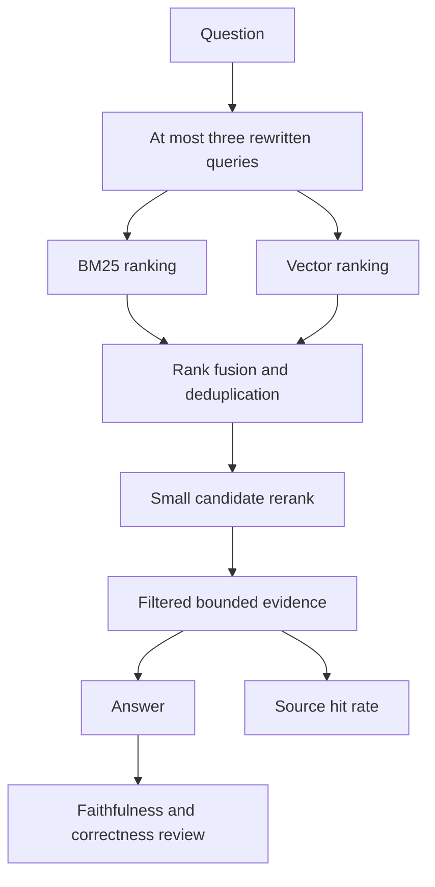

# Module 08: Advanced retrieval and evaluation
> After this module you can compare retrieval strategies and separate source hits from answer correctness.

**Time:** ~180 min · **Level:** Intermediate · **Cost:** offline/Ollama $0 hosted inference; plan roughly $0.05–$0.20 for small hosted experiments, with embeddings/reranking extra.

**AWS required:** Optional; local alternatives are provided. **AWS resources created:** none by default; optional labs and teardown are linked below.

**Assistant version 5:** Compare retrieval strategies and separate source hits from answer correctness.

## Prerequisites

Complete [Module 07](../07_rag/README.md). Run commands from the repository root. [AWS setup](../../docs/AWS_SETUP.md) is required before live AWS branches. [Costs](../../docs/COSTS.md) are dated estimates. Remove `--mock` only after installing/configuring the needed local model or cloud service.

## Learning objectives

- Bound and deduplicate model-generated query rewrites.
- Combine BM25 and vector ranks.
- Rerank a retrieved candidate pool.
- Run filtered two-hop retrieval.
- Measure held-out source hits and inspect judge limitations.

## The big idea

Searching a library often takes more than one phrasing. Query rewriting asks the model for a few alternative search requests. BM25 rewards useful word matches; vector search compares learned representations. Hybrid search combines their rankings, like consulting two librarians. A reranker then reorders a small candidate pile; it cannot return a book nobody retrieved. Evaluation asks different questions: did the correct source appear, did the answer use it faithfully, and did it answer the traveler correctly? A high source-hit score cannot answer all three. An LLM judge is another fallible reviewer, not an oracle.

## How it works



| Concept | Analogy | Under the hood |
|---|---|---|
| Query rewriting | Ask two librarians differently | A typed output caps the rewrite count at three; each search returns bounded hits. |
| BM25 and fusion | Word index plus semantic catalog | BM25 and cosine have different score scales; reciprocal ranks combine order, not raw magnitude. |
| Reranking | Review the candidate pile | The local score is a transparent heuristic; optional Bedrock returns model relevance scores. |
| Filters and multi-hop | Follow one cross-reference | Topic filters run before results are exposed; the second hop follows an explicit policy ID and then stops. |
| Evaluation and judges | Answer key plus independent reviewer | Golden labels are consulted only after prediction; mock judges prove API shape, not quality. |

## Key APIs at a glance

| API | What it does | When to use it |
|---|---|---|
| `BM25Okapi.get_scores` | Score tokenized documents | Exact-keyword retrieval |
| `hybrid_search` | Fuse sparse and dense ranks | Compare to a simple baseline |
| `bedrock-agent-runtime.rerank` | Reorder provided document candidates | Optional supported cloud reranker |
| `retrieval_report` | Compute source hits at a fixed k | Compare the same frozen question set |
| `Judgment / judge_answer` | Typed faithfulness and correctness review | A separate fallible model evaluation |

## Walkthrough

### Keep the comparison honest

Run `uv sync --group rag`. The committed golden policy set has 11 answerable questions and one unsupported visa question. The comparison uses the same corpus and top-three result budget for both methods. Source labels are read only when scoring; a test changes labels and confirms retrieved IDs stay unchanged.

The observed offline result is **11/11 for both lexical and hybrid retrieval**. That is a tie, not evidence that hybrid search improves real model answers. The fixture embedding is lexical hashing. The useful measured behavior improvements are boundary checks: fabricated quotes are rejected, empty evidence allows abstention, and repeated searches are capped/deduplicated. A fresh paraphrase development set and real embeddings are needed before judging semantic gains. Do not tune against the held-out labels.

The simple local reranker is word-overlap scoring, not a trained cross-encoder. The AWS demonstration uses the verified `Rerank` request with `BEDROCK_RERANK_MODEL_ID=cohere.rerank-v3-5:0` in us-east-1. Removing `--mock` from example 03 calls AWS regardless of the chat provider; skip that branch for an entirely local session. Reranking has its own price and region availability.

### Faithfulness, correctness and failure modes

Faithfulness asks whether a claim follows from retrieved text. Correctness asks whether it answers the question and matches the reference. Exact quote validation only establishes provenance. Example 05 gives a judge the evidence “30 minutes” and the false answer “30 days.” Its scripted negative judgment is a contract test; live judges must be calibrated against human-reviewed examples and disagreements inspected.

Missing facts require a different chunk/query, irrelevant chunks require better retrieval, false citations require application validation, and injected instructions require both trusted-source boundaries and restricted tools. Example 06 quarantines the poisoned document instead of executing it. Full adversarial model testing and guardrails follow in Tier 3.

### 01_query_rewriting

Agent query rewrite and multi-query retrieval with a query budget. [Source](examples/01_query_rewriting.py).

```text
uv run python modules/08_advanced_rag/examples/01_query_rewriting.py --mock
```

Expected fragment:

```text
Unique evidence
```

### 02_hybrid_search

BM25 plus vector search and deduplication. [Source](examples/02_hybrid_search.py).

```text
uv run --group rag python modules/08_advanced_rag/examples/02_hybrid_search.py --mock
```

Expected fragment:

```text
Hybrid:
```

### 03_reranking

Local reranking and optional Bedrock reranking with supported model/region. [Source](examples/03_reranking.py).

```text
uv run python modules/08_advanced_rag/examples/03_reranking.py --mock
```

Expected fragment:

```text
Bedrock rerank
```

### 04_filters_multihop

Metadata filters and bounded multi-hop retrieval. [Source](examples/04_filters_multihop.py).

```text
uv run python modules/08_advanced_rag/examples/04_filters_multihop.py --mock
```

Expected fragment:

```text
Hop 2
```

### 05_evaluate_retrieval

Hit rate, faithfulness, correctness, held-out golden sets and LLM-as-judge limitations. [Source](examples/05_evaluate_retrieval.py).

```text
uv run --group rag python modules/08_advanced_rag/examples/05_evaluate_retrieval.py --mock
```

Expected fragment:

```text
baseline_hit_rate
```

### 06_failure_gallery

Before/after results for missing facts, irrelevant chunks, false citations and injection. [Source](examples/06_failure_gallery.py).

```text
uv run python modules/08_advanced_rag/examples/06_failure_gallery.py --mock
```

Expected fragment:

```text
Rejected false citation
```

## Real-world use case

Nimbus engineers want evidence before replacing the simple search baseline. The use case writes per-question retrieved IDs and hit flags, then a before/after table to .nimbus/retrieval_report.json. A real team would review regressions, add untouched paraphrases, measure answer quality and latency, and ship only a useful improvement.

```text
uv run --group rag python modules/08_advanced_rag/use_case/retrieval_comparison.py --mock
```

Expected offline output (formatting may vary):

```text
Method | source hit rate @3
Lexical | 1.0
Hybrid  | 1.0
Mode: hashed lexical fixture
```

## Common mistakes

| Error text or exact diagnostic fragment | Fix |
|---|---|
| `No queries within the turn budget` | Check structured output and keep a finite retry budget. |
| `No module named 'rank_bm25'` | Use uv run --group rag for hybrid search and evaluation. |
| `Vectors must have the same nonzero dimension` | Use one embedding configuration and rebuild incompatible indexes. |
| `Citation or quotation was not in the retrieved evidence` | Reject fabricated quotes; the failure gallery shows the rejected case. |
| `Check MODEL_ID, its inference profile, region and supported model parameters.` | For reranking check BEDROCK_RERANK_MODEL_ID separately: Amazon Rerank is not offered in us-east-1; the default here is Cohere 3.5. |

Provider errors are sanitized by `common.pretty` and point to `scripts/check_env.py`; module-level missing optional imports require the documented group first.

## Exercises

- **Practice:** Deduplicate normalized query strings and keep at most three nonempty queries. [Starter](exercises/01_query_budget.py) · [Solution](solutions/01_query_budget.py). Run `uv run python modules/08_advanced_rag/exercises/01_query_budget.py`.
- **Apply:** Fuse two ranked ID lists with reciprocal rank weights 1/(60+rank), deduplicating IDs. [Starter](exercises/02_fusion.py) · [Solution](solutions/02_fusion.py). Run `uv run python modules/08_advanced_rag/exercises/02_fusion.py`.
- **Stretch:** Compute source hit rate; exclude abstention cases without an expected source. [Starter](exercises/03_hit_rate.py) · [Solution](solutions/03_hit_rate.py). Run `uv run python modules/08_advanced_rag/exercises/03_hit_rate.py`.

```text
uv run pytest modules/08_advanced_rag/tests --exercise-starters
uv run pytest modules/08_advanced_rag/tests
```

Unedited starters run but intentionally fail some acceptance tests. The second command checks solutions; optional adapter tests skip if their group is absent. The [notebook](notebook.ipynb) mirrors all examples and the use case. Start Jupyter with `uv run --group notebooks --group rag --group memory --group aws jupyter lab`; its default cells replay fixtures.

## Quiz

1. Why not add BM25 scores to cosine scores?

<details><summary>Answer</summary>

They are not calibrated to one scale. Reciprocal rank fusion is an explicit alternative.

</details>

2. Can a reranker fix missing candidates?

<details><summary>Answer</summary>

No. Improve the first retrieval stage or increase a bounded candidate pool.

</details>

3. Is a metadata filter an authorization system?

<details><summary>Answer</summary>

Only if trusted application identity determines it and the backend enforces it. A model-selectable topic is not customer authorization.

</details>

4. What is source hit rate @3?

<details><summary>Answer</summary>

The fraction of answerable questions whose expected source appears among the top three retrieved chunks.

</details>

5. Why exclude abstention questions from that denominator?

<details><summary>Answer</summary>

They have no expected source; their behavior belongs in a separate answer/abstention metric.

</details>

6. What if the new strategy ties or regresses?

<details><summary>Answer</summary>

Report it. Use a separate development set to diagnose changes and freeze a fresh test set before tuning.

</details>

## Key takeaways

- Bound and deduplicate model-generated query rewrites.
- Keep identity, provenance and operation bounds below the model.
- Mock success verifies integration, not semantic model quality.
- Record ties, regressions and untested cloud behavior honestly.
- Verify cleanup separately from a successful example.

## Clean up

Local reports/indexes remain under ignored `.nimbus/`; temporary session/preference demos remove their own directories. No default script deploys AWS. If you chose an optional lab, follow the exact [tagged-stack teardown and leftover checks](../../infra/README.md#tear-down-and-verify). The resource inventory and per-month cost estimates are in that guide.

## Go deeper

- [Official module reference](https://docs.aws.amazon.com/bedrock/latest/userguide/knowledge-base.html)
- [Strands memory](https://strandsagents.com/docs/user-guide/sdk/memory/overview/)
- [Bedrock Knowledge Bases](https://docs.aws.amazon.com/bedrock/latest/userguide/knowledge-base.html)
- [AgentCore Memory](https://docs.aws.amazon.com/bedrock-agentcore/latest/devguide/memory-get-started.html)

## Next: Module 09

Continue to [Memory, state and sessions](../09_memory/README.md).

## Evaluate generated answers separately

```text
uv run --group rag python modules/08_advanced_rag/use_case/retrieval_comparison.py --mock --judge-answers
```

This generates all 12 predictions before giving each prediction and its reference to a separate judge. The JSON report includes faithfulness, correctness, per-case citations and abstention checks. Mock judgments are deliberately negative scripted values; their aggregate zeroes are schema/transport demonstrations, not measured model quality. Remove `--mock` only after configuring a live model and Ollama embeddings. The maximum is 72 model turns; review costs before running. A fallible judge requires human spot checks, including the unsupported visa question.

The [committed retrieval report](../../docs/verification/tier2_retrieval_report.json) records the offline source-hit comparison: 11/11 for both methods. A tie on this small synthetic set does not demonstrate improvement or generalization. The failure-gallery tests separately demonstrate rejection of fabricated quotes and abstention when evidence is absent.
