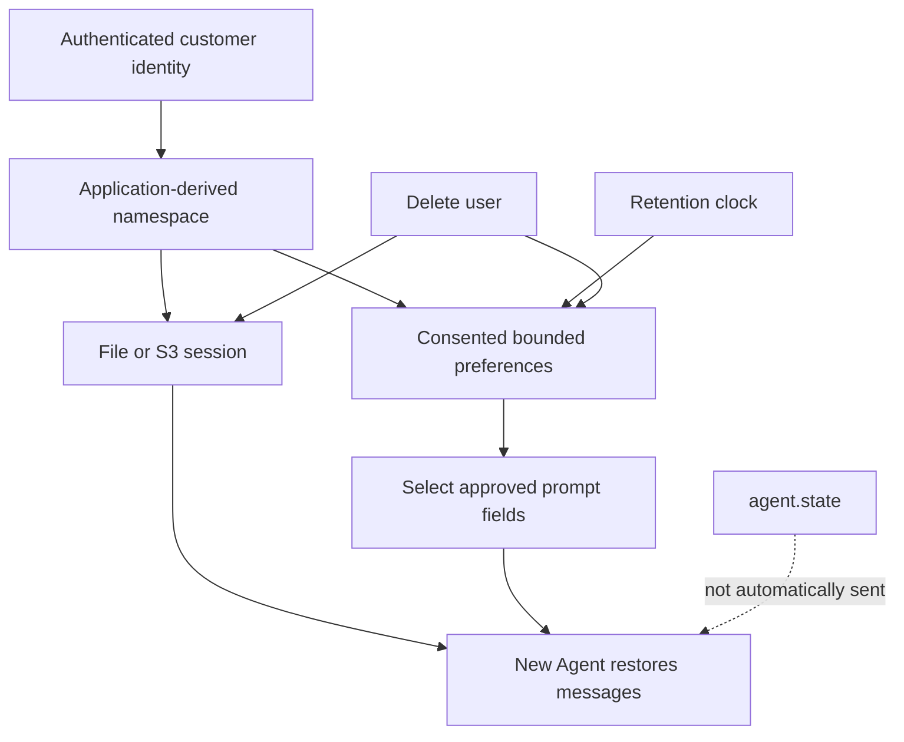

# Module 09: Memory, state and sessions
> After this module you can resume isolated conversations and delete a traveler's retained preferences and sessions.

**Time:** ~210 min · **Level:** Intermediate · **Cost:** offline/Ollama $0 hosted inference; plan roughly $0.05–$0.20 for small hosted experiments, with embeddings/reranking extra.

**AWS required:** Optional; local alternatives are provided. **AWS resources created:** none by default; optional labs and teardown are linked below.

**Assistant version 6:** Resume isolated conversations and delete a traveler's retained preferences and sessions.

## Prerequisites

Complete [Module 08](../08_advanced_rag/README.md). Run commands from the repository root. [AWS setup](../../docs/AWS_SETUP.md) is required before live AWS branches. [Costs](../../docs/COSTS.md) are dated estimates. Remove `--mock` only after installing/configuring the needed local model or cloud service.

## Learning objectives

- Distinguish model input, messages, private state and durable memory.
- Resume a scoped FileSessionManager session.
- Round-trip an S3 session with moto.
- Require consent and enforce preference retention.
- Delete one user without deleting another user's data.
- Inspect current AgentCore and Mem0 integrations.

## The big idea

A model is a worker who arrives at each call with only the papers your application hands over. Conversation messages are the current case file. Agent state is the clerk's private desk drawer; it is not automatically sent to the model. A session manager puts the case file in a filing cabinet so another process can resume it. Long-term memory stores selected facts that remain useful across cases. These stores need an owner, a purpose and an expiry. A traveler's meal preference is useful; their passport or payment number does not belong in this lesson's preference store. Deleting a user means finding every application-owned copy, not simply clearing today's messages.

## How it works



| Concept | Analogy | Under the hood |
|---|---|---|
| Messages versus state | Case file versus private drawer | Messages reach the provider; state remains application data unless explicitly returned or injected. |
| File/S3 session | Durable filing cabinet | A manager persists messages and agent state; use application-derived customer/session identifiers. |
| Preferences | Selected facts across cases | SQLite stores only allow-listed fields with a 90-day expiry and explicit consent. |
| AgentCore memory | Managed extraction and recall | A course-owned MemoryStore reads one trusted namespace using the stable AgentCore API; MemoryManager supplies the Strands integration. |
| Mem0 store | A recall backend behind one interface | MemoryManager delegates scoped add/search to Mem0MemoryStore; delete is a backend API, not a MemoryManager method. |
| Deletion and retention | Destroy the registered file copies | Delete preferences and registered local sessions; remote histories and backups require separate lifecycle policy. |

## Key APIs at a glance

| API | What it does | When to use it |
|---|---|---|
| `agent.state.set / get` | Store private application values | State that should not automatically enter prompts |
| `FileSessionManager` | Persist local sessions | Resume without AWS |
| `S3SessionManager` | Persist session objects in S3 | Optional cloud storage; moto offline |
| `Preferences.save/read/delete_user` | Explicit scoped storage and erasure | Bounded consented customer preferences |
| `MemoryManager / AgentCorePreferencesStore` | Read scoped managed memory | Optional existing AgentCore memory |
| `MemoryManager / Mem0MemoryStore` | Supported cross-session Mem0 adapter | Replace deprecated mem0_memory |

## Walkthrough

### Storage belongs to the authenticated application

The examples use synthetic CUS-001/CUS-002 identities supplied by code. They are not a login system. `Preferences.session` derives a storage namespace from the trusted identity and validates the session ID before handing it to FileSessionManager. Hashing an identifier avoids unsafe path characters; it is not encryption or anonymization.

The local preference store permits only seat, meal and a bounded whole-dollar budget. It uses parameterized SQL and requires explicit consent. It records a 90-day expiry and physically removes expired rows when read. The application tracks all session IDs it creates so deletion removes registered sessions too. Backups, arbitrary copied folders and open old Agent instances are outside this simple store; invalidate active sessions during real user deletion. The demo removes its temporary directory on exit.

### Optional stores and their limits

File and S3 session examples use the same SDK managers as live code. The S3 example creates a bucket only inside moto; live mode requires an existing tagged bucket and deletes its demo session after reading it back. The bucket itself is removed through the [optional lab cleanup](../../infra/README.md).

Install `uv sync --group aws --group memory` for the two integration examples. AgentCore uses exact boto3 Stubber request/response contracts, not moto emulation. The read-only store uses `/preferences/CUS-001/` and has no write methods. The application explicitly supplies retrieved preferences to the model. Full managed extraction deployment remains optional before Tier 5. The memory resource's event expiry does not expire every long-term record; the isolated lab cleanup deletes the entire resource.

Mem0 uses the current `mem0-strands` adapter, not deprecated `mem0_memory`. Mock mode injects a scoped contract double into the real adapter/MemoryManager. Live mode uses local Ollama chat and embeddings plus a disposable Qdrant directory. `MEM0_TELEMETRY=false` is set before importing the integration. Automatic extraction is disabled: one explicit consented fact is stored. Active-memory deletion is verified through a subsequent search, but Mem0's history database is a separate copy; the demo closes its backend and removes the entire temporary directory. A production deployment must design that erasure policy explicitly.

### 01_state_and_messages

Stateless model versus messages and agent.state; explicitly exposing private state when needed. [Source](examples/01_state_and_messages.py).

```text
uv run python modules/09_memory/examples/01_state_and_messages.py --mock
```

Expected fragment:

```text
Private state
```

### 02_file_sessions

FileSessionManager, session IDs, resume and user isolation. [Source](examples/02_file_sessions.py).

```text
uv run python modules/09_memory/examples/02_file_sessions.py --mock
```

Expected fragment:

```text
Restored messages: 2
```

### 03_s3_sessions

S3SessionManager; moto tests and optional tagged bucket teardown. [Source](examples/03_s3_sessions.py).

```text
uv run python modules/09_memory/examples/03_s3_sessions.py --mock
```

Expected fragment:

```text
S3 restored messages: 2
```

### 04_local_preferences

Preference storage, retention, retrieval and complete user deletion. [Source](examples/04_local_preferences.py).

```text
uv run python modules/09_memory/examples/04_local_preferences.py --mock
```

Expected fragment:

```text
Expired at day 90
```

### 05_agentcore_memory

Stable MemoryManager plus a course-owned AgentCore store; optional live scoped recall. [Source](examples/05_agentcore_memory.py).

```text
uv run --group aws python modules/09_memory/examples/05_agentcore_memory.py --mock
```

Expected fragment:

```text
aisle seat
```

### 06_mem0_store

Mem0MemoryStore via mem0-strands and MemoryManager; replace deprecated mem0_memory tool; deletion through backend API. [Source](examples/06_mem0_store.py).

```text
uv run --group memory python modules/09_memory/examples/06_mem0_store.py --mock
```

Expected fragment:

```text
Mem0 scoped deletion verified
```

## Real-world use case

Nimbus wants returning travelers to avoid repeating meal and seat preferences while retaining control of their data. The use case stores three explicit preferences, starts a new scoped session, supplies only approved fields to the planner, then demonstrates user deletion. A real service would persist an application-owned store and honor consent revocation across active sessions and backups.

```text
uv run python modules/09_memory/use_case/preferences_assistant.py --mock
```

Expected offline output (formatting may vary):

```text
Aisle, vegetarian meals, budget $600. Please confirm dates.
Traveler preferences and registered sessions deleted.
```

## Common mistakes

| Error text or exact diagnostic fragment | Fix |
|---|---|
| `Preference storage requires explicit consent` | Ask for an explicit storage decision before calling save. |
| `Only bounded seat, meal and budget preferences may be stored` | Reject payment/passport data and unknown values; do not expand fields to satisfy model output. |
| `Session ID must be a short safe identifier` | Use an application-generated opaque ID, never a raw path from a prompt. |
| `Set NIMBUS_SESSION_BUCKET after deploying the optional session lab` | Use --mock or the local file manager until you have an approved bucket. |
| `Set AGENTCORE_MEMORY_ID for an existing optional memory resource` | Use the offline contract or deploy the optional lab; a new empty memory does not contain the scripted preference. |

Provider errors are sanitized by `common.pretty` and point to `scripts/check_env.py`; module-level missing optional imports require the documented group first.

## Exercises

- **Practice:** Allow only explicitly consented seat/meal fields with known values; deny arbitrary data. [Starter](exercises/01_consent.py) · [Solution](solutions/01_consent.py). Run `uv run python modules/09_memory/exercises/01_consent.py`.
- **Apply:** Return only the trusted owner's unexpired records; expiry is exclusive. [Starter](exercises/02_retention.py) · [Solution](solutions/02_retention.py). Run `uv run python modules/09_memory/exercises/02_retention.py`.
- **Stretch:** Remove every preference and session record owned by one user, preserving other users. [Starter](exercises/03_deletion.py) · [Solution](solutions/03_deletion.py). Run `uv run python modules/09_memory/exercises/03_deletion.py`.

```text
uv run pytest modules/09_memory/tests --exercise-starters
uv run pytest modules/09_memory/tests
```

Unedited starters run but intentionally fail some acceptance tests. The second command checks solutions; optional adapter tests skip if their group is absent. The [notebook](notebook.ipynb) mirrors all examples and the use case. Start Jupyter with `uv run --group notebooks --group rag --group memory --group aws jupyter lab`; its default cells replay fixtures.

## Quiz

1. Does agent.state automatically reach the provider?

<details><summary>Answer</summary>

No. The application must deliberately include selected state in a prompt or tool result.

</details>

2. Does a session ID authenticate a user?

<details><summary>Answer</summary>

No. Derive the namespace from already authenticated identity and enforce backend access.

</details>

3. When does a preference expire?

<details><summary>Answer</summary>

At the expiry instant: reads retain only expires > now.

</details>

4. Does clearing messages delete durable sessions?

<details><summary>Answer</summary>

No. Delete registered session data and separate preference stores explicitly.

</details>

5. Why can this AgentCore example not save the conversation?

<details><summary>Answer</summary>

The custom store is read-only, extraction and write tools are disabled, and it implements only RetrieveMemoryRecords.

</details>

6. Does Mem0 delete_all prove all data is erased?

<details><summary>Answer</summary>

It removes scoped active memories. History databases, snapshots and backups need separate erasure; this disposable demo removes its local directory on exit.

</details>

## Key takeaways

- Distinguish model input, messages, private state and durable memory.
- Keep identity, provenance and operation bounds below the model.
- Mock success verifies integration, not semantic model quality.
- Record ties, regressions and untested cloud behavior honestly.
- Verify cleanup separately from a successful example.

## Clean up

Local reports/indexes remain under ignored `.nimbus/`; temporary session/preference demos remove their own directories. No default script deploys AWS. If you chose an optional lab, follow the exact [tagged-stack teardown and leftover checks](../../infra/README.md#tear-down-and-verify). The resource inventory and per-month cost estimates are in that guide.

## Go deeper

- [Official module reference](https://strandsagents.com/docs/user-guide/sdk/agents/session-management/)
- [Strands memory](https://strandsagents.com/docs/user-guide/sdk/memory/overview/)
- [Bedrock Knowledge Bases](https://docs.aws.amazon.com/bedrock/latest/userguide/knowledge-base.html)
- [AgentCore Memory](https://docs.aws.amazon.com/bedrock-agentcore/latest/devguide/memory-get-started.html)

## Next: Tier 2 checkpoint

Build the [Policy & Preferences assistant](../../checkpoints/02_policy_preferences/README.md). Module 10 follows in Phase 5.

## AgentCore compatibility decision

The pinned `bedrock-agentcore` 1.25.1 session integration still imports deprecated Strands bidi and multi-agent hook aliases internally. This lesson avoids that import entirely. [Our read-only store](../../common/memory_adapters.py) implements the current Strands `MemoryStore` protocol and calls the stable [RetrieveMemoryRecords API](https://docs.aws.amazon.com/bedrock-agentcore/latest/APIReference/API_RetrieveMemoryRecords.html). It is course code, not an AWS-provided adapter. Session persistence remains the job of FileSessionManager or S3SessionManager; long-term recall uses MemoryManager. Tests retain strict deprecation errors without warning exceptions or dependency patching.

The store bounds recall to three records and one response page, validates the namespace from trusted identity, filters unexpected namespaces and propagates service errors. A memory ID or namespace is not authentication: enforce the caller's IAM permissions and application identity in a deployed service. The demo caller is the fixed synthetic traveler CUS-001.
