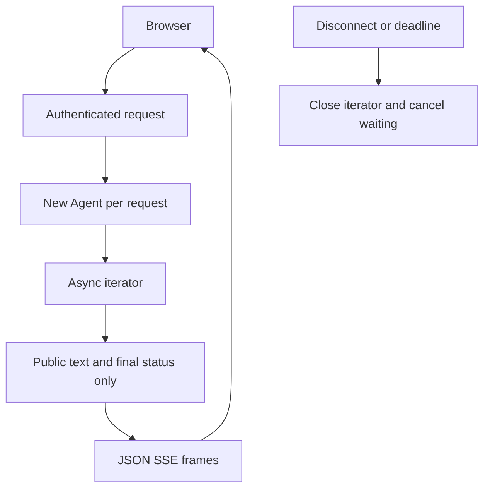

# Module 10: Streaming and async
> After this module you can stream a trip plan to a browser while bounding concurrent work and closing cancelled requests.

**Time:** ~150 min · **Level:** Intermediate · **Cost:** offline $0; Ollama has no hosted inference charge; budget roughly $0.05–$0.20 for small hosted runs, with optional Guardrails charges separate.

**AWS required:** No for the core path; optional AWS branches are labeled. **AWS resources created:** none by default; Module 13 links the optional Guardrails stack and teardown.

**Assistant version 6:** Stream a trip plan to a browser while bounding concurrent work and closing cancelled requests.

## Prerequisites

Complete [Module 09](../09_memory/README.md). Run commands from the repository root. Use `uv sync --group apps` for web lessons. Offline examples need no credentials; remove `--mock` only after [provider setup](../../docs/AWS_SETUP.md) or local Ollama setup in the [root guide](../../README.md). Live tool lessons need a tool-capable chat model. See [dated costs](../../docs/COSTS.md).

## Learning objectives

- Distinguish text, tool, lifecycle and provider reasoning events.
- Compare callback delivery with an async iterator.
- Bound concurrent agents with a semaphore.
- Close streams on timeout and disconnect.
- Build a per-session Streamlit chat and a FastAPI SSE endpoint.

## The big idea

A streamed answer is like watching a travel adviser fill in an itinerary as they work. You can read the first line before the whole plan is ready. An async iterator hands your program each new event; a callback is a function the SDK calls when something happens. Neither means every event belongs on screen. Tool arguments, internal metadata and provider reasoning can contain information the traveler should not see. Server-sent events (SSE) wrap selected text in a simple HTTP format. Cancellation is hanging up the phone: it stops waiting and releases local resources, but cannot undo an airline booking already accepted elsewhere. Each simultaneous conversation needs its own Agent and history, just as each traveler needs a separate case file.

## How it works



| Concept | Analogy | Under the hood |
|---|---|---|
| Async iterator | An adviser hands you each completed line | async for consumes events without blocking another independent request. |
| Callbacks | A bell rings when work changes | The SDK calls a supplied handler; it is not an authorization hook. |
| SSE | Numbered envelopes on one open connection | Each frame has an event name, JSON data, and a blank line terminator. |
| Concurrency | Several advisers with a fixed number of desks | A semaphore bounds independent Agent instances; do not concurrently invoke one instance. |
| Cancellation | Hanging up the call | The iterator closes and cooperative tasks cancel; external side effects require idempotency and reconciliation. |

## Key APIs at a glance

| API | What it does | When to use it |
|---|---|---|
| `agent.stream_async` | Yield SDK events asynchronously | Streaming responses |
| `callback_handler` | Observe events as callbacks | Terminal output and instrumentation |
| `asyncio.Semaphore / timeout` | Bound concurrency and elapsed time | Avoid unbounded work |
| `StreamingResponse` | Send SSE frames over HTTP | Browser trip planner |
| `st.session_state / st.write_stream` | Isolate history and display chunks | Streamlit chat |

## Walkthrough

### Inspect first, then choose what to display

Example 01 prints event keys from both delivery methods. Its reasoning block is a deliberately written fixture summary; live reasoning appears only when the provider exposes it. Do not promise hidden model reasoning or forward every event to users. The public route emits only text, final status, interrupt count and sanitized errors. JSON encoding prevents a newline in text from forging an SSE event.

Example 02 runs three independent agents with two available slots. A separate deterministic slow local tool demonstrates cooperative cancellation even when the selected live model is fast. Token/turn limits bound model work, while the wall-clock timeout bounds waiting. A cancelled synchronous tool in a thread or a remote request can still finish; cancellation is not a transaction rollback.

### Open the two local apps

```text
uv run --group apps python modules/10_streaming/examples/03_fastapi_sse.py --mock --serve
uv run --group apps streamlit run modules/10_streaming/examples/04_streamlit_chat.py -- --mock --ui
```

For FastAPI, open the loopback URL printed in the terminal and paste the generated customer token into the page. The token is a local teaching substitute for sign-in. The browser uses fetch because this POST endpoint requires an Authorization header. Press Ctrl+C to stop. The Streamlit runner displays its own URL. Each browser session owns an Agent and chat list; Clear this session replaces both. A session is not authenticated identity. Neither app is a production internet deployment.

The CLI path of the Streamlit example prints chunks without starting a web server. Automated tests also exercise the actual Streamlit widgets through two messages, a second isolated session, and Clear. A bounded queue bridges one worker's async iterator to Streamlit's synchronous consumer, keeping SDK trace context in one task. The worker has a 30-second timeout and observes consumer shutdown; cancelling the UI cannot roll back remote effects. Live mode requires a configured model; retain `--group apps` on every command so uv retains the optional dependencies.

### 01_stream_events

stream_async text deltas, reasoning if exposed, tool and lifecycle events versus callbacks. [Source](examples/01_stream_events.py).

```text
uv run python modules/10_streaming/examples/01_stream_events.py --mock
```

Expected fragment:

```text
Iterator event keys:
```

### 02_concurrency_and_cancel

Concurrent agents, timeouts, cancellation and bounded resource use. [Source](examples/02_concurrency_and_cancel.py).

```text
uv run python modules/10_streaming/examples/02_concurrency_and_cancel.py --mock
```

Expected fragment:

```text
Lesson complete.
```

### 03_fastapi_sse

FastAPI SSE framing, client disconnect and cancellation propagation. [Source](examples/03_fastapi_sse.py).

```text
uv run --group apps python modules/10_streaming/examples/03_fastapi_sse.py --mock
```

Expected fragment:

```text
SSE and authenticated routes verified
```

### 04_streamlit_chat

Streamlit chat, per-user sessions and streamed responses. [Source](examples/04_streamlit_chat.py).

```text
uv run --group apps python modules/10_streaming/examples/04_streamlit_chat.py --mock
```

Expected fragment:

```text
Lesson complete.
```

## Real-world use case

Nimbus travelers see a plan appear as it is generated. The use case reuses the bounded public stream in a terminal or the same local browser app. It does not reserve travel; the visible plan is advice about synthetic destinations.

[Complete use case](use_case/streaming_trip_planner.py).

```text
uv run --group apps python modules/10_streaming/use_case/streaming_trip_planner.py --mock
```

Expected: `Lesson complete.` plus the recorded outcome; inspect tool/database status instead of treating model prose as proof.

## Common mistakes

| Symptom or mistake | Fix |
|---|---|
| Passing all events straight to a browser | Emit an explicit public schema; keep tool inputs and trace data private. |
| Invoking one Agent concurrently | Create independent agents or serialize access within one authenticated conversation. |
| asyncio.run() cannot be called from a running event loop | Use await in an existing async function; the notebook helper runs standalone lessons in a worker. |
| No module named fastapi or streamlit | Run uv sync --group apps and keep that group on uv run. |
| Assuming cancellation undoes a refund | Use the authoritative status and idempotency checks in Module 12. |

## Exercises

1. **Encode one SSE text frame without allowing a newline to forge another event.** [Starter](exercises/01_frame.py) · [Solution](solutions/01_frame.py). Input: `"hello"`. Expected: `"event: text\ndata: {\"text\": \"hello\"}\n\n"`.

2. **Extract only public text deltas; never leak tool inputs or raw trace metadata.** [Starter](exercises/02_text_only.py) · [Solution](solutions/02_text_only.py). Input: `[{"data": "Hi"}, {"metadata": {"secret": "x"}}, {"data": " there"}]`. Expected: `["Hi", " there"]`.

3. **Split jobs into ordered batches no larger than the positive worker budget.** [Starter](exercises/03_batch_budget.py) · [Solution](solutions/03_batch_budget.py). Input: `{"jobs": [1, 2, 3, 4, 5], "workers": 2}`. Expected: `[[1, 2], [3, 4], [5]]`.

```text
uv run python modules/10_streaming/exercises/01_frame.py
uv run pytest modules/10_streaming/tests --exercise-starters
uv run pytest modules/10_streaming/tests
```

Unedited starters run and intentionally fail some acceptance tests. The last command tests the completed solutions. The [notebook](notebook.ipynb) mirrors every example and the use case with cleared outputs and offline defaults. Start it with `uv run --group notebooks --group apps jupyter lab`. The [boundary tests](../../tests/test_tier3_boundaries.py), [MCP tests](../../tests/test_tier3_mcp.py) and [Streamlit test](../../tests/test_tier3_ui.py) verify integration across lessons.

## Quiz

1. Why can the browser show text before the final AgentResult?

<details><summary>Answer</summary>

Text deltas arrive during the model stream; the final result arrives when the invocation completes.

</details>

2. Should tool arguments be displayed as text?

<details><summary>Answer</summary>

No. Select public text explicitly; arguments can contain sensitive or untrusted data.

</details>

3. What does a semaphore bound?

<details><summary>Answer</summary>

The number of concurrent jobs inside its guarded section, not tokens per job.

</details>

4. Can two requests invoke the same Agent concurrently?

<details><summary>Answer</summary>

Use separate agents or serialize access; messages and invocation state are mutable conversation data.

</details>

5. Does client disconnect guarantee a remote write stopped?

<details><summary>Answer</summary>

No. Inspect authoritative state and use idempotency to handle an uncertain outcome.

</details>

6. Why renew a scripted response for each Streamlit turn?

<details><summary>Answer</summary>

The finite mock provider otherwise exhausts its script. Renew the response while preserving only that session's history.

</details>

## Key takeaways

- Distinguish text, tool, lifecycle and provider reasoning events.
- Compare callback delivery with an async iterator.
- Bound concurrent agents with a semaphore.
- Treat scripted output as integration evidence, not a measurement of live model quality.
- Enforce authorization and operation bounds below model-generated text.

## Clean up

Stop local servers with Ctrl+C. Finite CLI demos close clients and remove temporary databases. Web approval state and reports remain in ignored `.nimbus/`; stop the server before deleting a specific demo database you no longer need. No default script deploys AWS. If you deployed Guardrails, follow the [exact stack teardown and leftover checks](../../infra/13_guardrails/README.md#tear-down-and-verify).

## Go deeper

- [Official Strands reference](https://strandsagents.com/docs/user-guide/sdk/streaming/async-iterators/)
- [Strands interrupts](https://strandsagents.com/docs/user-guide/sdk/interrupts/)
- [Official MCP Python SDK](https://github.com/modelcontextprotocol/python-sdk)
- [Verification and API changes](../../docs/VERIFICATION_NOTES.md)

## Next: Module 11

Continue to [Hooks and lifecycle](../11_hooks/README.md).
