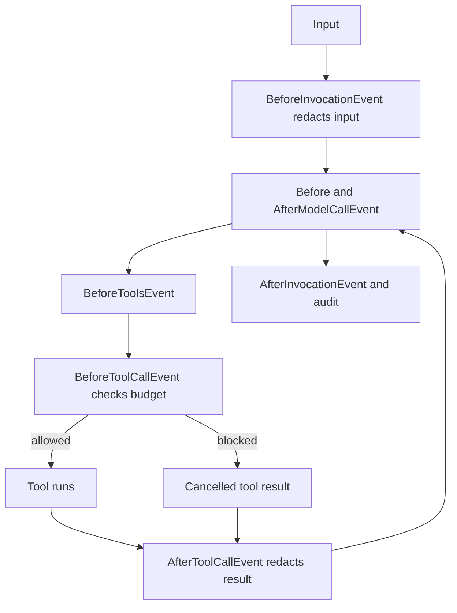

# Module 11: Hooks and lifecycle
> After this module you can enforce a trusted booking budget and record a redacted audit of the agent lifecycle.

**Time:** ~120 min · **Level:** Intermediate · **Cost:** offline $0; Ollama has no hosted inference charge; budget roughly $0.05–$0.20 for small hosted runs, with optional Guardrails charges separate.

**AWS required:** No for the core path; optional AWS branches are labeled. **AWS resources created:** none by default; Module 13 links the optional Guardrails stack and teardown.

**Assistant version 7:** Enforce a trusted booking budget and record a redacted audit of the agent lifecycle.

## Prerequisites

Complete [Module 10](../10_streaming/README.md). Run commands from the repository root. Use `uv sync --group apps` for web lessons. Offline examples need no credentials; remove `--mock` only after [provider setup](../../docs/AWS_SETUP.md) or local Ollama setup in the [root guide](../../README.md). Live tool lessons need a tool-capable chat model. See [dated costs](../../docs/COSTS.md).

## Learning objectives

- Register lifecycle callbacks with HookProvider and HookRegistry.
- Normalize and reject tool calls before execution.
- Rewrite tool results before they return to the model.
- Redact inputs and log copies at the correct boundary.
- Supply trusted policy through invocation_state.

## The big idea

Hooks are checkpoints on a conveyor belt. Before a parcel enters a machine, an inspector can read its label and reject it. After processing, another inspector records the outcome. The model suggests a tool call, but a BeforeToolCallEvent hook can normalize the destination or block a quote outside the application's budget. The catalog price and budget come from trusted code, not a number invented in a prompt. An audit is a receipt of what was attempted and allowed. It should keep enough information to explain the decision without becoming a second store of customer secrets. Hooks are useful enforcement points, but a database or remote service must still check authorization at its own write boundary.

## How it works



| Concept | Analogy | Under the hood |
|---|---|---|
| Lifecycle events | Inspection stations | Agent initialization, invocation, model call, tool batch, tool call and messages emit distinct events. |
| Tool normalization | Correcting an address label | BeforeToolCallEvent can mutate supported tool input fields, such as normalizing bos to BOS. |
| Budget policy | A purchase order ceiling | A catalog lookup supplies price; trusted invocation_state supplies the ceiling. |
| Message redaction | A censored copy of a case file | Redact input before model/history and tool results before reuse; observers separately redact their own log copies. |

## Key APIs at a glance

| API | What it does | When to use it |
|---|---|---|
| `HookProvider.register_hooks` | Declare event callbacks | Reusable policy bundle |
| `HookRegistry.add_callback` | Bind a callback to an event | Select the lifecycle boundary |
| `BeforeToolCallEvent.cancel_tool` | Cancel an individual call | Enforce allow-list and catalog budget |
| `AfterToolCallEvent.result` | Replace a result | Remove sensitive fields before model reuse |
| `MessageAddedEvent / MessageUpdatedEvent` | Observe appended/replaced messages | Redacted audit copies |
| `invocation_state` | Pass application-owned context | Trusted budget and identity metadata |

## Walkthrough

### Follow one quote through the lifecycle

The shared [AuditPolicy](../../common/audit.py) registers AgentInitializedEvent, Before/AfterInvocationEvent, Before/AfterModelCallEvent, Before/AfterToolsEvent, Before/AfterToolCallEvent and MessageAdded/UpdatedEvent. Example 01 prints the actual events observed on a tool round trip. Not every invocation emits every event: a response with no tools has no tool-call lifecycle.

Example 02 changes `" bos "` to `"BOS"` and returns a $350 catalog quote under the $500 budget. AfterToolCallEvent replaces the returned contact email with `[EMAIL]`. Example 04 requests a $900 LAX quote and blocks it. The mock final sentence is scripted; judge success by the tool result and audit, not reassuring prose.

### Redact at the boundary you actually own

BeforeInvocationEvent modifies supported invocation messages before they enter the provider/history. Message observers redact separate audit copies. Example 03 explicitly supplies a MessageUpdatedEvent fixture to test a replacement observer; editing `agent.messages` yourself does not emit a framework replacement event. The lesson attaches no session manager and makes no claim that an arbitrary persistence plugin runs after this observer. Integrate and test ordering before adding storage. The email/US-phone regex is a small demonstration, not universal PII detection.

Pass context as `agent(prompt, invocation_state={"budget_cents": 50000})`. Bare extra invocation keyword arguments are deprecated by the pinned SDK. Never let a model tool argument overwrite this trusted budget. Each agent receives its own AuditPolicy; its call count deliberately spans that agent's lifetime, including resume. Logs record attempts, blocked status, tool outcome and duration without raw arguments. Message audit copies still require a retention policy in production.

### 01_lifecycle_hooks

HookProvider, HookRegistry; AgentInitializedEvent, Before/AfterInvocationEvent, Before/AfterModelCallEvent. [Source](examples/01_lifecycle_hooks.py).

```text
uv run python modules/11_hooks/examples/01_lifecycle_hooks.py --mock
```

Expected fragment:

```text
Lifecycle:
```

### 02_tool_hooks

Before/AfterToolCallEvent, Before/AfterToolsEvent; block or modify inputs and rewrite results. [Source](examples/02_tool_hooks.py).

```text
uv run python modules/11_hooks/examples/02_tool_hooks.py --mock
```

Expected fragment:

```text
Normalized input:
```

### 03_message_hooks

MessageAddedEvent and MessageUpdatedEvent; redaction before persistence/logging. [Source](examples/03_message_hooks.py).

```text
uv run python modules/11_hooks/examples/03_message_hooks.py --mock
```

Expected fragment:

```text
Redacted history:
```

### 04_audit_budget

Invocation state, structured audit trail, booking budget enforcement and metrics. [Source](examples/04_audit_budget.py).

```text
uv run python modules/11_hooks/examples/04_audit_budget.py --mock
```

Expected fragment:

```text
Trusted budget: $500.
```

## Real-world use case

The audited booking assistant records a permitted quote and its lifecycle to `.nimbus/tool_audit.json`. Inspect the redacted messages and blocked flags before trusting the final answer. The example quotes travel without charging or reserving it.

[Complete use case](use_case/audited_booking.py).

```text
uv run python modules/11_hooks/use_case/audited_booking.py --mock
```

Expected: `Lesson complete.` plus the recorded outcome; inspect tool/database status instead of treating model prose as proof.

## Common mistakes

| Symptom or mistake | Fix |
|---|---|
| Trusting a price supplied by a tool request | Look up the catalog price below the model. |
| Expecting a callback_handler to deny a tool | Use the supported BeforeToolCallEvent cancellation field. |
| Redacting only after persistence | Redact input/results before reuse and verify the storage integration separately. |
| Sharing one AuditPolicy across users | Use a separate instance; counters and logs are mutable. |
| Using bare budget_cents as an invocation keyword | Put it inside invocation_state to avoid the current deprecation warning. |

## Exercises

1. **Recursively redact email and US phone patterns without mutating the input.** [Starter](exercises/01_redact.py) · [Solution](solutions/01_redact.py). Input: `{"message": ["a@example.com", "555-123-4567"]}`. Expected: `{"message": ["[EMAIL]", "[PHONE]"]}`.

2. **Allow only catalog-priced destinations inside the trusted budget.** [Starter](exercises/02_budget.py) · [Solution](solutions/02_budget.py). Input: `{"destination": " bos ", "budget": 35000}`. Expected: `true`.

3. **Build an audit record that omits raw arguments and redacts status text.** [Starter](exercises/03_audit.py) · [Solution](solutions/03_audit.py). Input: `{"name": "quote", "status": "ok", "arguments": {"email": "a@example.com"}}`. Expected: `{"name": "quote", "status": "ok"}`.

```text
uv run python modules/11_hooks/exercises/01_redact.py
uv run pytest modules/11_hooks/tests --exercise-starters
uv run pytest modules/11_hooks/tests
```

Unedited starters run and intentionally fail some acceptance tests. The last command tests the completed solutions. The [notebook](notebook.ipynb) mirrors every example and the use case with cleared outputs and offline defaults. Start it with `uv run --group notebooks --group apps jupyter lab`. The [boundary tests](../../tests/test_tier3_boundaries.py), [MCP tests](../../tests/test_tier3_mcp.py) and [Streamlit test](../../tests/test_tier3_ui.py) verify integration across lessons.

## Quiz

1. Who supplies the trusted budget?

<details><summary>Answer</summary>

The authenticated application through invocation_state; never the model.

</details>

2. Which hook blocks an individual tool?

<details><summary>Answer</summary>

BeforeToolCallEvent, by setting cancel_tool.

</details>

3. Why normalize before the catalog lookup?

<details><summary>Answer</summary>

The policy and tool must agree on the same canonical destination.

</details>

4. Does observing MessageAddedEvent automatically change saved history?

<details><summary>Answer</summary>

No. This observer redacts its own audit copy; persistence ordering needs a separate verified integration.

</details>

5. Does every invocation emit tool events?

<details><summary>Answer</summary>

No. A model can answer without selecting a tool.

</details>

6. Why check authorization again in the tool or database?

<details><summary>Answer</summary>

A hook protects this invocation path; the underlying write must remain safe when called by another path.

</details>

## Key takeaways

- Register lifecycle callbacks with HookProvider and HookRegistry.
- Normalize and reject tool calls before execution.
- Rewrite tool results before they return to the model.
- Treat scripted output as integration evidence, not a measurement of live model quality.
- Enforce authorization and operation bounds below model-generated text.

## Clean up

Stop local servers with Ctrl+C. Finite CLI demos close clients and remove temporary databases. Web approval state and reports remain in ignored `.nimbus/`; stop the server before deleting a specific demo database you no longer need. No default script deploys AWS. If you deployed Guardrails, follow the [exact stack teardown and leftover checks](../../infra/13_guardrails/README.md#tear-down-and-verify).

## Go deeper

- [Official Strands reference](https://strandsagents.com/docs/user-guide/sdk/agents/hooks-events/)
- [Strands interrupts](https://strandsagents.com/docs/user-guide/sdk/interrupts/)
- [Official MCP Python SDK](https://github.com/modelcontextprotocol/python-sdk)
- [Verification and API changes](../../docs/VERIFICATION_NOTES.md)

## Next: Module 12

Continue to [Human approval with interrupts](../12_interrupts/README.md).
