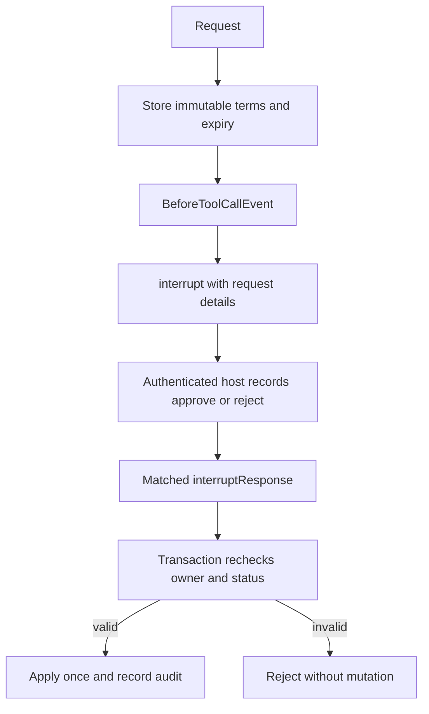

# Module 12: Human approval with interrupts
> After this module you can pause a refund for a supervisor and resume it without duplicate financial effects.

**Time:** ~150 min · **Level:** Intermediate · **Cost:** offline $0; Ollama has no hosted inference charge; budget roughly $0.05–$0.20 for small hosted runs, with optional Guardrails charges separate.

**AWS required:** No for the core path; optional AWS branches are labeled. **AWS resources created:** none by default; Module 13 links the optional Guardrails stack and teardown.

**Assistant version 8:** Pause a refund for a supervisor and resume it without duplicate financial effects.

## Prerequisites

Complete [Module 11](../11_hooks/README.md). Run commands from the repository root. Use `uv sync --group apps` for web lessons. Offline examples need no credentials; remove `--mock` only after [provider setup](../../docs/AWS_SETUP.md) or local Ollama setup in the [root guide](../../README.md). Live tool lessons need a tool-capable chat model. See [dated costs](../../docs/COSTS.md).

## Learning objectives

- Capture and resume matched interrupt identifiers.
- Compare hook, batch and ToolContext interrupts.
- Distinguish handoff_to_user from authorization.
- Bind approval to stored customer, amount, action and expiry.
- Apply approve/reject/expire decisions through CLI and web flows.

## The big idea

An interrupt is putting a case on an adviser's desk while waiting for a supervisor. It pauses the agent before the tool changes anything. Resuming the conversation is only delivering the supervisor's envelope; the database still checks whether the envelope represents a recorded, valid decision for these exact terms. An approval is bound to a customer, booking, action, amount and expiry, like a signed purchase order. Reusing a request identifier must return the same outcome instead of paying twice. A rejected or expired case cannot become approved because a model says so. In this lesson the money and bookings are synthetic rows in a temporary SQLite database.

## How it works



| Concept | Analogy | Under the hood |
|---|---|---|
| Individual versus batch pause | Hold one parcel or the entire tray | BeforeToolCallEvent pauses one call; BeforeToolsEvent pauses before the complete tool batch. |
| Resume ID | A case-number label | The host sends the exact interruptId back; arbitrary text cannot resume an unrelated case. |
| Durable approval | A signed order in a filing cabinet | SQLite stores terms, decision, expiry, status and audit independently of conversation text. |
| Idempotency | Stamp the receipt only once | BEGIN IMMEDIATE and an applied state ensure repeated/concurrent apply calls do not duplicate the refund. |

## Key APIs at a glance

| API | What it does | When to use it |
|---|---|---|
| `event.interrupt` | Pause from an interruptible hook | Review before one tool or a batch |
| `ToolContext.interrupt` | Pause inside a context-aware tool | Ask for missing human input |
| `AgentResult.interrupts` | Read interruption identifiers and reasons | Render the review request |
| `interruptResponse` | Resume the matching interrupted call | Return a host-produced response |
| `handoff_to_user` | Obtain a synchronous user reply | Simple clarification, not durable approval |
| `ApprovalLedger.decide / apply` | Authorize and atomically apply terms | Refund replay and expiry protection |

## Walkthrough

### Failure first: a rejected $600 refund

The default CLI decision is reject. A refund strictly above $500 needs approval; exactly $500 may follow the local policy path. Any change to the seeded non-refundable fare also needs approval. The ledger validates ownership and remaining paid balance, stores the exact terms and expires requests after five minutes. This ledger is separate from the committed read-only bookings dataset.

```text
uv run python modules/12_interrupts/examples/03_approval_cli.py --mock --decision approve
uv run python modules/12_interrupts/examples/03_approval_cli.py --mock --decision expire
uv run python modules/12_interrupts/examples/03_approval_cli.py --mock --action change --decision ask
```

The expiry command advances the decision clock to the stored expiry instant. A forged interrupt response saying approve does not change the ledger and cannot authorize a refund. The tool checks the ledger again inside its write transaction. Applying a previously applied request returns `already_applied`. This teaches local atomicity; a real payment provider additionally needs its own idempotency key and reconciliation after uncertain responses.

### Choose the right human interaction

Example 02 demonstrates ToolContext interruption and the current handoff_to_user tool. Its handoff input is patched to a synthetic `email` reply so automation never hangs; this is a clarification contract, not supervisor sign-in. Example 05 pauses a whole batch of two harmless fare inspections. The host approves those reads directly. Financial decisions use the ledger in examples 01, 03 and 04.

```text
uv run --group apps python modules/12_interrupts/examples/04_approval_web.py --mock --serve
```

Open the printed loopback URL. Paste the customer token to request a refund or fare change; paste the distinct supervisor token to approve or reject. The server binds the customer to CUS-001 and supplies supervisor identity after checking the role token. Do not put either token in a prompt. All tokens are temporary demo credentials, not a production identity system.

The SQLite ledger survives a web restart, but paused Agent objects live only in this process. A restart invalidates in-memory resume state; inspect outstanding ledger rows and reconcile before creating a new request. Do not retry a possibly applied refund under a new ID. The demo caps pending reviews and bounds agent calls. It has no durable queue, multi-worker coordination or recovery UI. Those are explicit deployment requirements beyond this local lesson.

### 01_hook_interrupt

Interrupt an individual call from BeforeToolCallEvent; capture identifiers. [Source](examples/01_hook_interrupt.py).

```text
uv run python modules/12_interrupts/examples/01_hook_interrupt.py --mock
```

Expected fragment:

```text
Authoritative status: rejected
```

### 02_tool_interrupt

Interrupt from ToolContext and resume with matched human response. [Source](examples/02_tool_interrupt.py).

```text
uv run python modules/12_interrupts/examples/02_tool_interrupt.py --mock
```

Expected fragment:

```text
Lesson complete.
```

### 03_approval_cli

Approve/reject/expire refunds over $500 and non-refundable changes; handoff_to_user comparison. [Source](examples/03_approval_cli.py).

```text
uv run python modules/12_interrupts/examples/03_approval_cli.py --mock
```

Expected fragment:

```text
Authoritative status: rejected
```

### 04_approval_web

Authenticated approval state, web approve/reject, audit trail and replay-safe mutation. [Source](examples/04_approval_web.py).

```text
uv run --group apps python modules/12_interrupts/examples/04_approval_web.py --mock
```

Expected fragment:

```text
SSE and authenticated routes verified
```

### 05_batch_interrupt

BeforeToolsEvent pauses the complete tool batch; matched resume or cancellation. [Source](examples/05_batch_interrupt.py).

```text
uv run python modules/12_interrupts/examples/05_batch_interrupt.py --mock
```

Expected fragment:

```text
Tools before review: 0
```

## Real-world use case

Nimbus support reviews a synthetic $600 refund or a non-refundable fare change. Run the use case with approve, reject and expire, then compare authoritative statuses. The same shared policy is used by the CLI and web routes; no payment provider is contacted.

[Complete use case](use_case/refund_approval.py).

```text
uv run python modules/12_interrupts/use_case/refund_approval.py --mock
```

Expected: `Lesson complete.` plus the recorded outcome; inspect tool/database status instead of treating model prose as proof.

## Common mistakes

| Symptom or mistake | Fix |
|---|---|
| Approving from model-generated text | Record decisions in the authenticated host and recheck the durable ledger. |
| Comparing dollars using floating point | Use integer cents; $500 is 50000. |
| Changing an amount after approval | Create a new proposal and review its exact terms. |
| Replaying an old approval after expiry | Reject at the expiry boundary and recheck before committing. |
| Treating handoff_to_user as supervisor authentication | A chat reply is input; authorization requires a trusted identity and stored decision. |

## Exercises

1. **Require approval above $500 or for a change to a non-refundable fare.** [Starter](exercises/01_threshold.py) · [Solution](solutions/01_threshold.py). Input: `{"cents": 50000, "action": "refund", "nonrefundable": true}`. Expected: `false`.

2. **Accept only an approved, unexpired request belonging to the trusted owner.** [Starter](exercises/02_expiry.py) · [Solution](solutions/02_expiry.py). Input: `{"status": "approved", "owner": "a", "trusted_owner": "a", "expires": 11, "now": 10}`. Expected: `true`.

3. **Apply each request ID at most once while preserving first-seen order.** [Starter](exercises/03_replay.py) · [Solution](solutions/03_replay.py). Input: `["r1", "r2", "r1"]`. Expected: `["r1", "r2"]`.

```text
uv run python modules/12_interrupts/exercises/01_threshold.py
uv run pytest modules/12_interrupts/tests --exercise-starters
uv run pytest modules/12_interrupts/tests
```

Unedited starters run and intentionally fail some acceptance tests. The last command tests the completed solutions. The [notebook](notebook.ipynb) mirrors every example and the use case with cleared outputs and offline defaults. Start it with `uv run --group notebooks --group apps jupyter lab`. The [boundary tests](../../tests/test_tier3_boundaries.py), [MCP tests](../../tests/test_tier3_mcp.py) and [Streamlit test](../../tests/test_tier3_ui.py) verify integration across lessons.

## Quiz

1. Does a $500 refund need approval under this demo policy?

<details><summary>Answer</summary>

No; refunds strictly above $500 do. Changes to non-refundable fares require approval independently.

</details>

2. What binds a decision to an operation?

<details><summary>Answer</summary>

The stored request ID, customer, booking, action, amount and expiry.

</details>

3. Is an interrupt response of approve sufficient?

<details><summary>Answer</summary>

No. Financial actions require a recorded supervisor decision and transactional revalidation.

</details>

4. What happens at exactly expires?

<details><summary>Answer</summary>

The request is expired; now must be strictly less than expires.

</details>

5. What does a repeated successful apply return?

<details><summary>Answer</summary>

already_applied, with no second refund.

</details>

6. What survives a demo web restart?

<details><summary>Answer</summary>

The SQLite ledger survives; the paused Agent and resumable in-memory mapping do not.

</details>

## Key takeaways

- Capture and resume matched interrupt identifiers.
- Compare hook, batch and ToolContext interrupts.
- Distinguish handoff_to_user from authorization.
- Treat scripted output as integration evidence, not a measurement of live model quality.
- Enforce authorization and operation bounds below model-generated text.

## Clean up

Stop local servers with Ctrl+C. Finite CLI demos close clients and remove temporary databases. Web approval state and reports remain in ignored `.nimbus/`; stop the server before deleting a specific demo database you no longer need. No default script deploys AWS. If you deployed Guardrails, follow the [exact stack teardown and leftover checks](../../infra/13_guardrails/README.md#tear-down-and-verify).

## Go deeper

- [Official Strands reference](https://strandsagents.com/docs/user-guide/sdk/interrupts/)
- [Strands interrupts](https://strandsagents.com/docs/user-guide/sdk/interrupts/)
- [Official MCP Python SDK](https://github.com/modelcontextprotocol/python-sdk)
- [Verification and API changes](../../docs/VERIFICATION_NOTES.md)

## Next: Module 13

Continue to [Guardrails and safety](../13_guardrails/README.md).
