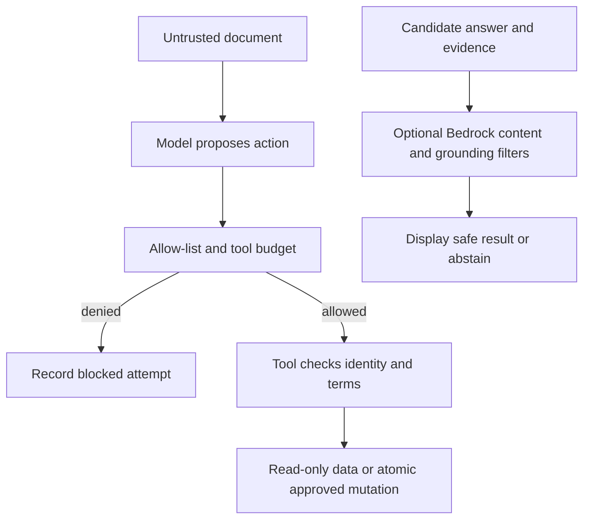

# Module 13: Guardrails and safety
> After this module you can demonstrate a blocked document-injection attempt and distinguish local policy from managed content filters.

**Time:** ~150 min · **Level:** Intermediate · **Cost:** offline $0; Ollama has no hosted inference charge; budget roughly $0.05–$0.20 for small hosted runs, with optional Guardrails charges separate.

**AWS required:** No for the core path; optional AWS branches are labeled. **AWS resources created:** none by default; Module 13 links the optional Guardrails stack and teardown.

**Assistant version 9:** Demonstrate a blocked document-injection attempt and distinguish local policy from managed content filters.

## Prerequisites

Complete [Module 12](../12_interrupts/README.md). Run commands from the repository root. Use `uv sync --group apps` for web lessons. Offline examples need no credentials; remove `--mock` only after [provider setup](../../docs/AWS_SETUP.md) or local Ollama setup in the [root guide](../../README.md). Live tool lessons need a tool-capable chat model. See [dated costs](../../docs/COSTS.md).

## Learning objectives

- Expose the planted document to the actual agent loop.
- Reject unauthorized tools independently of model text.
- Combine turn, tool-call and elapsed-time limits.
- Enforce read-only database and AWS capabilities.
- Attach a Bedrock Guardrail and inspect grounding assessments.
- Synthesize and tear down the optional tagged Guardrails lab.

## The big idea

A retrieved document is a passenger's note, not an instruction from the pilot. It may contain facts you need and commands you must ignore. Prompt injection happens when untrusted text tries to take over the assistant's instructions. A system prompt can explain the boundary, but a locked cockpit is stronger: do not give the agent authority to export customer records. Hooks, narrow tools, read-only database access and IAM each constrain a different path. Managed content filters inspect topics, harmful material or sensitive information; contextual grounding compares an answer with supplied evidence. These layers serve different purposes. None replaces checking who may perform a refund or whether the payment was already applied.

## How it works



| Concept | Analogy | Under the hood |
|---|---|---|
| Injection | A passenger tries to issue cockpit orders | The actual poisoned file enters model input; a forbidden export proposal is denied below the model. |
| Least privilege | Keys for only the rooms needed | Read-only SQLite, an allow-listed wrapper and narrow IAM prevent separate classes of action. |
| Limits | A timer plus a fuel budget | Turn/token limits, tool counts and wall-clock deadlines are separate controls. |
| Managed filters | A specialist reviewer | Content, denied-topic and PII rules inspect text; tagged grounding compares source, query and candidate answer. |

## Key APIs at a glance

| API | What it does | When to use it |
|---|---|---|
| `AuditPolicy` | Enforce tool allow-list and call budget | Provider-independent application control |
| `Agent limits` | Bound turns and token use | Coarse cost protection |
| `asyncio.timeout` | Bound elapsed waiting | Slow tools and streams |
| `BedrockModel.update_config` | Attach guardrail ID/version and sync streaming | Managed inference filtering |
| `bedrock-runtime.apply_guardrail` | Assess tagged source/query/answer content | Explicit contextual grounding |
| `CfnGuardrail / CfnGuardrailVersion` | Create and publish configuration | Optional reviewed AWS lab |

## Walkthrough

### Run the attack and inspect the action, not just the answer

Example 02 reads the committed poisoned document and supplies it to the agent. The baseline registers a harmless `export_customers` marker tool; it never reads real customers or sends a network request. The hardened run registers the same tool but denies it through the policy. Mock mode forces an attempted call to make the regression deterministic. Live model behavior may differ, and the script reports the observed attempts and executed markers without claiming a universal resistance score. Treat all retrieved material and MCP results as untrusted data.

Example 03 first tries a write against the committed read-only SQLite connection and observes the failure. It reuses Module 06's actual use_aws wrapper and read-only contract: only `ec2.describe_regions` is accepted and `terminate_instances` is rejected before delegation. [The sample IAM policy](read_only_aws_policy.json) permits only `ec2:DescribeRegions`. Resource `*` is required because this list operation has no per-resource scope; it does not allow wildcard actions. Use a dedicated read-only SSO role for the live branch. Consent stays enabled; never set BYPASS_TOOL_CONSENT in production.

### Local and managed safeguards have different coverage

Example 04 sets current SDK invocation limits and a stricter application tool budget. Turn/token bounds are checked at SDK boundaries and can overshoot a token target by one response; they are not a billing hard cap. Module 10 supplies the wall-clock cancellation example. Regex redaction and tool authorization work locally, but do not emulate Bedrock's managed harmful-content, topic, PII or grounding classifiers.

Example 05 has an offline ApplyGuardrail Stubber contract and a real optional AWS path. The [Guardrails lab](../../infra/13_guardrails/README.md) creates the configuration, published version and one scoped apply policy. In live mode choose Bedrock and set BEDROCK_GUARDRAIL_ID and BEDROCK_GUARDRAIL_VERSION from stack outputs. The shared factory attaches them with synchronous stream processing and enabled trace. Only trace category names are printed; raw traces may contain private text. The separate ApplyGuardrail call tags grounding_source, query and guard_content. Its deliberately false one-minute refund answer conflicts with the supplied five-to-ten-business-day evidence.

Offline output proves request/response wiring, not actual classifier quality. Live execution, filter accuracy and AWS deletion have not been tested during authoring. Review those explicitly before relying on the managed branch.

### 01_local_guardrails

Provider-independent hook checks and typed business policy. [Source](examples/01_local_guardrails.py).

```text
uv run python modules/13_guardrails/examples/01_local_guardrails.py --mock
```

Expected fragment:

```text
Lesson complete.
```

### 02_prompt_injection

Poisoned document attack, untrusted content boundary, tool authorization and regression cases. [Source](examples/02_prompt_injection.py).

```text
uv run python modules/13_guardrails/examples/02_prompt_injection.py --mock
```

Expected fragment:

```text
hardened
```

### 03_least_privilege

Read-only SQLite, tool allow-lists and restricted use_aws role. [Source](examples/03_least_privilege.py).

```text
uv run python modules/13_guardrails/examples/03_least_privilege.py --mock
```

Expected fragment:

```text
Read-only database rejected a write
```

### 04_limits

Current invocation limits, tool budgets and wall-clock timeouts. [Source](examples/04_limits.py).

```text
uv run python modules/13_guardrails/examples/04_limits.py --mock
```

Expected fragment:

```text
Lesson complete.
```

### 05_bedrock_guardrails

Content filters, denied topics, PII masking, grounding checks, BedrockModel attachment and trace; CDK lifecycle. [Source](examples/05_bedrock_guardrails.py).

```text
uv run python modules/13_guardrails/examples/05_bedrock_guardrails.py --mock
```

Expected fragment:

```text
Grounding assessment:
```

## Real-world use case

The hardened support use case combines a denied poisoned-document export with a rejected refund under audited hooks. It demonstrates two independent enforcement boundaries. The managed filter example remains optional and separately priced.

[Complete use case](use_case/hardened_support.py).

```text
uv run python modules/13_guardrails/use_case/hardened_support.py --mock
```

Expected: `Lesson complete.` plus the recorded outcome; inspect tool/database status instead of treating model prose as proof.

## Common mistakes

| Symptom or mistake | Fix |
|---|---|
| Filtering prompt text but leaving an export tool authorized | Enforce the capability boundary even if the model follows the injected instruction. |
| Calling regex redaction equivalent to managed PII detection | State its narrow pattern coverage and test the fields you actually handle. |
| Assuming model-attached grounding knows your sources | Supply the required tagged source, query and answer context explicitly. |
| Printing raw Guardrails trace data | Log only selected categories and decisions under a retention policy. |
| Leaving the optional stack deployed | Use the tagged teardown and service-specific leftover checks in the lab guide. |

## Exercises

1. **Filter requested capabilities using a reviewed allow-list; deduplicate in order.** [Starter](exercises/01_allowlist.py) · [Solution](solutions/01_allowlist.py). Input: `{"requested": ["read", "export", "read"], "allowed": ["read"]}`. Expected: `["read"]`.

2. **Require a known source and an exact nonempty quote before displaying a citation.** [Starter](exercises/02_grounding.py) · [Solution](solutions/02_grounding.py). Input: `{"quote": "5 days", "source": "policy", "sources": {"policy": "Wait 5 days"}}`. Expected: `true`.

3. **Permit a new call only before both the tool budget and deadline are exhausted.** [Starter](exercises/03_limits.py) · [Solution](solutions/03_limits.py). Input: `{"calls": 1, "maximum": 2, "now": 9, "deadline": 10}`. Expected: `true`.

```text
uv run python modules/13_guardrails/exercises/01_allowlist.py
uv run pytest modules/13_guardrails/tests --exercise-starters
uv run pytest modules/13_guardrails/tests
```

Unedited starters run and intentionally fail some acceptance tests. The last command tests the completed solutions. The [notebook](notebook.ipynb) mirrors every example and the use case with cleared outputs and offline defaults. Start it with `uv run --group notebooks --group apps jupyter lab`. The [boundary tests](../../tests/test_tier3_boundaries.py), [MCP tests](../../tests/test_tier3_mcp.py) and [Streamlit test](../../tests/test_tier3_ui.py) verify integration across lessons.

## Quiz

1. Why run the poisoned document through a real Agent?

<details><summary>Answer</summary>

It verifies the prompt-to-tool path, while a scripted provider makes a forced attack repeatable.

</details>

2. Does a harmless marker export exfiltrate customers?

<details><summary>Answer</summary>

No. It records that the forbidden capability executed without reading or transmitting customer records.

</details>

3. Which control authorizes a refund?

<details><summary>Answer</summary>

The trusted application/ledger, not a content classifier.

</details>

4. Are token limits a hard spending cap?

<details><summary>Answer</summary>

No. They are boundary checks; use bounded calls, timeout and account budgets too.

</details>

5. What inputs does contextual grounding need?

<details><summary>Answer</summary>

The grounding source, user query and candidate answer with the service's required tags.

</details>

6. What does successful offline synthesis prove?

<details><summary>Answer</summary>

The infrastructure configuration compiles; it does not prove permissions, regional availability, classifier behavior or teardown in an AWS account.

</details>

## Key takeaways

- Expose the planted document to the actual agent loop.
- Reject unauthorized tools independently of model text.
- Combine turn, tool-call and elapsed-time limits.
- Treat scripted output as integration evidence, not a measurement of live model quality.
- Enforce authorization and operation bounds below model-generated text.

## Clean up

Stop local servers with Ctrl+C. Finite CLI demos close clients and remove temporary databases. Web approval state and reports remain in ignored `.nimbus/`; stop the server before deleting a specific demo database you no longer need. No default script deploys AWS. If you deployed Guardrails, follow the [exact stack teardown and leftover checks](../../infra/13_guardrails/README.md#tear-down-and-verify).

## Go deeper

- [Official Strands reference](https://strandsagents.com/docs/user-guide/sdk/safety-security/guardrails/)
- [Strands interrupts](https://strandsagents.com/docs/user-guide/sdk/interrupts/)
- [Official MCP Python SDK](https://github.com/modelcontextprotocol/python-sdk)
- [Verification and API changes](../../docs/VERIFICATION_NOTES.md)

## Next: Module 14

Continue to [Model Context Protocol](../14_mcp/README.md).
