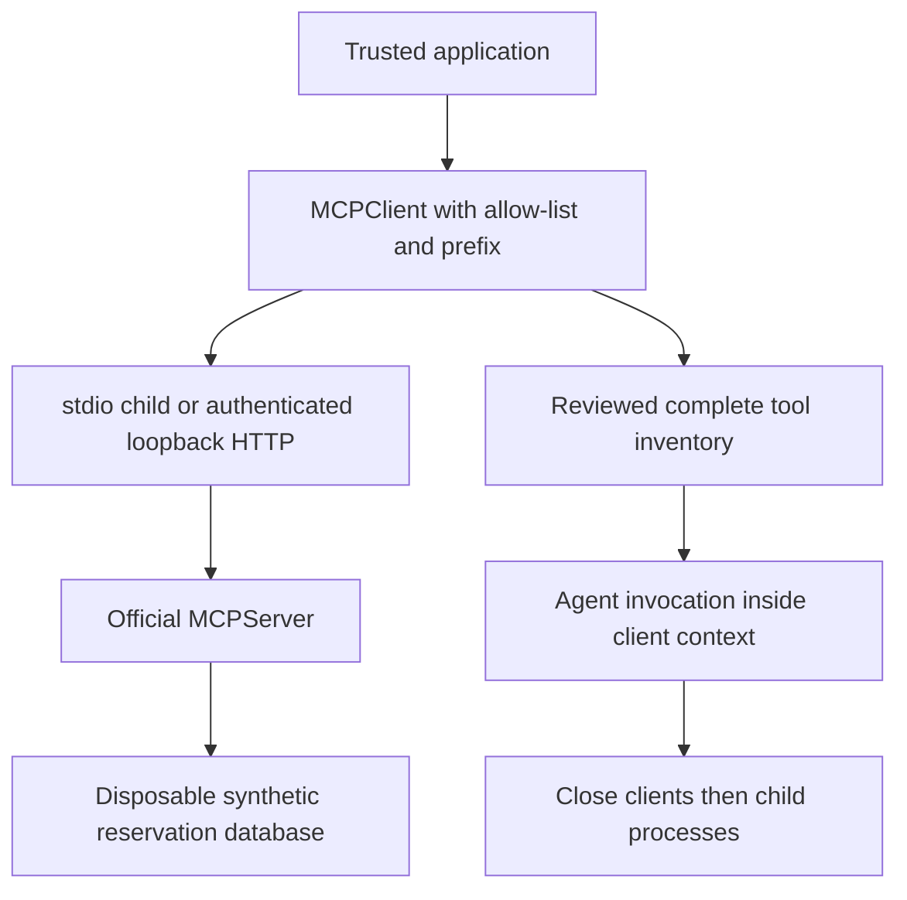

# Module 14: Model Context Protocol
> After this module you can connect an agent to real local MCP booking tools with scoped discovery and correct client lifetime.

**Time:** ~150 min · **Level:** Intermediate · **Cost:** offline $0; Ollama has no hosted inference charge; budget roughly $0.05–$0.20 for small hosted runs, with optional Guardrails charges separate.

**AWS required:** No for the core path; optional AWS branches are labeled. **AWS resources created:** none by default; Module 13 links the optional Guardrails stack and teardown.

**Assistant version 9:** Connect an agent to real local mcp booking tools with scoped discovery and correct client lifetime.

## Prerequisites

Complete [Module 13](../13_guardrails/README.md). Run commands from the repository root. Use `uv sync --group apps` for web lessons. Offline examples need no credentials; remove `--mock` only after [provider setup](../../docs/AWS_SETUP.md) or local Ollama setup in the [root guide](../../README.md). Live tool lessons need a tool-capable chat model. See [dated costs](../../docs/COSTS.md).

## Learning objectives

- Connect with stdio and authenticated streamable HTTP.
- Keep MCP clients open for the complete agent invocation.
- Expose synthetic booking tools with the official MCP SDK.
- Filter and namespace discovered capabilities.
- Reject unexpected or incomplete inventories.
- Inspect pinned AWS Documentation and Pricing server integrations.

## The big idea

MCP is a shared plug shape for tools. A server advertises named operations and their input schemas; a client discovers and calls them. The Strands adapter turns those descriptions into agent tools. A common plug shape does not mean every appliance is safe. The application still chooses which server to start, what credentials it receives and which operations the agent may see. Standard input/output (stdio) connects to a child process. Streamable HTTP connects through a network endpoint and needs authentication. A client context is like keeping a phone line open: if you hang up after discovery, the stored tool descriptions cannot make calls. Prefixes avoid name collisions when two servers expose similar tools; they do not grant permission.

## How it works



| Concept | Analogy | Under the hood |
|---|---|---|
| Discovery | Reading a service menu | Tool schemas become Strands MCPAgentTools after an explicit allow-list. |
| Transport lifetime | An open phone line | Enter the client context before discovery and exit after all agent calls finish. |
| Namespacing | Branch labels on identical menus | nimbus_search_flights and other_get_booking coexist; direct protocol calls use the unprefixed server name. |
| Trust boundary | A contractor with a limited badge | A subprocess can execute code with its process permissions; filtering tools is not OS isolation. |
| Idempotency | A reservation receipt number | The server binds a key to flight terms and returns the existing reservation on replay. |

## Key APIs at a glance

| API | What it does | When to use it |
|---|---|---|
| `MCPClient / stdio_client` | Connect Strands to a process transport | Local reviewed server |
| `MCPClient(url=..., headers=...)` | Connect to streamable HTTP | Authenticated loopback demo |
| `list_tools_sync / tool_filters` | Discover selected tools | Minimize exposed capabilities |
| `prefix` | Namespace agent-facing names | Combine two servers |
| `call_tool_sync` | Invoke a server tool directly | Protocol tests and bounded AWS queries |
| `MCPServer.tool` | Publish a typed Python tool | Official pinned MCP 2.x server |

## Walkthrough

### Real local protocols, even in mock mode

The model is scripted in `--mock`, but examples 01–03 and 05 launch the actual official server in a child Python process. HTTP runs on loopback with an ephemeral port and random bearer token. Tests send an unauthenticated request and expect 401, invoke a real authenticated tool, then verify shutdown. Child environment variables are allow-listed rather than inheriting model or AWS credentials.

The pinned `mcp==2.1.1` API uses `MCPServer` from `mcp.server.mcpserver`; old FastMCP imports are removed. The server exposes search_flights, create_booking and get_booking. Its identity is deliberately fixed to CUS-001 by the host. It uses synthetic catalog prices, a separate SQLite file, capacity checks and transaction-bound idempotency. A changed flight under the same key fails. There is no airline booking or payment API.

Keep every Agent invocation inside every relevant MCPClient context. Example 05 combines two live clients with different prefixes. reviewed_tools requires exactly the reviewed names and refuses an inventory with another page; review and implement pagination explicitly before widening the interface. Tool annotations such as read-only are metadata, not authorization. A malicious server can still return injected text, and a local subprocess has the user's file permissions.

Jupyter's displayed stderr has no file descriptor, so subprocess transports use the original stderr handle. The HTTP helper requests authenticated graceful shutdown before removing its database; terminating only a Windows virtual-environment launcher can leave its child running. A bounded fallback terminates only the process tree owned by that helper. Each server database connection is explicitly closed.

### AWS documentation and the pricing question

Example 04 prints exact uvx package pins from [aws_servers.json](aws_servers.json). The optional network branches are:

```text
uv run python modules/14_mcp/examples/04_aws_servers.py --connect documentation
uv run python modules/14_mcp/examples/04_aws_servers.py --connect pricing
```

These commands download/run reviewed third-party packages outside the project lock through uvx. Documentation reads the official Lambda introduction; Pricing requires an SSO profile with pricing:GetProducts, pricing:DescribeServices and pricing:GetAttributeValues (read-only actions requiring Resource `*`). It retrieves a bounded first page for AWSLambda in your configured region. Review returned units, architecture, tiers, product family and pagination before using a price. The server is not granted broad account-management access; do not add such policies to fix a read error.

The question is: what would one million Lambda Event Function requests at 512 MB and 200 ms cost? Duration is 1000000 × 0.5 GB × 0.2 seconds = 100000 GB-seconds. The offline arithmetic uses explicitly illustrative rates of $0.20 per million requests and $0.0000166667 per GB-second, yielding $1.87 before any free tier. This is a unit-conversion exercise, not a live quote. Live results must match the intended architecture, pricing tier and Event Functions product, and include dates, exclusions and any free-tier choice. Logs, transfer, API Gateway and other services are excluded. AWS now has additional Lambda product categories; never apply an Event Functions rate to a different product silently.

The pinned AWS servers were inspected but not launched during offline verification. uvx installation, SSO and returned live pricing remain untested. Their default command path is a configuration/arithmetic fixture, unlike the real local booking protocol tests.

### 01_stdio_client

MCPClient stdio transport and managed/context-manager lifecycle. [Source](examples/01_stdio_client.py).

```text
uv run python modules/14_mcp/examples/01_stdio_client.py --mock
```

Expected fragment:

```text
Lesson complete.
```

### 02_http_client

Streamable HTTP transport, lifetime, authentication and shutdown. [Source](examples/02_http_client.py).

```text
uv run python modules/14_mcp/examples/02_http_client.py --mock
```

Expected fragment:

```text
Lesson complete.
```

### 03_booking_server

Official mcp SDK server exposing Nimbus booking tools. [Source](examples/03_booking_server.py).

```text
uv run python modules/14_mcp/examples/03_booking_server.py --mock
```

Expected fragment:

```text
Lesson complete.
```

### 04_aws_servers

Pinned AWS Documentation and AWS Pricing MCP servers via uvx; trust and access review. [Source](examples/04_aws_servers.py).

```text
uv run python modules/14_mcp/examples/04_aws_servers.py --mock
```

Expected fragment:

```text
Illustrative Event Functions estimate: $1.87
```

### 05_tool_filtering

Filter/namespace tools, combine servers and reject unexpected capabilities. [Source](examples/05_tool_filtering.py).

```text
uv run python modules/14_mcp/examples/05_tool_filtering.py --mock
```

Expected fragment:

```text
Reviewed tools:
```

## Real-world use case

The booking assistant searches Porto flights and reserves one synthetic seat through the actual stdio MCP server. A temporary database is deleted after the client closes. It then runs a separate cost-question agent. By default that agent receives explicitly illustrative rates through a tool; it does not contact AWS. Add `--pricing-live` without `--mock` to give the cost agent a bounded wrapper around the actual AWS Pricing MCP server. Example 04 teaches that same integration separately. The wrapper fixes service, region, page size and response length below model-generated arguments. An incomplete first page requires abstention or further reviewed discovery, not an invented live quote.

```text
uv run python modules/14_mcp/use_case/mcp_booking_assistant.py --pricing-live
```

Complete SSO and configure the chat provider first. Lambda hosting and model inference are separate costs. Neither pricing command deploys the agent.

[Complete use case](use_case/mcp_booking_assistant.py).

```text
uv run python modules/14_mcp/use_case/mcp_booking_assistant.py --mock
```

Expected: `Lesson complete.` plus the recorded outcome; inspect tool/database status instead of treating model prose as proof.

## Common mistakes

| Symptom or mistake | Fix |
|---|---|
| Calling a tool after leaving with MCPClient | Keep discovery and every invocation inside the client context. |
| Sending a prefixed name through call_tool_sync | Direct calls use server names; Agent tools use their configured prefixed names. |
| Assuming a prefix is authorization | Use server authentication and application capability checks independently. |
| Letting the child inherit all environment secrets | Supply only the environment that the reviewed server needs. |
| Quoting the first returned price as the complete estimate | Inspect units, filters, product category and pagination; state exclusions and free-tier assumptions. |

## Exercises

1. **Prefix tool names with the reviewed server name, preserving order.** [Starter](exercises/01_namespace.py) · [Solution](solutions/01_namespace.py). Input: `{"server": "nimbus", "tools": ["search", "book"]}`. Expected: `["nimbus_search", "nimbus_book"]`.

2. **Reject an unexpected tool inventory, including hidden additional pages.** [Starter](exercises/02_review.py) · [Solution](solutions/02_review.py). Input: `{"actual": ["search"], "expected": ["search"], "next_page": false}`. Expected: `true`.

3. **Return new, replay, or conflict by comparing a key with its stored flight terms.** [Starter](exercises/03_idempotency.py) · [Solution](solutions/03_idempotency.py). Input: `{"stored": {}, "key": "k", "flight": "f1"}`. Expected: `"new"`.

```text
uv run python modules/14_mcp/exercises/01_namespace.py
uv run pytest modules/14_mcp/tests --exercise-starters
uv run pytest modules/14_mcp/tests
```

Unedited starters run and intentionally fail some acceptance tests. The last command tests the completed solutions. The [notebook](notebook.ipynb) mirrors every example and the use case with cleared outputs and offline defaults. Start it with `uv run --group notebooks --group apps jupyter lab`. The [boundary tests](../../tests/test_tier3_boundaries.py), [MCP tests](../../tests/test_tier3_mcp.py) and [Streamlit test](../../tests/test_tier3_ui.py) verify integration across lessons.

## Quiz

1. Does --mock replace the local MCP transport?

<details><summary>Answer</summary>

No. It scripts model responses while the real child process and protocol run.

</details>

2. When can the client context close?

<details><summary>Answer</summary>

After discovery and all invocations using its tools have completed.

</details>

3. What name does a direct call use?

<details><summary>Answer</summary>

The original server tool name, such as search_flights, without the agent-facing prefix.

</details>

4. Does tool filtering sandbox a subprocess?

<details><summary>Answer</summary>

No. It narrows the interface visible to the agent; process permissions still matter.

</details>

5. What happens when the same booking key is reused for another flight?

<details><summary>Answer</summary>

The server rejects the changed terms instead of silently creating another reservation.

</details>

6. Why is a pricing first page insufficient for a quote?

<details><summary>Answer</summary>

It may omit products or tiers and can mix units/categories. Validate filters and follow relevant pagination before selecting rates.

</details>

## Key takeaways

- Connect with stdio and authenticated streamable HTTP.
- Keep MCP clients open for the complete agent invocation.
- Expose synthetic booking tools with the official MCP SDK.
- Treat scripted output as integration evidence, not a measurement of live model quality.
- Enforce authorization and operation bounds below model-generated text.

## Clean up

Stop local servers with Ctrl+C. Finite CLI demos close clients and remove temporary databases. Web approval state and reports remain in ignored `.nimbus/`; stop the server before deleting a specific demo database you no longer need. No default script deploys AWS. If you deployed Guardrails, follow the [exact stack teardown and leftover checks](../../infra/13_guardrails/README.md#tear-down-and-verify).

## Go deeper

- [Official Strands reference](https://strandsagents.com/docs/user-guide/sdk/tools/mcp-tools/)
- [Strands interrupts](https://strandsagents.com/docs/user-guide/sdk/interrupts/)
- [Official MCP Python SDK](https://github.com/modelcontextprotocol/python-sdk)
- [Verification and API changes](../../docs/VERIFICATION_NOTES.md)

## Next: Tier 3 checkpoint

Build the [Safe Support Agent](../../checkpoints/03_safe_support/README.md). Continue to [Module 15: Agents as tools](../15_agents_as_tools/README.md).
