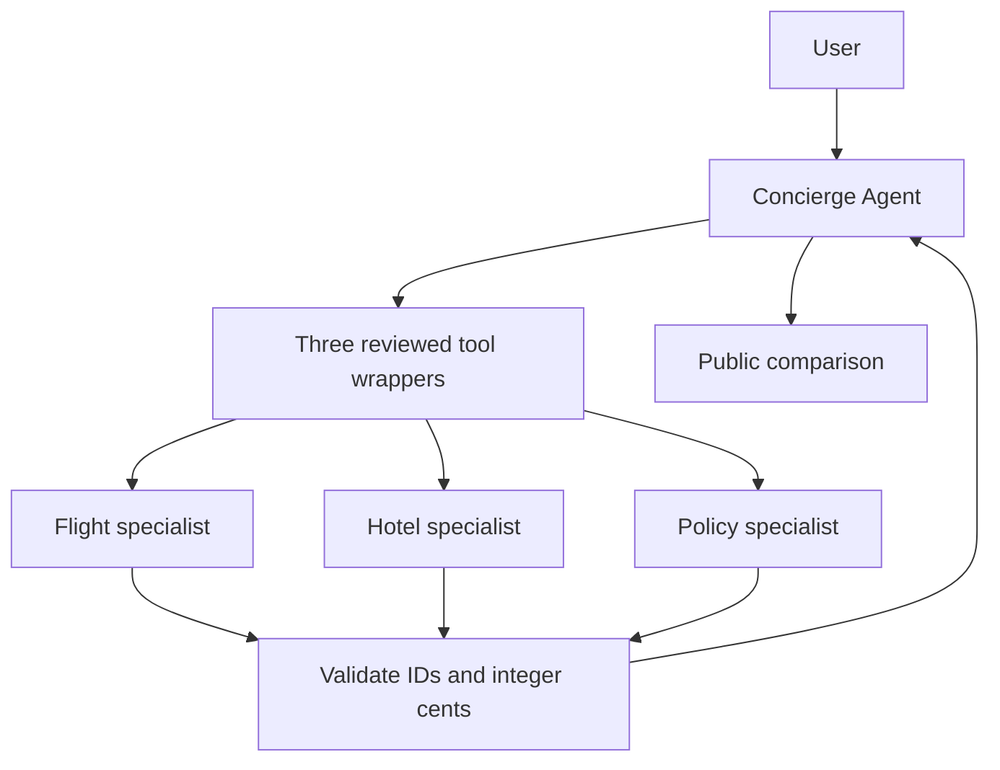

# Module 15: Agents as tools
> After this module you can delegate bounded tasks to specialists and measure whether the extra agents help.

**Time:** ~150 min · **Level:** Advanced · **Cost:** mock $0 / free Ollama API / Bedrock usage-based (see below)
**AWS required:** No · **AWS resources created:** None
**Assistant version 10:** adds agents as tools to the Nimbus assistant.

## Prerequisites

Complete [Module 14: Model Context Protocol](../14_mcp/README.md).
Use Python 3.12 or 3.13, run from the repository root, and keep the synthetic data unchanged.
Tools, structured output, async functions and interrupts were introduced in earlier modules.
Read [configuration](../../.env.example) and [costs](../../docs/COSTS.md) before live calls.

## Learning objectives

- Wrap a specialist agent as a tool.
- Pass minimal public context across a delegation boundary.
- Validate structured output against an authoritative catalog.
- Compare single-agent and delegated token use, latency and answer checks.

## The big idea

A concierge can ask a flight desk, a hotel desk and a policy desk for help. Each desk needs a small work order, not the traveler's entire case file. In Strands, the concierge is an Agent and each desk is another Agent behind a Python tool. The concierge model asks for a tool call; the wrapper invokes the specialist, checks its answer, and returns a normal tool result. More desks can help when the work needs different expertise. They can also repeat work, disagree and cost more. For a simple price lookup, a deterministic catalog tool is usually enough. Delegation divides reasoning; it does not grant new authority.

## How it works



Under the hood, each local model Agent still runs the familiar tool-use loop: model output,
tool execution, tool result, then another model call. Coordination changes who receives the
work and when. Deterministic application steps need no model call. All local models are
constructed through [get_model](../../common/models.py), including the scripted test provider.

### Open the wrapper before running it

[common/specialists.py](../../common/specialists.py) holds the three `@tool` wrappers.
Each tool has no model-selected arguments: the host has already validated a `TripRequest`.
The flight, hotel and policy specialists get only a city and public catalog evidence. They
have no booking, payment, shell or private-customer tools. A per-role guard marks a call
before awaiting it, so simultaneous duplicate requests cannot start extra child models.
Each child has a 15-second deadline and three model turns. The parent starts with three
turns and can make one two-turn follow-up if it omitted a specialist. The same 30-second
deadline covers both invocations, and failed/already attempted children cannot be retried.
All three validated results remain required. No prompts can raise those limits.

The child returns a Pydantic `SpecialistAnswer`. A valid schema still permits a plausible
but invented price, so `validate_offer` compares role, reference and cents with the original
record. The explanatory summary remains model text: check its meaning before displaying
it as policy. The policy excerpt is public synthetic evidence, not permission to refund.

### Is delegation worth it?

Example 03 gives both designs the same catalog and prints latency, usage, estimated cost,
reference mentions and a refund-topic check. The single agent uses a catalog bundle tool;
the delegated version calls three models. The fixture totals are **240 versus 600 tokens**.
Both final answers are scripted, so these counts verify accounting and the surface checks
do not establish real quality. A missing reference is visible even if the final prose sounds
confident. With a live model, repeat the same requests and manually grade correct references,
policy coverage and usefulness. Keep delegation only if its improvement justifies its cost.
The wrapper sums child usage because a plain AgentResult does not automatically include
models invoked inside arbitrary tools. Graph/Swarm aggregates are different (Modules 16–17).

The synthetic Porto subtotal is $528 for two one-way seats and one room for two nights.
Room occupancy, return flights, meals and extras still need review. Do not call this a
complete trip price or a reservation.


## Key APIs at a glance

| API | What it does | When to use it |
|---|---|---|
| `@tool + async function` | Expose a bounded specialist call | Keep context and authority explicit |
| `Agent.invoke_async` | Run one child conversation | Concurrent independent specialists |
| `structured_output_model` | Parse a typed SpecialistAnswer | Require role, reference, cents and summary |
| `asyncio.timeout / invocation limits` | Bound waiting and model calls | Contain expensive delegation |
| `result.metrics.accumulated_usage` | Read one agent's usage | Sum parent and children once |

## Walkthrough

Start with `--mock`. It exercises the real SDK while replacing model responses with fixtures.
Mock outputs and token counts are not live model quality or pricing measurements. For Ollama,
set `MODEL_PROVIDER=ollama` in `.env`, choose the tool-capable model from Module 02, and remove
`--mock`. For Bedrock, complete SSO and the budget alert first. Settings cap each response at
512 output tokens by default. A short successful run is typically cents or less with a low-cost
model, but input histories, repeated calls and chosen rates determine the actual price.
The report prints an estimate only when dated rates are configured; see the usage caveats above.


### 01_specialist_tools.py

Flight, hotel and policy agents wrapped as tools. Read [the script](examples/01_specialist_tools.py) and its shared helper before running it.

```text
uv run python modules/15_agents_as_tools/examples/01_specialist_tools.py --mock
```

Expected excerpt (formatting and live outputs can differ):

```text
"pattern": "delegated"
Lesson complete.
```

### 02_context_boundaries.py

Minimum specialist context, output validation and authority boundaries. Read [the script](examples/02_context_boundaries.py) and its shared helper before running it.

```text
uv run python modules/15_agents_as_tools/examples/02_context_boundaries.py --mock
```

Expected excerpt (formatting and live outputs can differ):

```text
Context fields: ['city', 'evidence']
Lesson complete.
```

### 03_delegation_cost.py

Compare single-agent and delegated quality, latency and total token cost. Read [the script](examples/03_delegation_cost.py) and its shared helper before running it.

```text
uv run python modules/15_agents_as_tools/examples/03_delegation_cost.py --mock
```

Expected excerpt (formatting and live outputs can differ):

```text
"totalTokens": 240 ... "totalTokens": 600
Lesson complete.
```

## Real-world use case

The concierge compares synthetic flight, hotel and refund evidence. A real travel business could use bounded specialists for distinct reasoning tasks, while keeping inventory and purchase authority in validated services.

```text
uv run python modules/15_agents_as_tools/use_case/nimbus_concierge.py --mock
```

The [mini-app](use_case/nimbus_concierge.py) prints the checked evidence or route outcome,
scoped usage where available, and `Lesson complete.`. Reject is the default for any review.
The notebook mirrors every script and mini-app; its model calls replay offline by default.
Install `notebooks` plus this module's optional groups before opening `notebook.ipynb`.

## Common mistakes

Messages below appear in terminal output, captured tool results or the exception when calling
the helper directly. CLI provider errors use the friendly `scripts/check_env.py` guidance.

| Message or observed output | Fix |
|---|---|
| `Specialist already called for this request` | The host permits one attempt per role; start a new reviewed request instead of repeating calls. |
| `Concierge did not obtain all three validated specialist answers` | Inspect tool failures and configure a tool-capable model; do not accept partial evidence as success. |
| `Node model-call budget exhausted` | Simplify the task or investigate looping tool calls; changing a prompt cannot increase the host budget. |
| `ValidationError` | Check strict integer party/budget fields and exact catalog terms; never coerce a boolean into a price. |
| `TimeoutError` | The child or parent deadline elapsed. Local cancellation does not undo remote side effects. |

## Exercises

The starters run but intentionally fail selected acceptance cases until edited.


- **Practice:** [01_context.py](exercises/01_context.py) — Pass only city and nights to a hotel specialist; omit all private fields. Compare with [the solution](solutions/01_context.py) after attempting it.

- **Apply:** [02_validate.py](exercises/02_validate.py) — Accept a quote only when role, reference and integer cents match the catalog. Compare with [the solution](solutions/02_validate.py) after attempting it.

- **Stretch:** [03_usage.py](exercises/03_usage.py) — Sum parent and child per-call token usage exactly once. Compare with [the solution](solutions/03_usage.py) after attempting it.


```text
uv run pytest modules/15_agents_as_tools/tests --exercise-starters
uv run pytest modules/15_agents_as_tools/tests
```

## Quiz

Try the [six questions with hidden answers](quiz.md), then explain each answer in your own words.

## Key takeaways

- Choose the smallest pattern that solves the problem.
- Give every model, node and external call an explicit budget or deadline.
- Pass public task evidence instead of whole private conversations.
- Validate results and recorded authority below the model.
- Keep fixture measurements, live model quality and actual billing distinct.

## Local cleanup

No AWS resources are created. Scripts close their local clients, servers and temporary state.
Stop an interactive notebook kernel when finished. A canceled request is not an external-write
rollback. No script in this module books travel, sends email or charges a customer.

## Go deeper

- [Official Strands guide](https://strandsagents.com/docs/user-guide/sdk/multi-agent/agents-as-tools/)
- [Strands SDK source and releases](https://github.com/strands-agents/sdk-python/releases)
- [Amazon Bedrock pricing](https://aws.amazon.com/bedrock/pricing/)

## Next: Module 16


Continue to [Swarms](../16_swarms/README.md).
