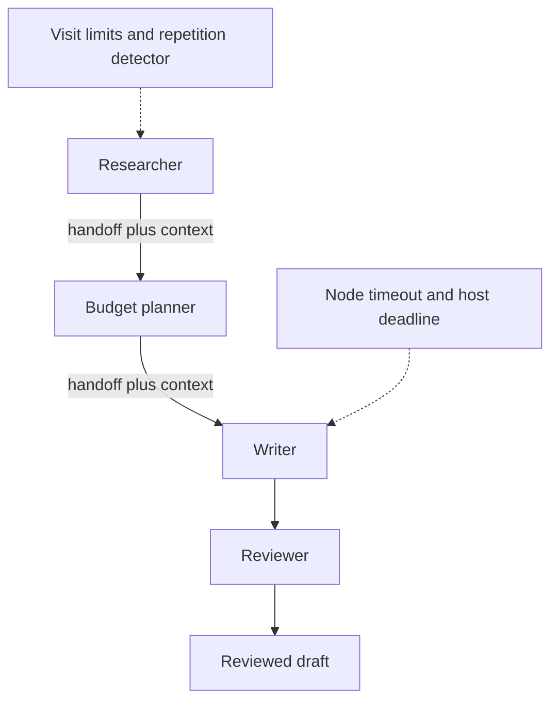

# Module 16: Swarms
> After this module you can run a bounded handoff team and diagnose its actual execution history.

**Time:** ~180 min · **Level:** Advanced · **Cost:** mock $0 / free Ollama API / Bedrock usage-based (see below)
**AWS required:** No · **AWS resources created:** None
**Assistant version 10:** adds swarms to the Nimbus assistant.

## Prerequisites

Complete [Module 15: Agents as tools](../15_agents_as_tools/README.md).
Use Python 3.12 or 3.13, run from the repository root, and keep the synthetic data unchanged.
Tools, structured output, async functions and interrupts were introduced in earlier modules.
Read [configuration](../../.env.example) and [costs](../../docs/COSTS.md) before live calls.

## Learning objectives

- Construct a Swarm with an explicit entry point.
- Pass public context through handoff_to_agent.
- Set visit, repetition and timeout limits.
- Inspect node results and execution order.
- Distinguish creative collaboration from authorization.

## The big idea

A swarm is a relay team of travel advisers. The researcher can pass a draft to a budget planner, who passes it to a writer and then a reviewer. The current adviser chooses whom to call next. The baton carries context, so each adviser can continue the work. A supervisor still limits the number of turns and the time spent. If two advisers keep passing the baton back and forth, repetition detection ends the run. A handoff is collaboration, not a purchase approval: the team can propose an itinerary while the application keeps spending rules outside the conversation.

## How it works



Under the hood, each local model Agent still runs the familiar tool-use loop: model output,
tool execution, tool result, then another model call. Coordination changes who receives the
work and when. Deterministic application steps need no model call. All local models are
constructed through [get_model](../../common/models.py), including the scripted test provider.

### Follow the baton

The [team factory](../../common/swarm_lessons.py) creates four independent agents. Strands
adds `handoff_to_agent` to their tools. The selected model emits a tool call naming the next
agent and a short context dictionary. The current agent finishes its turn, then the runtime
invokes the next node. The fixture therefore includes both the handoff tool call and its
following final text. Shared context contains only public destination, budget and draft notes.
Do not put credentials or private booking history into context accessible to the whole team.

The realistic team starts with catalog evidence and proposes a two-day Porto outline. The
researcher supplies ideas, the budget planner flags excluded costs, the writer arranges days,
and the reviewer lists unresolved assumptions. Mock text is deliberately written in advance;
live models choose their own handoffs. The final reviewer output is a draft, not proof of
factual accuracy. Inspect `status`, `node_history` and each `results` entry first.

### Limits you can observe

The default ceiling is six visits, 30 seconds of elapsed execution and ten seconds per node.
Every worker also gets at most three model calls. Example 02 sets each visit ceiling to two,
then demonstrates a four-visit repetition window requiring three distinct agents. The two-agent
loop fails at four visits. In Strands 1.62 both `max_handoffs` and `max_iterations` checks use
the node-history length; do not assume the setting means the number of edges traversed.

`execution_timeout` is checked **between nodes** in this SDK. It cannot interrupt a single
slow final node on its own. Example 02 uses a deterministic slow async tool to demonstrate
`node_timeout`, then wraps the entire call with `asyncio.timeout` for a hard host deadline.
The tool's `finally` block proves cooperative cleanup. These probes always use a local mock
model, including when the other examples use a live provider. A synchronous tool running
in a thread or a remote write may finish after cancellation; this is not rollback.

### Read the usage caveat

The ordinary four-agent fixture makes seven model calls: **840 synthetic tokens**. Swarm
already aggregates distinct child usage. On revisits, this pinned SDK can add a returning
agent's cumulative metrics again. Our two-agent loop makes eight fixture calls (960 tokens)
but the SDK reports 1440. The report retains that raw evidence, adds a warning and suppresses
the dollar estimate for repeated node IDs. Use independent per-call provider telemetry for
billing. `results` retains each named node's latest result; `node_history` preserves visits.


## Key APIs at a glance

| API | What it does | When to use it |
|---|---|---|
| `Swarm(nodes, entry_point=...)` | Coordinate Agent nodes | Model-selected collaboration |
| `handoff_to_agent` | Pass message and context to a named node | Continue a public draft |
| `max_handoffs / max_iterations` | Bound node visits in the pinned implementation | Stop open-ended work |
| `repetitive_handoff_detection_window` | Inspect recent visits | Detect a small repeating group |
| `node_timeout / execution_timeout` | Bound nodes and check elapsed execution | Combine with a host wall-clock deadline |
| `SwarmResult.node_history / results` | Inspect visited nodes and latest outcomes | Diagnose completion and failures |

## Walkthrough

Start with `--mock`. It exercises the real SDK while replacing model responses with fixtures.
Mock outputs and token counts are not live model quality or pricing measurements. For Ollama,
set `MODEL_PROVIDER=ollama` in `.env`, choose the tool-capable model from Module 02, and remove
`--mock`. For Bedrock, complete SSO and the budget alert first. Settings cap each response at
512 output tokens by default. A short successful run is typically cents or less with a low-cost
model, but input histories, repeated calls and chosen rates determine the actual price.
The report prints an estimate only when dated rates are configured; see the usage caveats above.


### 01_handoffs.py

Swarm, entry point, agent handoffs and shared context. Read [the script](examples/01_handoffs.py) and its shared helper before running it.

```text
uv run python modules/16_swarms/examples/01_handoffs.py --mock
```

Expected excerpt (formatting and live outputs can differ):

```text
"order": ["researcher", "budget_planner", "writer", "reviewer"]
Lesson complete.
```

### 02_swarm_limits.py

max_handoffs, max_iterations, execution_timeout, node_timeout and repetitive handoff detection. Read [the script](examples/02_swarm_limits.py) and its shared helper before running it.

```text
uv run python modules/16_swarms/examples/02_swarm_limits.py --mock
```

Expected excerpt (formatting and live outputs can differ):

```text
host deadline exceeded ... closed: True
Lesson complete.
```

### 03_swarm_results.py

Result status, node outcomes, execution order and failure diagnosis. Read [the script](examples/03_swarm_results.py) and its shared helper before running it.

```text
uv run python modules/16_swarms/examples/03_swarm_results.py --mock
```

Expected excerpt (formatting and live outputs can differ):

```text
"status": "completed" ... "status": "failed"
Lesson complete.
```

### 04_itinerary_team.py

Researcher, budget planner, itinerary writer and reviewer collaboration. Read [the script](examples/04_itinerary_team.py) and its shared helper before running it.

```text
uv run python modules/16_swarms/examples/04_itinerary_team.py --mock
```

Expected excerpt (formatting and live outputs can differ):

```text
This creative handoff exercise does not authorize spending.
Lesson complete.
```

## Real-world use case

Nimbus generates a creative two-day itinerary through four roles. The team shares public evidence; the application still requires separate validation before any inventory or payment action.

```text
uv run python modules/16_swarms/use_case/itinerary_swarm.py --mock
```

The [mini-app](use_case/itinerary_swarm.py) prints the checked evidence or route outcome,
scoped usage where available, and `Lesson complete.`. Reject is the default for any review.
The notebook mirrors every script and mini-app; its model calls replay offline by default.
Install `notebooks` plus this module's optional groups before opening `notebook.ipynb`.

## Common mistakes

Messages below appear in terminal output, captured tool results or the exception when calling
the helper directly. CLI provider errors use the friendly `scripts/check_env.py` guidance.

| Message or observed output | Fix |
|---|---|
| `"status": "failed"` | Read the visited nodes and limit settings; a deliberate bounded loop is expected to fail. |
| `Node 'slow' execution timed out after 0.05s` | This is the intentional slow-tool probe. Real work needs a realistic node deadline. |
| `host deadline exceeded` | The outer deadline cancelled the invocation; check actual side effects before retrying. |
| `Scripted model exhausted` | A handoff fixture needs the tool call and its following final response; provide enough responses for every permitted visit. |
| `Node model-call budget exhausted` | Inspect the current node's tool requests instead of increasing every swarm limit. |

## Exercises

The starters run but intentionally fail selected acceptance cases until edited.


- **Practice:** [01_order.py](exercises/01_order.py) — Extract visited node IDs in order, retaining repeated visits. Compare with [the solution](solutions/01_order.py) after attempting it.

- **Apply:** [02_repetition.py](exercises/02_repetition.py) — Flag a full recent window with fewer than the required unique agents. Compare with [the solution](solutions/02_repetition.py) after attempting it.

- **Stretch:** [03_deadline.py](exercises/03_deadline.py) — Return whether another node can start before both the visit limit and deadline. Compare with [the solution](solutions/03_deadline.py) after attempting it.


```text
uv run pytest modules/16_swarms/tests --exercise-starters
uv run pytest modules/16_swarms/tests
```

## Quiz

Try the [six questions with hidden answers](quiz.md), then explain each answer in your own words.

## Key takeaways

- Choose the smallest pattern that solves the problem.
- Give every model, node and external call an explicit budget or deadline.
- Pass public task evidence instead of whole private conversations.
- Validate results and recorded authority below the model.
- Keep fixture measurements, live model quality and actual billing distinct.

## Local cleanup

No AWS resources are created. Scripts close their local clients, servers and temporary state.
Stop an interactive notebook kernel when finished. A canceled request is not an external-write
rollback. No script in this module books travel, sends email or charges a customer.

## Go deeper

- [Official Strands guide](https://strandsagents.com/docs/user-guide/sdk/multi-agent/swarm/)
- [Strands SDK source and releases](https://github.com/strands-agents/sdk-python/releases)
- [Amazon Bedrock pricing](https://aws.amazon.com/bedrock/pricing/)

## Next: Module 17


Continue to [Graphs and workflows](../17_graphs/README.md).
