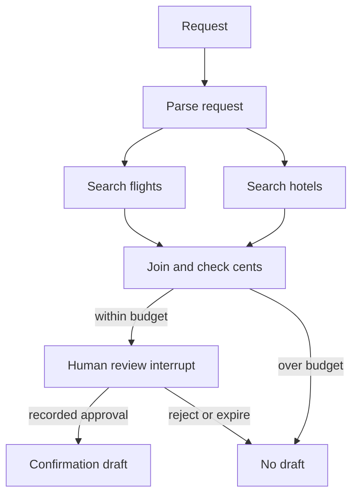

# Module 17: Graphs and workflows
> After this module you can build parallel, conditional trip workflows with bounded execution and human review.

**Time:** ~240 min · **Level:** Advanced · **Cost:** mock $0 / free Ollama API / Bedrock usage-based (see below)
**AWS required:** No · **AWS resources created:** None
**Assistant version 10:** adds graphs and workflows to the Nimbus assistant.

## Prerequisites

Complete [Module 16: Swarms](../16_swarms/README.md).
Use Python 3.12 or 3.13, run from the repository root, and keep the synthetic data unchanged.
Tools, structured output, async functions and interrupts were introduced in earlier modules.
Read [configuration](../../.env.example) and [costs](../../docs/COSTS.md) before live calls.

## Learning objectives

- Declare nodes, dependencies and entry points with GraphBuilder.
- Join parallel searches once both have completed.
- Branch on authoritative budget data and bound loops.
- Nest graphs or swarms with independent inner limits.
- Pause for a recorded decision before drafting confirmation.
- Compare Graph with the existing workflow tool.

## The big idea

A graph is a travel office checklist drawn as boxes and arrows. A box is work; an arrow says which work must finish first. Flight and hotel searches can happen at the same time, but the budget calculation waits for both. A conditional arrow chooses whether to ask for approval or stop. Some boxes use a model to understand language, and others use ordinary Python for exact arithmetic. Unlike a swarm, the application defines the allowed routes. This makes a graph useful when order, joins and review rules must be predictable.

## How it works



Under the hood, each local model Agent still runs the familiar tool-use loop: model output,
tool execution, tool result, then another model call. Coordination changes who receives the
work and when. Deterministic application steps need no model call. All local models are
constructed through [get_model](../../common/models.py), including the scripted test provider.

### Read the graph before the prompt

[common/trip_graph.py](../../common/trip_graph.py) validates a host `TripRequest`, parses the
same request with structured output, and checks that parsing did not change any field.
Parallel flight/hotel nodes read the synthetic catalogs. `FunctionNode`, a small
`MultiAgentBase` executor, lets the real SDK schedule deterministic Python alongside Agents.
It returns actual `MultiAgentResult`/`NodeResult` values. Most function nodes use zero model
tokens; the checkpoint propagates specialist usage explicitly through `StepOutput`.

Both search edges feed the budget node. The SDK waits for both dependencies, then runs the
join once. Example 02 inserts a short local delay and measures overlapping intervals; speed
alone would be weak proof of concurrency. The subtotal uses integer cents and never asks a
model to decide whether it fits. Graph conditions read trusted state. The over-budget branch
has no approval call or email draft.

### Loops and nested patterns

Example 03 also runs a self-loop with an impossible revision request and a maximum of three
executions. It fails at the ceiling instead of running indefinitely. Example 04 puts a real
graph and then a real swarm inside an outer graph node. Inner and outer limits are separate:
an outer two-node graph can execute many inner steps. Set limits at both levels, and inspect
the aggregate once. The SDK resets revisited Agent conversation state by default
(`reset_on_revisit=True`); do not rely on hidden node history as durable business state.

### Review is an application decision

The approval tool raises a real `ToolContext.interrupt`. The host displays an immutable quote,
fingerprint and five-minute expiry, records a CLI decision, then resumes the matching interrupt
IDs. The response text only says a decision was recorded. Even a forged response saying
APPROVE produces no draft unless the host recorded approval. Both the conditional edge and
draft node recheck it. Rejection and expiry route to `rejected`; an over-budget quote routes
to `over_budget`. The email is fixed prose so references and prices cannot drift.

```text
uv run python modules/17_graphs/use_case/group_trip_pipeline.py --mock --decision approve
uv run python modules/17_graphs/use_case/group_trip_pipeline.py --mock --decision ask
uv run python modules/17_graphs/use_case/group_trip_pipeline.py --mock --budget-cents 1
```

`approve` is an explicit single-user demo action. `ask` displays the terms at the terminal.
There is no authenticated supervisor service or durable review store. Restarting loses the
review; generate a new quote and obtain a new decision. Nothing is sent, booked or charged.
The five-minute quote-review lifetime is a local exercise rule, distinct from refund policy.

### The workflow tool still exists

In strands-agents-tools 0.8.10, `workflow` supports create, start, list, status and delete.
Pause/resume are explicitly unimplemented in its source. It owns persistent metadata and
background workers, with a different lifecycle and model configuration path from this course's
factory. Example 05 really creates, inspects and deletes metadata in a temporary directory;
it **does not start workflow workers** or claim to evaluate their execution. It then executes
a real Graph for comparison. A narrow cleanup adapter uses the pinned tool's private manager
cleanup to stop its observer; this is isolated compatibility code, not an SDK teaching API.
Run this lesson in a fresh process (or restart the notebook kernel before repeating it).
For the approval pipeline, Graph exposes the needed dependency and interrupt behavior
directly. Use ordinary Python alone when no model reasoning is needed.


## Key APIs at a glance

| API | What it does | When to use it |
|---|---|---|
| `GraphBuilder.add_node` | Register an Agent or MultiAgentBase executor | Mix language work with exact Python |
| `add_edge / set_entry_point` | Declare dependencies and starting nodes | Build the execution plan |
| `add_edge(..., condition)` | Evaluate application-owned route conditions | Budget and approval branches |
| `set_max_node_executions` | Bound repeated work | Stop cycles even when a condition never changes |
| `set_execution_timeout / set_node_timeout` | Set execution and node deadlines | Contain waiting alongside outer request deadlines |
| `GraphResult.results / execution_order` | Read outcomes and visits | Check joins and failures |
| `workflow(action=...)` | Create and inspect persistent workflow metadata | Compare a separate background-worker architecture |

## Walkthrough

Start with `--mock`. It exercises the real SDK while replacing model responses with fixtures.
Mock outputs and token counts are not live model quality or pricing measurements. For Ollama,
set `MODEL_PROVIDER=ollama` in `.env`, choose the tool-capable model from Module 02, and remove
`--mock`. For Bedrock, complete SSO and the budget alert first. Settings cap each response at
512 output tokens by default. A short successful run is typically cents or less with a low-cost
model, but input histories, repeated calls and chosen rates determine the actual price.
The report prints an estimate only when dated rates are configured; see the usage caveats above.


### 01_graph_basics.py

GraphBuilder nodes, edges, entry point and per-node results. Read [the script](examples/01_graph_basics.py) and its shared helper before running it.

```text
uv run python modules/17_graphs/examples/01_graph_basics.py --mock
```

Expected excerpt (formatting and live outputs can differ):

```text
"order": ["research", "writer"]
Lesson complete.
```

### 02_parallel_search.py

Parallel flight/hotel branches and single fan-in after completion. Read [the script](examples/02_parallel_search.py) and its shared helper before running it.

```text
uv run python modules/17_graphs/examples/02_parallel_search.py --mock
```

Expected excerpt (formatting and live outputs can differ):

```text
Search intervals overlap: True
Lesson complete.
```

### 03_conditional_budget.py

Conditional edges and bounded loops using set_max_node_executions/timeouts. Read [the script](examples/03_conditional_budget.py) and its shared helper before running it.

```text
uv run python modules/17_graphs/examples/03_conditional_budget.py --mock
```

Expected excerpt (formatting and live outputs can differ):

```text
Revision attempts: 3
Lesson complete.
```

### 04_nested_patterns.py

Nested graph/swarm nodes and aggregate limits. Read [the script](examples/04_nested_patterns.py) and its shared helper before running it.

```text
uv run python modules/17_graphs/examples/04_nested_patterns.py --mock
```

Expected excerpt (formatting and live outputs can differ):

```text
Nested pattern: graph ... Nested pattern: swarm
Lesson complete.
```

### 05_workflow_comparison.py

Existing workflow tool versus Graph and deterministic orchestration. Read [the script](examples/05_workflow_comparison.py) and its shared helper before running it.

```text
uv run python modules/17_graphs/examples/05_workflow_comparison.py --mock
```

Expected excerpt (formatting and live outputs can differ):

```text
"created": "success" ... "deleted": "success"
Lesson complete.
```

### 06_approval_pipeline.py

Parse, parallel search, budget branch, approval, and confirmation draft. Read [the script](examples/06_approval_pipeline.py) and its shared helper before running it.

```text
uv run python modules/17_graphs/examples/06_approval_pipeline.py --mock
```

Expected excerpt (formatting and live outputs can differ):

```text
Draft: None: review not approved or over budget
Lesson complete.
```

## Real-world use case

Nimbus processes a group trip through parsing, concurrent catalog searches, a budget branch, review and a confirmation draft. Exact arithmetic and authority stay in host code; language interpretation uses an Agent.

```text
uv run python modules/17_graphs/use_case/group_trip_pipeline.py --mock
```

The [mini-app](use_case/group_trip_pipeline.py) prints the checked evidence or route outcome,
scoped usage where available, and `Lesson complete.`. Reject is the default for any review.
The notebook mirrors every script and mini-app; its model calls replay offline by default.
Install `notebooks` plus this module's optional groups before opening `notebook.ipynb`.

## Common mistakes

Messages below appear in terminal output, captured tool results or the exception when calling
the helper directly. CLI provider errors use the friendly `scripts/check_env.py` guidance.

| Message or observed output | Fix |
|---|---|
| `Parsed request differs from the host-reviewed request` | The parser changed validated terms; reject and clarify the request instead of silently changing the budget. |
| `Decision must match the displayed quote` | Record approve or reject against the displayed fingerprint. |
| `This review already has a decision` | Treat a repeated decision as a replay; start a new review for changed terms. |
| `A current recorded approval is required to draft confirmation` | Check the host decision and expiry; chat text is insufficient. |
| `Run this lesson in a fresh process to isolate workflow state` | Restart the kernel or use the documented standalone command. |

## Exercises

The starters run but intentionally fail selected acceptance cases until edited.


- **Practice:** [01_join.py](exercises/01_join.py) — Allow the budget node only when flight and hotel are both completed. Compare with [the solution](solutions/01_join.py) after attempting it.

- **Apply:** [02_route.py](exercises/02_route.py) — Route to review only when the authoritative subtotal fits the budget. Compare with [the solution](solutions/02_route.py) after attempting it.

- **Stretch:** [03_approval.py](exercises/03_approval.py) — Require recorded approval, a matching fingerprint, and an unexpired review. Compare with [the solution](solutions/03_approval.py) after attempting it.


```text
uv run pytest modules/17_graphs/tests --exercise-starters
uv run pytest modules/17_graphs/tests
```

## Quiz

Try the [six questions with hidden answers](quiz.md), then explain each answer in your own words.

## Key takeaways

- Choose the smallest pattern that solves the problem.
- Give every model, node and external call an explicit budget or deadline.
- Pass public task evidence instead of whole private conversations.
- Validate results and recorded authority below the model.
- Keep fixture measurements, live model quality and actual billing distinct.

## Local cleanup

No AWS resources are created. Scripts close their local clients, servers and temporary state.
Stop an interactive notebook kernel when finished. A canceled request is not an external-write
rollback. No script in this module books travel, sends email or charges a customer.

## Go deeper

- [Official Strands guide](https://strandsagents.com/docs/user-guide/sdk/multi-agent/graph/)
- [Strands SDK source and releases](https://github.com/strands-agents/sdk-python/releases)
- [Amazon Bedrock pricing](https://aws.amazon.com/bedrock/pricing/)

## Next: Module 18


Continue to [Agent-to-Agent protocol](../18_a2a/README.md).
