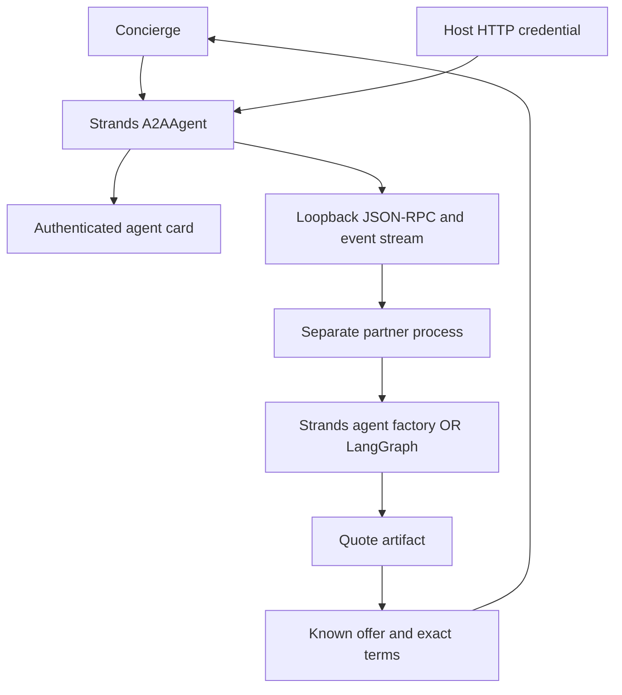

# Module 18: Agent-to-Agent protocol
> After this module you can call an authenticated partner agent in another process using a verified A2A contract.

**Time:** ~150 min · **Level:** Advanced · **Cost:** mock $0 / free Ollama API / Bedrock usage-based (see below)
**AWS required:** No · **AWS resources created:** None
**Assistant version 10:** adds agent-to-agent protocol to the Nimbus assistant.

## Prerequisites

Complete [Module 17: Graphs and workflows](../17_graphs/README.md).
Use Python 3.12 or 3.13, run from the repository root, and keep the synthetic data unchanged.
Tools, structured output, async functions and interrupts were introduced in earlier modules.
Read [configuration](../../.env.example) and [costs](../../docs/COSTS.md) before live calls.

## Learning objectives

- Explain cards, tasks, artifacts and streaming in A2A.
- Expose Strands agents through an agent_factory.
- Call a remote agent using A2AAgent and ClientConfig.
- Protect discovery and invocation with HTTP authentication.
- Validate a remote quote independently of its framework.
- Demonstrate a real LangGraph partner using the same client.

## The big idea

A2A is a shared service-counter language for separate agent systems. Nimbus asks an airline partner for an upgrade; it does not need to know how that partner reasons internally. An agent card is the counter's sign: its address, advertised skills, protocol version and authentication requirements. A task tracks requested work, and an artifact carries a produced result. Streaming delivers updates while that work runs. The card describes a service; it does not prove the operator is trustworthy. Nimbus must approve the destination, authenticate, enforce a deadline and validate the returned quote.

## How it works



Under the hood, each local model Agent still runs the familiar tool-use loop: model output,
tool execution, tool result, then another model call. Coordination changes who receives the
work and when. Deterministic application steps need no model call. All local models are
constructed through [get_model](../../common/models.py), including the scripted test provider.

### Install and follow the process boundary

```text
uv sync --frozen --group multiagent --group partner
```

Keep both groups on each `uv run` command below. `multiagent` supplies the Strands A2A extra;
`partner` supplies LangGraph. Swarm and Graph themselves are in the core Strands package.
The [server](../../common/partner_server.py) creates a real A2A HTTP application. A parent
context manager starts it as a separate Python process on an ephemeral loopback port, waits
for authenticated card discovery, and shuts it down in `finally`. No public listener, cloud
resource or external partner is used by the mock examples. The Strands server constructs a
fresh Agent through `agent_factory(context_id)` and caps contexts at 16. The old shared
`agent=` constructor is deprecated and is intentionally absent.

### Pin the wire contract, not just the package

The compatible a2a-sdk 0.3.26 and Strands 1.62 integration advertise **protocol 0.3.0**.
This lesson teaches that verified combination, not every feature in newer A2A specifications.
`enable_a2a_compliant_streaming=True` selects artifact/task updates. Strands remote streams
yield `a2a_stream` events with protocol payloads, followed by a final `result`; these are not
ordinary local-model `data` text deltas. Example 02 prints event class names and validates the
final JSON artifact as `UpgradeOffer`. A remote agent can fail or return invalid content:
completion status alone does not establish a valid price.

The server buffers model prose and publishes a quote artifact only after an actual
successful `seat_upgrade` call and normal agent completion. The application serializes
that validated tool result, so the model cannot change an identifier or price while
copying it. Task events still stream, but partial quote JSON is not published. The
client preserves text fragments exactly and checks the A2A task state before validating
the final artifact; Strands' `end_turn` alone can also represent a failed remote task.

### Authentication is enforced, not merely advertised

The card advertises a bearer scheme, and the server's HTTP boundary checks the token for
card discovery, RPC and shutdown. Example 03 shows **401** without it. A generated process
token goes in an HTTP Authorization header configured on the client; it is never a tool
argument, prompt or public quote field. The client disables environment proxies and redirects,
compares the advertised endpoint origin with the host-approved origin, and enforces HTTP and
outer call deadlines. This is one local demonstration principal, not per-user authorization.
Use HTTPS, authenticated reviewer identity, scoped service credentials, key rotation and
retention controls before exposing a partner service. Keep this demo bound to loopback.

The offered contract is deliberately narrow: UP-001, FLT-0001, USD 7500 cents and quote-only.
Unexpected fields, prices or purchase semantics are rejected. The local bearer does not
authorize a charge. Each concierge request permits one partner quote call. Token usage from
the partner's model is **unavailable** in this A2A response, so the use case prints only local
concierge metrics and explicitly leaves remote cost unknown. Do not substitute zero.

### Another framework means a real adapter

Example 04 runs an actual LangGraph `StateGraph` in the child process. Its one deterministic
quote node is wrapped in the A2A SDK's `AgentExecutor`, `DefaultRequestHandler` and in-memory
task store. It emits working status, a text artifact and completion. The same Strands client
validates the same quote. This proves local wire interoperability without adding another
billable model. It is not a full partner network or durable task service. The tiny adapter's
cancel endpoint reports cancellation; it does not implement durable recovery or guarantee
that concurrent work stops. Production cancellation requires task ownership and reconciliation.

For live Strands partner calls, configure Bedrock or Ollama in `.env` and remove `--mock`.
The child forwards the reviewed AWS profile/region or Ollama host, not arbitrary parent
credentials. Other provider keys must be available through the child's own configuration;
there is no blanket environment forwarding. Live model behavior and internet deployment
have not been validated by the offline suite.


## Key APIs at a glance

| API | What it does | When to use it |
|---|---|---|
| `A2AServer(agent_factory=...)` | Create a fresh agent for each context | Isolate remote conversation history |
| `public_agent_card` | Advertise capabilities and endpoint | Discover the service contract |
| `A2AAgent(endpoint=...)` | Represent a remote agent | Invoke through protocol rather than Python import |
| `ClientConfig(httpx_client=...)` | Supply authenticated HTTP transport | Keep secrets outside prompts |
| `invoke_async / stream_async` | Return a result or protocol events | Receive remote artifacts and completion |
| `StateGraph + AgentExecutor` | Adapt a different framework to A2A | Test an actual interoperability boundary |

## Walkthrough

Start with `--mock`. It exercises the real SDK while replacing model responses with fixtures.
Mock outputs and token counts are not live model quality or pricing measurements. For Ollama,
set `MODEL_PROVIDER=ollama` in `.env`, choose the tool-capable model from Module 02, and remove
`--mock`. For Bedrock, complete SSO and the budget alert first. Settings cap each response at
512 output tokens by default. A short successful run is typically cents or less with a low-cost
model, but input histories, repeated calls and chosen rates determine the actual price.
The report prints an estimate only when dated rates are configured; see the usage caveats above.


### 01_partner_server.py

A2A protocol, Strands A2AServer and agent cards. Read [the script](examples/01_partner_server.py) and its shared helper before running it.

```text
uv run --group multiagent --group partner python modules/18_a2a/examples/01_partner_server.py --mock
```

Expected excerpt (formatting and live outputs can differ):

```text
"protocolVersion": "0.3.0"
Lesson complete.
```

### 02_remote_agent.py

A2AAgent endpoint, invoke_async and streamed remote results. Read [the script](examples/02_remote_agent.py) and its shared helper before running it.

```text
uv run --group multiagent --group partner python modules/18_a2a/examples/02_remote_agent.py --mock
```

Expected excerpt (formatting and live outputs can differ):

```text
"events": [... "TaskArtifactUpdateEvent" ...]
Lesson complete.
```

### 03_authenticated_client.py

client_config authenticated transport, card discovery and credential boundaries. Read [the script](examples/03_authenticated_client.py) and its shared helper before running it.

```text
uv run --group multiagent --group partner python modules/18_a2a/examples/03_authenticated_client.py --mock
```

Expected excerpt (formatting and live outputs can differ):

```text
Anonymous card: 401 ... Anonymous RPC: 401
Lesson complete.
```

### 04_framework_interop.py

Protocol contracts for a partner in another framework; full LangGraph implementation in capstone. Read [the script](examples/04_framework_interop.py) and its shared helper before running it.

```text
uv run --group multiagent --group partner python modules/18_a2a/examples/04_framework_interop.py --mock
```

Expected excerpt (formatting and live outputs can differ):

```text
"card_name": "LangGraph Partner Airline"
Lesson complete.
```

## Real-world use case

The Nimbus concierge calls a separately running airline agent for a $75 seat upgrade. Host code validates the known offer before the concierge describes it. The service offers a quote only; neither process can charge the traveler.

```text
uv run --group multiagent --group partner python modules/18_a2a/use_case/partner_upgrade.py --mock
```

The [mini-app](use_case/partner_upgrade.py) prints the checked evidence or route outcome,
scoped usage where available, and `Lesson complete.`. Reject is the default for any review.
The notebook mirrors every script and mini-app; its model calls replay offline by default.
Install `notebooks` plus this module's optional groups before opening `notebook.ipynb`.

## Common mistakes

Messages below appear in terminal output, captured tool results or the exception when calling
the helper directly. CLI provider errors use the friendly `scripts/check_env.py` guidance.

| Message or observed output | Fix |
|---|---|
| `No module named a2a` | Install multiagent and retain the group on uv run. |
| `No module named langgraph` | Install partner for the framework interoperability example. |
| `Anonymous card: 401` | Expected without the generated bearer; use the configured client, never paste credentials into the prompt. |
| `Partner failed to start; install --group multiagent --group partner` | Check the installed groups and local process permissions. |
| `The partner card advertises an unapproved destination` | Reject the card; review the service origin before sending credentials. |
| `Partner did not complete a quote` | Inspect status and service availability; do not turn a partial response into a purchase. |

## Exercises

The starters run but intentionally fail selected acceptance cases until edited.


- **Practice:** [01_card.py](exercises/01_card.py) — Accept only a streaming card whose exact URL is in the host allow-list. Compare with [the solution](solutions/01_card.py) after attempting it.

- **Apply:** [02_public_offer.py](exercises/02_public_offer.py) — Expose only the reviewed public quote fields; omit credentials and debug data. Compare with [the solution](solutions/02_public_offer.py) after attempting it.

- **Stretch:** [03_usage_unknown.py](exercises/03_usage_unknown.py) — Return unknown if any agent omits its usage; otherwise sum reported totals. Compare with [the solution](solutions/03_usage_unknown.py) after attempting it.


```text
uv run pytest modules/18_a2a/tests --exercise-starters
uv run pytest modules/18_a2a/tests
```

## Quiz

Try the [six questions with hidden answers](quiz.md), then explain each answer in your own words.

## Key takeaways

- Choose the smallest pattern that solves the problem.
- Give every model, node and external call an explicit budget or deadline.
- Pass public task evidence instead of whole private conversations.
- Validate results and recorded authority below the model.
- Keep fixture measurements, live model quality and actual billing distinct.

## Local cleanup

No AWS resources are created. Scripts close their local clients, servers and temporary state.
Stop an interactive notebook kernel when finished. A canceled request is not an external-write
rollback. No script in this module books travel, sends email or charges a customer.

## Go deeper

- [Official Strands guide](https://strandsagents.com/docs/user-guide/sdk/multi-agent/agent-to-agent/)
- [Strands SDK source and releases](https://github.com/strands-agents/sdk-python/releases)
- [Amazon Bedrock pricing](https://aws.amazon.com/bedrock/pricing/)

## Next: Module 19


Complete the [Trip Planning Crew checkpoint](../../checkpoints/04_trip_planning_crew/README.md). Continue to [Module 19: Observability and evaluation](../19_observability/README.md).
