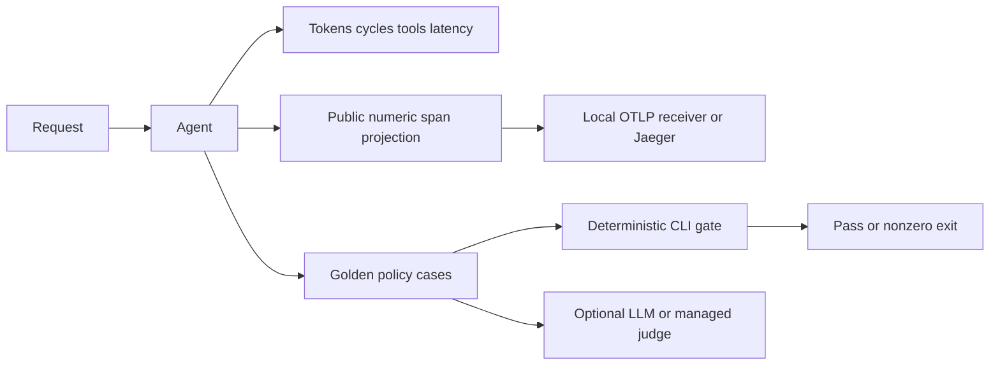

# Module 19: Observability, testing and evaluation
> After this module you can build a repeatable support-quality gate and diagnose requests without leaking their contents.

**Time:** ~240 min · **Level:** Advanced · **Cost:** Mock/local $0; live agent and judge tokens plus optional CloudWatch usage
**AWS required:** Optional (local alternative: mocks, local protocols and fixture services).
**AWS resources created:** None by default. Optional log group, metric alarm and managed telemetry policy; managed evaluation is an invocation. See the production resource inventory. Teardown commands: [production guide](../../infra/PRODUCTION.md).
**Assistant version 10:** measured and deployable support.

## Prerequisites

Complete [Module 18](../18_a2a/README.md),
[safe AWS setup](../../docs/AWS_SETUP.md) and the [Tier 4 checkpoint](../../checkpoints/04_trip_planning_crew/README.md).
The free path requires no account, keys, Docker engine or local model. Install the relevant optional packages:

```text
uv sync --group aws --group apps --group evals --group observability --group identity
```

Use `uv sync --all-groups` for all notebooks and optional lessons. The default `uv sync`
does not install every production dependency. Read [costs](../../docs/PRODUCTION_COSTS.md)
before enabling live services. All commands below run from the repository root.

## Learning objectives

- Read token, cycle, latency and tool-success metrics.
- Export redacted spans to a local OTLP receiver.
- Separate unit tests, deterministic evaluations and model judgments.
- Make a quality regression fail CI.
- Explain CloudWatch retention and managed evaluation costs.

## The big idea

A flight recorder tells you what happened; an examiner decides whether it was good. Metrics are the counters on the recorder: tokens, seconds and tool calls. Traces connect the steps in one request. Evaluations ask whether the answer contains the right policy evidence and whether the right tools ran. A green HTTP response says the server answered, not that the answer was correct. Nimbus therefore keeps three checks separate: unit tests for business rules, deterministic checks against known synthetic policies, and optional model judges for judgments that cannot be reduced to exact rules.

## How it works



Under the hood, the model emits a toolUse block, Strands executes the reviewed tool and returns a toolResult. The host enforces deadlines and authority. The final AgentResult supplies measured usage; the surrounding services own deployment, transport and retention.

### What each result proves

The shared support agent retrieves committed Markdown policies and cites their paths. Its
mock answer copies retrieved evidence; it does not read the golden answers. Twelve cases
check required phrases, source references and abstention on visa advice. A second evaluator
requires `search_policies` in the actual message trajectory. That makes 24 evaluator results.
The normal fixture scores 1.0; an injected false refund answer scores 0.5 because tool use
still passes while every answer check fails. Neither result measures a real model's quality.
Phrase checks can be fooled by contradictory prose, so review a held-out set manually.

`OutputEvaluator` and `TrajectoryEvaluator` use models from `common.models.get_model()`.
The mock structured rating only verifies judge plumbing. For a real judge, remove `--mock`,
use temperature zero, compare its ratings with human labels and budget for both agent and
judge tokens. Golden cases are test evidence, never instructions given to the agent.

### Console, OTLP and Jaeger

A **span** is one timed operation. **OpenTelemetry** is the instrumentation standard;
**OTLP** is its transport format. Example 02 starts a fresh process because tracing providers
are process globals. It sends real protobuf spans to a loopback HTTP receiver and verifies
that a private marker was excluded. The exporter keeps numeric usage fields and IDs, drops
events, arbitrary attributes, names and status prose, and fails if export fails. It deliberately
gives up rich content diagnostics to avoid storing private prompts or tool responses.

For the optional Docker viewer, start the engine first:

```text
docker compose -f deploy/jaeger-compose.yml up -d
uv run --group observability python modules/19_observability/examples/02_local_tracing.py --mock --otlp http://127.0.0.1:4318/v1/traces
docker compose -f deploy/jaeger-compose.yml down
```

Open `http://localhost:16686` and search for service `nimbus-support`. Ports bind only to
loopback. The viewer is in memory; stopping it discards traces. The authoring environment
tested OTLP transport but had no running Docker engine, so the Jaeger container was not run.

### A real command-line quality gate

The installed CLI is `python -X utf8 -m strands_evals.cli`. UTF-8 avoids Windows console
errors in help text. The course wrapper writes an Experiment file, invokes the real CLI
with `--task common.support_evaluation:cli_task`, the custom evidence evaluator and
`--fail-on any`, then preserves its exit code. `threshold:0.9` is also tested. Its child
process blocks external networking in mock mode. Inspect `.nimbus/evaluations/` for reports.

```text
uv run --group evals python -m common.evaluation_cli
uv run --group evals python -m common.evaluation_cli --regression
```

The second command deliberately exits **1**. CI runs the positive gate; a regression test
expects the negative gate to fail. Do not turn a failed child process into a green build.
Live models require the wrapper's explicit `--live`; they are never used by normal CI.

### Testing and managed telemetry

Example 03 tests a tool directly and performs an S3 round trip inside `moto.mock_aws()`.
`common.testing.ScriptedModel` implements the pinned SDK model interface, including tool
messages. Botocore Stubber checks AWS request/response shapes. `pytest.mark.live` tests
are skipped unless `--live` is supplied; Strands deprecations are errors in pytest configuration.
Service contracts cannot establish IAM access, regional availability or service behavior.

Example 06 sends only Tokens and Latency to `Nimbus/Course`. Its CDK app adds a seven-day
log group, a scoped telemetry policy and a p95 latency alarm without notification actions.
AgentCore's CloudWatch observability additionally needs trace delivery and Transaction Search;
see [the production guide](../../infra/PRODUCTION.md). The metadata-only export here cannot
feed a semantic helpfulness judge. Export and review a synthetic content-bearing session
separately before using `--live-aws --spans path/to/reviewed-session.json` in example 07.
Managed responses may contain partial failures; the helper fails closed instead of silently
averaging only successful rows. Traces belong to one session and are bounded to 256 KB.

Red teaming is optional. The pinned Evals package exposes a stable red-team API, so this
course does not import its removed experimental alias. The dedicated attack corpus lesson
is scheduled for bonus B4 in Phase 8. A phrase-based quality gate is not a security red team.


## Key APIs at a glance

| API | What it does | When to use it |
|---|---|---|
| `AgentResult.metrics` | Counters for this invocation | Measure cost and tool failures |
| `StrandsTelemetry / TracerProvider` | Emit connected spans | Diagnose request timing |
| `OTLPSpanExporter` | Send spans over HTTP | Use a local viewer |
| `Case / Experiment` | Run tasks against a dataset | Repeatable quality evaluation |
| `OutputEvaluator / TrajectoryEvaluator` | Use a model to score output/tool paths | Calibrated semantic judgments |
| `bedrock-agentcore.evaluate` | Score selected session spans | Managed AWS judge |

## Walkthrough

Run each script with `--mock` first. AWS-specific scripts require `--live-aws` to call existing resources; they do not deploy resources. Mock outputs are interface checks, not managed-service outcomes.

### 01_agent_metrics.py

AgentResult token/cycle/latency/tool metrics and total cost accounting. Open [the script](examples/01_agent_metrics.py) and follow its shared helper.

```text
uv run --all-groups python modules/19_observability/examples/01_agent_metrics.py --mock
```

Expected excerpt (spacing and generated IDs vary):

```text
totalTokens ... 240
Lesson complete.
```

### 02_local_tracing.py

OpenTelemetry console and OTLP exporter; local Jaeger with Docker. Open [the script](examples/02_local_tracing.py) and follow its shared helper.

```text
uv run --all-groups python modules/19_observability/examples/02_local_tracing.py --mock
```

Expected excerpt (spacing and generated IDs vary):

```text
otlp_batches_received
Lesson complete.
```

### 03_offline_testing.py

Scripted Model interface, tool unit tests, moto/Stubber, deprecations and opt-in live markers. Open [the script](examples/03_offline_testing.py) and follow its shared helper.

```text
uv run --all-groups python modules/19_observability/examples/03_offline_testing.py --mock
```

Expected excerpt (spacing and generated IDs vary):

```text
moto_s3_round_trip ... passed
Lesson complete.
```

### 04_strands_evals.py

Cases, experiments, output and trajectory evaluators, LLM judges and deterministic scoring. Open [the script](examples/04_strands_evals.py) and follow its shared helper.

```text
uv run --all-groups python modules/19_observability/examples/04_strands_evals.py --mock
```

Expected excerpt (spacing and generated IDs vary):

```text
Deterministic overall score: 1.0
Lesson complete.
```

### 05_evaluation_cli.py

strands-evals run thresholds and nonzero exits as a CI quality gate. Open [the script](examples/05_evaluation_cli.py) and follow its shared helper.

```text
uv run --all-groups python modules/19_observability/examples/05_evaluation_cli.py --mock
```

Expected excerpt (spacing and generated IDs vary):

```text
exit_code ... 1
Lesson complete.
```

### 06_cloud_observability.py

CloudWatch and AgentCore telemetry, redaction and retention. Open [the script](examples/06_cloud_observability.py) and follow its shared helper.

```text
uv run --all-groups python modules/19_observability/examples/06_cloud_observability.py --mock
```

Expected excerpt (spacing and generated IDs vary):

```text
metrics ... 2
Lesson complete.
```

### 07_managed_evaluation.py

AgentCore Evaluations as a managed option. Open [the script](examples/07_managed_evaluation.py) and follow its shared helper.

```text
uv run --all-groups python modules/19_observability/examples/07_managed_evaluation.py --mock
```

Expected excerpt (spacing and generated IDs vary):

```text
scores ... 1.0
Lesson complete.
```

## Real-world use case

Nimbus blocks a support release when its policy checks regress. The suite records the actual tools called and makes the real CLI return failure. A production team would add held-out cases, calibrated human/model review and an explicit quality owner.

```text
uv run --all-groups python modules/19_observability/use_case/support_quality_gate.py --mock
```

The [mini-app](use_case/support_quality_gate.py) prints checked evidence and `Lesson complete.`.
The [notebook](notebook.ipynb) mirrors every example and use case, with outputs cleared.
It starts with `--mock`; do not interpret fixture scores or timings as live benchmarks.

## Common mistakes

Messages below can appear in captured tool results or direct helper exceptions. AWS/provider
setup failures are translated to guidance pointing at `scripts/check_env.py`.

| Error or observed result | Fix |
|---|---|
| `No spans captured; run the tracing lesson in a fresh process` | Use example 02 or restart the notebook kernel; do not install multiple global providers. |
| `Trace export failed; check the local collector endpoint` | Start Jaeger and use port 4318 with /v1/traces, or omit --otlp for the local fixture. |
| `Managed evaluation returned incomplete results` | Inspect failed result codes using the AWS console; do not report missing ratings as success. |
| `Choose --mock for free contracts or --live-aws for existing AWS resources` | Choose explicitly after reviewing costs; the examples never provision AWS resources. |
| `Exit code 1 from the regression gate` | Expected for --regression. Investigate a baseline failure before release. |

## Exercises

Starters run but intentionally fail selected acceptance cases until edited.


- **Practice:** [01_redact.py](exercises/01_redact.py) — Project telemetry onto numeric usage only; booleans are not counters. Compare with [the solution](solutions/01_redact.py).

- **Apply:** [02_gate.py](exercises/02_gate.py) — Fail closed when any evaluation failed, is missing, or scored below 0.8. Compare with [the solution](solutions/02_gate.py).

- **Stretch:** [03_cost.py](exercises/03_cost.py) — Compute dollars from token counts and per-million prices without rounding each call. Compare with [the solution](solutions/03_cost.py).

```text
uv run pytest modules/19_observability/tests --exercise-starters
uv run pytest modules/19_observability/tests
uv run --all-groups pytest tests/test_production.py
```

## Quiz

Answer the [six questions](quiz.md) before opening their hidden answers.

## Key takeaways

- Measure behavior before interpreting a fluent answer as success.
- Bind identity and enforce tool authority below the model.
- Separate fixture contracts, real model quality and live AWS evidence.
- Price idle infrastructure, retained data and repeated evaluations.
- Stop sessions, disable schedules and verify resource deletion.

## Clean up

Mocks create no AWS resources. Local servers and managed demo sessions close in their
own lifecycles; stop interactive servers/notebook kernels when finished. For deployed
resources use the exact stack commands in [the production guide](../../infra/PRODUCTION.md),
then run `uv run python scripts/find_leftovers.py`. Deleting a stack does not remove shared
CDK bootstrap asset repositories or separately configured account telemetry.

## Go deeper

- [Official lesson reference](https://strandsagents.com/docs/user-guide/evals-sdk/)
- [Strands Python SDK releases](https://github.com/strands-agents/sdk-python/releases)
- [AgentCore developer guide](https://docs.aws.amazon.com/bedrock-agentcore/latest/devguide/what-is-bedrock-agentcore.html)
- [AgentCore pricing](https://aws.amazon.com/bedrock/agentcore/pricing/)

## Next: Module 20


Continue to [Deploying to AWS](../20_deployment/README.md).
