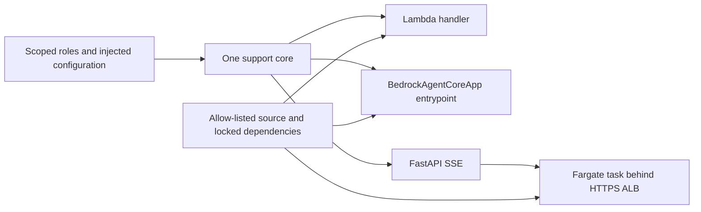

# Module 20: Deploying to AWS
> After this module you can package the same support implementation for Lambda, Fargate and AgentCore Runtime.

**Time:** ~300 min · **Level:** Advanced · **Cost:** Mock $0; Lambda/Runtime usage-based; Fargate about $0.05/hour before model, storage and traffic charges
**AWS required:** Optional (local alternative: mocks, local protocols and fixture services).
**AWS resources created:** None by default. Optional Lambda, Runtime container, Fargate service, ALB, VPC/subnets/security groups, logs, roles, SSM parameter and secret; CDK asset repositories are separate. Teardown commands: [production guide](../../infra/PRODUCTION.md).
**Assistant version 10:** measured and deployable support.

## Prerequisites

Complete [Module 19](../19_observability/README.md),
[safe AWS setup](../../docs/AWS_SETUP.md) and the [Tier 4 checkpoint](../../checkpoints/04_trip_planning_crew/README.md).
The free path requires no account, keys, Docker engine or local model. Install the relevant optional packages:

```text
uv sync --group aws --group apps --group evals --group observability --group identity
```

Use `uv sync --all-groups` for all notebooks and optional lessons. The default `uv sync`
does not install every production dependency. Read [costs](../../docs/PRODUCTION_COSTS.md)
before enabling live services. All commands below run from the repository root.

## Learning objectives

- Choose hosting from duration, streaming and isolation needs.
- Exercise the actual Runtime and FastAPI HTTP contracts locally.
- Package locked dependencies without credentials.
- Synthesize scoped roles and deployment resources.
- Compare live latency with explicit cost and cleanup accounting.

## The big idea

The support agent is a kitchen; hosting is the building around it. Lambda opens a small kitchen for each short order. Fargate keeps a kitchen staffed so it can serve a continuous stream of orders. Runtime supplies managed session isolation around the agent. The recipe should stay the same when the building changes, so all three adapters call one support implementation. Hosting changes operational responsibility, concurrency, authentication and idle cost. It does not make a model answer correct or give its tools permission to issue payments.

## How it works



Under the hood, the model emits a toolUse block, Strands executes the reviewed tool and returns a toolResult. The host enforces deadlines and authority. The final AgentResult supplies measured usage; the surrounding services own deployment, transport and retention.

### Choose from requirements

| Host | Good fit | Main tradeoff |
|---|---|---|
| Local | Learning, debugging, private experiments | Your machine supplies uptime and capacity |
| Lambda | Short independent requests | Cold starts and a 15-minute platform maximum; this app stops at 25 seconds |
| Fargate | Streaming APIs with explicit server control | Task, ALB and public-IP charges continue while idle |
| AgentCore Runtime | Managed isolated agent sessions | Session lifecycle, regional availability and service billing need review |
| EC2 | Custom operating system or hardware | You patch and operate instances |
| EKS | An existing Kubernetes platform with an operations team | Cluster and operational overhead rarely suit a first small agent |

The simple selector is a teaching rule, not a capacity planner. It picks Lambda for short
nonstreaming requests, Fargate for streaming or requests longer than 900 seconds, and Runtime
when managed session isolation is required. Lambda supports streaming in other integrations;
this particular direct-invoke lesson returns JSON. Measure your real workload before choosing.

### Follow one implementation through three adapters

`common.production_support` validates a prompt of 1–2000 characters, creates a fresh Agent,
retrieves public policy evidence and bounds the run to 25 seconds and three model calls.
No module imports a singleton Agent with shared conversation history. A Runtime session ID
isolates its hosting session; it does not automatically persist this stateless agent's messages.
The SDK entrypoint yields text/done records. FastAPI frames those records as server-sent events
(SSE: HTTP text records prefixed by `data:`). A streaming failure emits a generic error event.
Treat partial text as provisional until the done record arrives with an acceptable stop reason.

The actual Runtime SDK app and FastAPI app are exercised with HTTPX ASGI requests. This checks
their HTTP contracts in process; it does not measure network load balancing, cold starts or
AWS concurrency. Example 04 invokes the exact Lambda entrypoint locally. Example 03 validates
the AWS Runtime invocation shape with Stubber; live mode creates a fresh UUID session and
closes its response stream. The use case compares real deployed invocations only when explicitly
called with `--live-aws`; configure the resource IDs from stack outputs first.

### Packaging and local servers

```text
uv sync --group deploy
uv run python scripts/prepare_deployment.py
docker build --platform linux/amd64 -t nimbus-lambda .nimbus/deploy-context/lambda
docker build --platform linux/arm64 -t nimbus-runtime .nimbus/deploy-context/runtime
docker build --platform linux/amd64 -t nimbus-fargate .nimbus/deploy-context/fargate
```

The contexts include only reviewed common modules, public policies, a minimal nonsecret
configuration file and the hash-locked dependency export. `.env`, `.aws`, customer databases,
notebooks and the working tree are excluded. Runtime uses ARM64; Lambda/Fargate use AMD64 in
these templates. Docker base tags receive security patches and are not immutable digests:
record and approve the pulled digest in your own release process, rebuild and scan regularly.
The authoring environment could not build these images because its Docker engine was stopped.

For a local Runtime server, use `uv run --group deploy python -m common.deployment_apps runtime --mock`.
It listens on loopback, port 8080. Stop it with Ctrl+C. The local FastAPI server requires
`NIMBUS_API_TOKEN` in the process environment; the finite example handles that internally.
Never put this token into a prompt. Fargate injects a generated Secrets Manager value into
the container; the model's role cannot retrieve arbitrary secrets. Production should replace
the shared demo bearer with per-user identity, rotation and request-level authorization.

### AWS packaging and configuration

Use [the deployment commands and resource inventory](../../infra/PRODUCTION.md). Lambda has
two reserved concurrent executions, 1 GB memory and a 35-second hosting timeout. Runtime
uses a 60-second idle timeout and a 900-second lifetime. Fargate starts one 0.25-vCPU/0.5-GB
task behind an HTTPS ALB, restricts inbound traffic to your supplied CIDR, and accepts only
traffic from that ALB at the task. Public subnets avoid a NAT gateway but public IPv4 is billed.
The certificate must match a DNS name you control; point that name at the ALB before use.

Model ID and underlying foundation-model ID are deployment parameters. The default US
inference profile is permitted in its three US routing regions. For a different profile,
review its destination regions and update the explicit role resources; merely changing a
string in `.env` does not change deployed IAM. Containers use the role credential chain
(`AWS_PROFILE` is unset), while local calls may use the configured SSO profile.

SSM holds the service name; Secrets Manager holds the demo bearer. Example 06 loads them
through the caller's own scoped role and prints only a boolean for the secret. Lambda and
Runtime do not need that bearer. Separate environments need separate stacks and resource
names; the fixed AgentCore course names mean deploy one isolated course stack per account/region.


## Key APIs at a glance

| API | What it does | When to use it |
|---|---|---|
| `BedrockAgentCoreApp / @app.entrypoint` | Expose the support coroutine | Managed Runtime HTTP contract |
| `FastAPI / StreamingResponse` | Serve SSE frames | A long-running container API |
| `lambda_handler(event, context)` | Handle a direct Lambda invocation | Short bounded tasks |
| `invoke_agent_runtime` | Read a streaming response under a session ID | Call a deployed Runtime |
| `DockerImageFunction / CfnRuntime / CfnService` | Define hosting as code | Review and deploy reproducibly |
| `SSM / Secrets Manager` | Separate configuration from credentials | Per-environment runtime settings |

## Walkthrough

Run each script with `--mock` first. AWS-specific scripts require `--live-aws` to call existing resources; they do not deploy resources. Mock outputs are interface checks, not managed-service outcomes.

### 01_hosting_decision.py

Local/Lambda/Fargate/AgentCore tradeoffs; EKS and EC2 overview. Open [the script](examples/01_hosting_decision.py) and follow its shared helper.

```text
uv run --all-groups python modules/20_deployment/examples/01_hosting_decision.py --mock
```

Expected excerpt (spacing and generated IDs vary):

```text
-> Lambda
Lesson complete.
```

### 02_agentcore_local.py

BedrockAgentCoreApp, @app.entrypoint and local runtime testing. Open [the script](examples/02_agentcore_local.py) and follow its shared helper.

```text
uv run --all-groups python modules/20_deployment/examples/02_agentcore_local.py --mock
```

Expected excerpt (spacing and generated IDs vary):

```text
agentcore_http
Lesson complete.
```

### 03_agentcore_runtime.py

Toolkit/CLI deploy, invoke, streaming and sessions; resource inventory and teardown. Open [the script](examples/03_agentcore_runtime.py) and follow its shared helper.

```text
uv run --all-groups python modules/20_deployment/examples/03_agentcore_runtime.py --mock
```

Expected excerpt (spacing and generated IDs vary):

```text
session_id
Lesson complete.
```

### 04_lambda_handler.py

Lambda handler, dependency packaging, scoped execution role and CDK app. Open [the script](examples/04_lambda_handler.py) and follow its shared helper.

```text
uv run --all-groups python modules/20_deployment/examples/04_lambda_handler.py --mock
```

Expected excerpt (spacing and generated IDs vary):

```text
policies/refund.md
Lesson complete.
```

### 05_fargate_api.py

FastAPI container, Fargate service/load balancer, logs and explicit idle costs; CDK lifecycle. Open [the script](examples/05_fargate_api.py) and follow its shared helper.

```text
uv run --all-groups python modules/20_deployment/examples/05_fargate_api.py --mock
```

Expected excerpt (spacing and generated IDs vary):

```text
fargate_http
Lesson complete.
```

### 06_runtime_configuration.py

Secrets Manager/SSM, per-environment configuration, roles and cleanup comparison. Open [the script](examples/06_runtime_configuration.py) and follow its shared helper.

```text
uv run --all-groups python modules/20_deployment/examples/06_runtime_configuration.py --mock
```

Expected excerpt (spacing and generated IDs vary):

```text
credential_loaded ... True
Lesson complete.
```

## Real-world use case

Nimbus can compare the same policy agent through local adapters, then optionally invoke deployed Lambda and Runtime resources. Compare correctness first, then warm/cold latency distributions, model tokens, billed duration and idle resources; one fixture run cannot establish a winning platform.

```text
uv run --all-groups python modules/20_deployment/use_case/deployment_comparison.py --mock
```

The [mini-app](use_case/deployment_comparison.py) prints checked evidence and `Lesson complete.`.
The [notebook](notebook.ipynb) mirrors every example and use case, with outputs cleared.
It starts with `--mock`; do not interpret fixture scores or timings as live benchmarks.

## Common mistakes

Messages below can appear in captured tool results or direct helper exceptions. AWS/provider
setup failures are translated to guidance pointing at `scripts/check_env.py`.

| Error or observed result | Fix |
|---|---|
| `Authentication required` | Supply the configured bearer to FastAPI; /health is intentionally public. |
| `Request too large` | Send no more than 8 KB of JSON; the prompt itself must be 1–2000 characters. |
| `Supply only a prompt of 1 to 2000 characters` | Remove extra fields and validate the string before sending. |
| `Set NIMBUS_API_TOKEN through the environment or ECS secret injection` | Configure the host credential before starting the local FastAPI server. |
| `Cannot connect to the Docker daemon` | Start the Docker-compatible engine and select Linux containers before building. |

## Exercises

Starters run but intentionally fail selected acceptance cases until edited.


- **Practice:** [01_host.py](exercises/01_host.py) — Choose local, then managed sessions, then streaming/over-900s Fargate, otherwise Lambda. Compare with [the solution](solutions/01_host.py).

- **Apply:** [02_payload.py](exercises/02_payload.py) — Accept only one nonempty string prompt no longer than 2000 characters. Compare with [the solution](solutions/02_payload.py).

- **Stretch:** [03_idle.py](exercises/03_idle.py) — Sum hourly task, ALB and IPv4 rates, then multiply by hours. Compare with [the solution](solutions/03_idle.py).

```text
uv run pytest modules/20_deployment/tests --exercise-starters
uv run pytest modules/20_deployment/tests
uv run --all-groups pytest tests/test_production.py
```

## Quiz

Answer the [six questions](quiz.md) before opening their hidden answers.

## Key takeaways

- Measure behavior before interpreting a fluent answer as success.
- Bind identity and enforce tool authority below the model.
- Separate fixture contracts, real model quality and live AWS evidence.
- Price idle infrastructure, retained data and repeated evaluations.
- Stop sessions, disable schedules and verify resource deletion.

## Clean up

Mocks create no AWS resources. Local servers and managed demo sessions close in their
own lifecycles; stop interactive servers/notebook kernels when finished. For deployed
resources use the exact stack commands in [the production guide](../../infra/PRODUCTION.md),
then run `uv run python scripts/find_leftovers.py`. Deleting a stack does not remove shared
CDK bootstrap asset repositories or separately configured account telemetry.

## Go deeper

- [Official lesson reference](https://docs.aws.amazon.com/bedrock-agentcore/latest/devguide/using-any-agent-framework.html)
- [Strands Python SDK releases](https://github.com/strands-agents/sdk-python/releases)
- [AgentCore developer guide](https://docs.aws.amazon.com/bedrock-agentcore/latest/devguide/what-is-bedrock-agentcore.html)
- [AgentCore pricing](https://aws.amazon.com/bedrock/agentcore/pricing/)

## Next: Module 21


Continue to [Amazon Bedrock AgentCore services](../21_agentcore/README.md).
