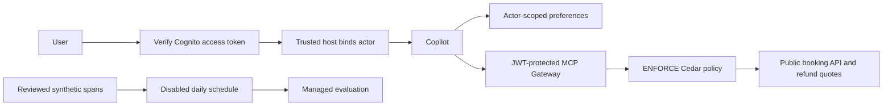

# Module 21: Amazon Bedrock AgentCore services
> After this module you can connect authenticated identity, Memory and Gateway while enforcing a refund limit outside the model.

**Time:** ~300 min · **Level:** Advanced · **Cost:** Mock $0; live Memory/Gateway/Policy/evaluation usage and brief managed tool sessions
**AWS required:** Optional (local alternative: mocks, local protocols and fixture services).
**AWS resources created:** None by default. Optional Memory, Cognito pool/client/domain, workload identity, Gateway/target, Policy engine/policies, Lambda functions, S3 export bucket, log groups, evaluation configuration and disabled scheduler. Teardown commands: [production guide](../../infra/PRODUCTION.md).
**Assistant version 11:** authenticated Copilot with managed service boundaries.

## Prerequisites

Complete [Module 20](../20_deployment/README.md),
[safe AWS setup](../../docs/AWS_SETUP.md) and the [Tier 4 checkpoint](../../checkpoints/04_trip_planning_crew/README.md).
The free path requires no account, keys, Docker engine or local model. Install the relevant optional packages:

```text
uv sync --group aws --group apps --group evals --group observability --group identity
```

Use `uv sync --all-groups` for all notebooks and optional lessons. The default `uv sync`
does not install every production dependency. Read [costs](../../docs/PRODUCTION_COSTS.md)
before enabling live services. All commands below run from the repository root.

## Learning objectives

- Write and delete a short-term event and recall actor-scoped preferences.
- Discover reviewed Gateway tools and inspect an OpenAPI target request.
- Verify JWT identity and keep outbound OAuth credentials away from the model.
- Close Code Interpreter and Browser sessions on failure.
- Enforce a Cedar refund ceiling and control managed evaluation schedules.

## The big idea

AgentCore services are departments around the assistant. Memory keeps the traveler's notes, Identity checks their badge, Gateway is the service desk, and Policy decides which request the desk may execute. Code Interpreter and Browser provide managed workspaces for specific tasks. Observability records activity; Evaluations assess results. These departments can be used independently. Their presence does not automatically make an application safe: the host must bind the right identity, select tools and datasets, enforce budgets and clean up resources.

## How it works



Under the hood, the model emits a toolUse block, Strands executes the reviewed tool and returns a toolResult. The host enforces deadlines and authority. The final AgentResult supplies measured usage; the surrounding services own deployment, transport and retention.

### Memory: events and extracted records

An event is a short conversation item. A strategy extracts longer-lived records from events.
The stack defines **semantic** facts, **user preferences**, **session summaries** and **episodic**
experiences. Extraction is asynchronous: an immediate recall can be empty or contain older
records. The helper creates a synthetic preference event, reads up to three records in the
trusted actor's namespace and deletes that event in `finally`. Deleting the event does not
delete already extracted records. Destroy the isolated Memory resource to remove the lab's
long-term records, or implement explicit record deletion for a real user-erasure workflow.

The standalone lesson binds synthetic `CUS-001`. The Copilot instead verifies a signed token
and binds its `sub` claim outside the tool schema. A model cannot choose another actor ID.
This host binding is necessary but not sufficient for a shared untrusted backend: use
per-tenant authorization and scoped service roles as well. No private booking data is exposed.

### Gateway: Lambda, OpenAPI and search

The deployed target wraps a dependency-free Lambda exposing `search_flights` and `refund_quote`.
Gateway prefixes names with `nimbus___`. Its semantic index supplies
`x_amz_bedrock_agentcore_search`. The local alternative uses the actual MCP 2.x `MCPServer`
over stdio and a clearly labeled keyword search; it does not simulate AWS semantic ranking.
The client accepts only an exact regional Gateway HTTPS host and a reviewed tool allow-list.

Example 02 also builds and validates a real `CreateGatewayTarget` request with an inline
OpenAPI 3.0.3 schema. Its `operationId` becomes a tool name. The fixture endpoint is never
called or registered. To adapt it to an existing API, supply a real IAM-protected API Gateway
URL, grant the Gateway role `execute-api:Invoke` on the specific route, and register the
returned request using the control-plane client. It is **not** an API server deployment.
OpenAPI targets may instead use an Identity OAuth/API-key provider. A public unauthenticated
API or an ALB that does not verify SigV4 is not equivalent to an IAM-protected API Gateway.
Delete any additional target you register before destroying its gateway.

### Identity: inbound and outbound are different

An access token is a signed statement about a caller; it is not merely JSON to decode.
The local test generates an ephemeral RSA key, signs a token and verifies signature, issuer,
expiry, required claims, `token_use=access`, `client_id` and the `nimbus/read` scope. The live
path loads signing keys only from the configured regional Cognito pool. ID tokens cannot
authorize this API. Access tokens and refresh tokens are secrets: supply them through the
process environment and keep them out of `.env`, source, prompts and terminal transcripts.

The CDK stack creates a Cognito pool, public authorization-code client, resource scope and
hosted domain. Follow the sign-in steps in the production guide; the client uses PKCE.
Outbound OAuth is separate: `GetWorkloadAccessTokenForJWT` identifies the workload and
`GetResourceOauth2Token` obtains a delegated resource token. The external OAuth application
and credential provider must already be configured for your actual partner; this course
does not invent a third-party service or embed its client secret. A first request may need
user consent. The lesson reports `consent_required` and does not pretend the connection is
complete. The public booking use case does not need an external OAuth credential.

### Code Interpreter and Browser

Both examples expose a zero-argument Strands tool selected by trusted host code. The model
cannot supply Python source, a URL or credentials. Code Interpreter runs a fixed receipt sum
with the confirmed API method `executeCode`, not the older `execute` spelling found in some
SDK docstrings. Browser opens `about:blank`, inserts fixed synthetic HTML and reads text via
Chrome DevTools Protocol (CDP). It cannot navigate to a customer-selected site. Each session
has a 60-second lifetime and is stopped in `finally`, including execution failures. The mock
browser verifies lifecycle contracts only; it explicitly says that no browser engine ran.
Managed tools still consume CPU and memory while used. Network reachability, service quotas
and remote cleanup require a live check in your own account.

### Policy: amounts are integer cents

The Gateway attaches a Policy engine in `ENFORCE` mode. Cedar permits only the named flight
search and refund-quote actions on that exact gateway. The refund input condition is:

```cedar
context.input.amount_cents > 0 && context.input.amount_cents <= 50000
```

This is a USD 500 ceiling, inclusive. The schema declares an integer; the Python handler
also rejects booleans, floats, zero, negative and excess values. The model cannot raise the
ceiling by explaining its reasoning. In mock mode the denial is a real local MCP tool error;
it does not prove Cedar execution. After deployment inspect the Gateway policy decision as
well as the returned error to distinguish a Gateway denial from handler defense in depth.
`refund_quote` never transfers money. A real payment integration additionally needs customer
ownership checks, durable idempotency, explicit review and a reconciled payment ledger.

### Observability and evaluations

Example 06 emits content-free CloudWatch metrics. The stack retains course logs for seven
days. Full managed trace delivery/Transaction Search is a separate account configuration;
see the production guide before enabling it. Do not put private production conversations in
the reviewed synthetic trace group. The course leaves managed evaluation disabled initially.

**Online evaluation** samples arriving traces continuously (1 percent in this template).
That is not a schedule. **Scheduled evaluation** is an actual EventBridge Scheduler resource
that invokes a Lambda once per day to score one reviewed `session-spans.json` object in S3.
The schedule is disabled by default, has no retries, and the export expires after one day.
The job fails for empty/partial results or scores below 0.8. Refresh the reviewed export and
test once before deliberately enabling the schedule. Do not enable both modes just to see
activity: they incur separate evaluation costs. Disabling either does not delete its logs.


## Key APIs at a glance

| API | What it does | When to use it |
|---|---|---|
| `create_event / retrieve_memory_records / delete_event` | Separate short-term events from asynchronous long-term records | Actor-bound recall |
| `MCPClient / tools/list / tools/call` | Discover and invoke reviewed Gateway tools | Keep the client lifecycle open |
| `JWT RS256 verification / GetResourceOauth2Token` | Inbound sign-in and outbound credentials | Authenticate before exposing tools |
| `CodeInterpreter.start / invoke / stop` | Run fixed reviewed Python in a managed session | Remote computation with cleanup |
| `StartBrowserSession / CDP / StopBrowserSession` | Read one host-owned synthetic page | Bounded browser lifecycle |
| `CfnPolicyEngine / CfnPolicy` | Cedar authorization at the gateway | Refuse excess input amounts |
| `CfnOnlineEvaluationConfig / CfnSchedule` | Continuous sampling or scheduled on-demand evaluation | Start disabled and review cost/data first |

## Walkthrough

Run each script with `--mock` first. AWS-specific scripts require `--live-aws` to call existing resources; they do not deploy resources. Mock outputs are interface checks, not managed-service outcomes.

### 01_memory.py

Short-term events and semantic, preference, summary and episodic strategies; deletion. Open [the script](examples/01_memory.py) and follow its shared helper.

```text
uv run --all-groups python modules/21_agentcore/examples/01_memory.py --mock
```

Expected excerpt (spacing and generated IDs vary):

```text
event_deleted ... True
Lesson complete.
```

### 02_gateway.py

Lambda/OpenAPI to MCP, semantic tool search and scoped targets. Open [the script](examples/02_gateway.py) and follow its shared helper.

```text
uv run --all-groups python modules/21_agentcore/examples/02_gateway.py --mock
```

Expected excerpt (spacing and generated IDs vary):

```text
OpenAPI request shape validated locally
Lesson complete.
```

### 03_identity.py

Cognito/JWT inbound identity and third-party OAuth outbound identity. Open [the script](examples/03_identity.py) and follow its shared helper.

```text
uv run --all-groups python modules/21_agentcore/examples/03_identity.py --mock
```

Expected excerpt (spacing and generated IDs vary):

```text
credential_ready ... True
Lesson complete.
```

### 04_code_interpreter.py

AgentCore Code Interpreter tool, sessions, execution limits and cleanup. Open [the script](examples/04_code_interpreter.py) and follow its shared helper.

```text
uv run --all-groups python modules/21_agentcore/examples/04_code_interpreter.py --mock
```

Expected excerpt (spacing and generated IDs vary):

```text
29800
Lesson complete.
```

### 05_browser.py

AgentCore Browser tool, restricted destinations, sessions and cleanup. Open [the script](examples/05_browser.py) and follow its shared helper.

```text
uv run --all-groups python modules/21_agentcore/examples/05_browser.py --mock
```

Expected excerpt (spacing and generated IDs vary):

```text
browser engine not executed
Lesson complete.
```

### 06_observability.py

Service telemetry, redaction, permissions and retention cleanup. Open [the script](examples/06_observability.py) and follow its shared helper.

```text
uv run --all-groups python modules/21_agentcore/examples/06_observability.py --mock
```

Expected excerpt (spacing and generated IDs vary):

```text
metrics ... 2
Lesson complete.
```

### 07_policy.py

Gateway Policy, Cedar, tool-input limits and refusal of excess refunds. Open [the script](examples/07_policy.py) and follow its shared helper.

```text
uv run --all-groups python modules/21_agentcore/examples/07_policy.py --mock
```

Expected excerpt (spacing and generated IDs vary):

```text
over_limit ... error
Lesson complete.
```

### 08_evaluations.py

Managed evaluation configuration, scheduled runs, score review and schedule deletion. Open [the script](examples/08_evaluations.py) and follow its shared helper.

```text
uv run --all-groups python modules/21_agentcore/examples/08_evaluations.py --mock
```

Expected excerpt (spacing and generated IDs vary):

```text
scores ... 1.0
Lesson complete.
```

### 09_integrated_copilot.py

Memory, booking Gateway, sign-in, refund policy and recurring evaluations. Open [the script](examples/09_integrated_copilot.py) and follow its shared helper.

```text
uv run --all-groups python modules/21_agentcore/examples/09_integrated_copilot.py --mock
```

Expected excerpt (spacing and generated IDs vary):

```text
integration ... local
Lesson complete.
```

## Real-world use case

The final course assistant verifies a traveler identity, binds Memory recall to that identity and uses Gateway to obtain a public flight quote. The deployed service desk also enforces the refund ceiling. A separate disabled daily evaluation job provides an explicit quality-review lifecycle. The Phase 8 flagship adds broader booking workflows and approvals.

```text
uv run --all-groups python modules/21_agentcore/use_case/production_copilot.py --mock
```

The [mini-app](use_case/production_copilot.py) prints checked evidence and `Lesson complete.`.
The [notebook](notebook.ipynb) mirrors every example and use case, with outputs cleared.
It starts with `--mock`; do not interpret fixture scores or timings as live benchmarks.

## Common mistakes

Messages below can appear in captured tool results or direct helper exceptions. AWS/provider
setup failures are translated to guidance pointing at `scripts/check_env.py`.

| Error or observed result | Fix |
|---|---|
| `Access token has the wrong client, type or scope` | Use a current Cognito access token for this client and nimbus/read; never bypass verification. |
| `Supply the deployed regional Gateway HTTPS /mcp URL and a JWT` | Copy the exact stack URL and provide a token through the host environment. |
| `Refund amount requires supervisor review (limit USD 500.00)` | Keep the quote within 50000 integer cents; escalate the business request outside this tool. |
| `Managed session did not return a checked result` | Inspect tool errors and session cleanup; do not trust a reassuring final answer. |
| `Managed evaluation incomplete` | Check service result errors and the reviewed export; missing results block the scheduled gate. |

## Exercises

Starters run but intentionally fail selected acceptance cases until edited.


- **Practice:** [01_actor.py](exercises/01_actor.py) — Bind Memory actor to the verified token subject; ignore requested actor IDs. Compare with [the solution](solutions/01_actor.py).

- **Apply:** [02_refund.py](exercises/02_refund.py) — Allow only strict integer positive cents up to and including 50000. Compare with [the solution](solutions/02_refund.py).

- **Stretch:** [03_schedule.py](exercises/03_schedule.py) — Enable a schedule only after traces are reviewed and the cost owner explicitly enables it. Compare with [the solution](solutions/03_schedule.py).

```text
uv run pytest modules/21_agentcore/tests --exercise-starters
uv run pytest modules/21_agentcore/tests
uv run --all-groups pytest tests/test_production.py
```

## Quiz

Answer the [six questions](quiz.md) before opening their hidden answers.

## Key takeaways

- Measure behavior before interpreting a fluent answer as success.
- Bind identity and enforce tool authority below the model.
- Separate fixture contracts, real model quality and live AWS evidence.
- Price idle infrastructure, retained data and repeated evaluations.
- Stop sessions, disable schedules and verify resource deletion.

## Clean up

Mocks create no AWS resources. Local servers and managed demo sessions close in their
own lifecycles; stop interactive servers/notebook kernels when finished. For deployed
resources use the exact stack commands in [the production guide](../../infra/PRODUCTION.md),
then run `uv run python scripts/find_leftovers.py`. Deleting a stack does not remove shared
CDK bootstrap asset repositories or separately configured account telemetry.

## Go deeper

- [Official lesson reference](https://docs.aws.amazon.com/bedrock-agentcore/latest/devguide/what-is-bedrock-agentcore.html)
- [Strands Python SDK releases](https://github.com/strands-agents/sdk-python/releases)
- [AgentCore developer guide](https://docs.aws.amazon.com/bedrock-agentcore/latest/devguide/what-is-bedrock-agentcore.html)
- [AgentCore pricing](https://aws.amazon.com/bedrock/agentcore/pricing/)

## Next: Production Readiness checkpoint


Complete the [Production Readiness checkpoint](../../checkpoints/05_production_readiness/README.md). Bonus modules and capstones follow in Phase 8.
