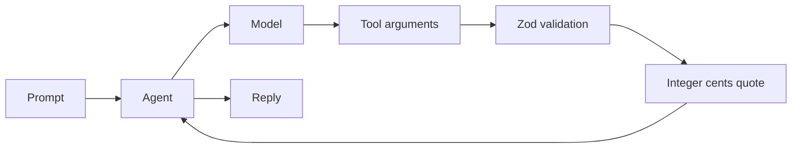

# Module B2: Strands in TypeScript
> After this module you can port a Python agent and a validated tool to TypeScript.

**Time:** ~120 min · **Level:** Intermediate · **Cost:** mock $0; live Bedrock token charges.
**AWS required:** Optional; mock alternative. **AWS resources created:** None.
**Assistant version 11:** a typed Nimbus quotation client.

## Prerequisites
Complete [first agent](../../01_first_agent/README.md) and [tools](../../05_building_tools/README.md). Install Node.js 22 or newer. Commands below run from the repository root on PowerShell, macOS and Linux.

```text
npm ci --ignore-scripts --prefix modules/bonus/B2_typescript
uv run python scripts/check_typescript.py
```

## Learning objectives
- Map Python Agent invocation to asynchronous TypeScript invocation.
- Validate unknown tool arguments with a Zod schema.
- Select a mock or Bedrock provider through one factory.
- Reject invalid quantities before calculating a quote.

## The big idea
TypeScript adds labels to JavaScript values, like labels on luggage. The compiler catches many mismatches before the program runs. Those labels disappear at runtime, so a model's tool arguments still need validation. Zod checks the actual arriving values. Think of the compiler as checking the packing list and Zod as inspecting the suitcase. Both are useful.

This is the real TypeScript SDK, with its own event types and asynchronous invocation. Python's model adapters are not interchangeable with TypeScript adapters. This small port supports mock and Bedrock; use the Python course for its five-provider comparison.

## How it works

Under the hood, the scripted provider emits the SDK's model stream events. The actual Agent dispatches `flight_quote`, appends its result, calls the model again and returns an AgentResult. The mock supplies known answers; it does not measure a live model's quality.

## Key APIs at a glance
| API | What it does | When to use it |
|---|---|---|
| `Agent.invoke` | Runs the asynchronous SDK loop | Await a finished response |
| `tool` | Registers a named callback and schema | Expose a narrow capability |
| `z.object(...).strict()` | Validates runtime arguments | Reject extra or invalid fields |
| `getModel` in common.ts | Chooses fixture or Bedrock | Keep provider choice in one place |
| `limits.turns` | Bounds model turns | Stop unexpectedly long runs |

## Walkthrough
Run each command from the root. The `--prefix` option applies only to npm; the checker selects the correct working directory for Node.

```text
npm exec --prefix modules/bonus/B2_typescript -- tsx modules/bonus/B2_typescript/examples/01_first_agent.ts --mock
npm exec --prefix modules/bonus/B2_typescript -- tsx modules/bonus/B2_typescript/examples/02_typed_tool.ts --mock
npm exec --prefix modules/bonus/B2_typescript -- tsx modules/bonus/B2_typescript/examples/03_provider_and_result.ts --mock
```

1. [First agent](examples/01_first_agent.ts): expect `Welcome to Nimbus.` and fixture metrics.
2. [Typed tool](examples/02_typed_tool.ts): expect `USD 356.00` for two travelers.
3. [Provider and result](examples/03_provider_and_result.ts): inspect the result and two-turn bound.

For live Bedrock, set `MODEL_PROVIDER=bedrock`, `MODEL_ID` and `AWS_REGION` in your terminal environment, authenticate with SSO, and omit `--mock`. This TypeScript sample does not automatically load Python's `.env`. See [AWS setup](../../../docs/AWS_SETUP.md) before a billable call. Never put keys in source. `common.ts` is the language-equivalent provider boundary for this port.

## Real-world use case
Nimbus needs a quotation component for a JavaScript application. The [reference app](use_case/typescript_booking.ts) calculates integer cents and returns `booked: false`; it has no purchase capability.

```text
npm run demo --prefix modules/bonus/B2_typescript
```

Expected: `Two travelers: USD 356.00. Quote only.`. The [notebook](notebook.ipynb) displays and runs these same TypeScript sources through Node from a Python kernel. Install the npm dependencies first.

## Common mistakes
| Error | Cause and fix |
|---|---|
| `Cannot find package '@strands-agents/sdk'` | Run npm ci with the module prefix above. |
| `Set MODEL_PROVIDER=bedrock and MODEL_ID, or use --mock.` | Set terminal variables, or add --mock. |
| `ScriptedModel exhausted` | Reused a finite fixture beyond its expected turns; create a fresh model. |
| `ZodError` | Quantity is fractional, outside 1..6, or has unexpected fields; validate the caller input. |
| `CredentialsProviderError` | Refresh AWS SSO and choose the correct AWS_PROFILE; run scripts/check_env.py. |

## Exercises
The three starter files run independently and return an intentionally unfinished answer. Edit their `solve` functions, then run the tests against starters:

```text
npm exec --prefix modules/bonus/B2_typescript -- tsx modules/bonus/B2_typescript/exercises/01_quote.ts
```

The test runner selects starters with the `NIMBUS_TS_STARTERS=1` environment variable instead of a command flag: on PowerShell set `$env:NIMBUS_TS_STARTERS='1'`; on macOS/Linux prefix the npm command with `NIMBUS_TS_STARTERS=1`. Run `npm test --prefix modules/bonus/B2_typescript`; unset the variable when done. Use this environment-variable method for the full suite.

- Practice: [quote](exercises/01_quote.ts), validate travelers and calculate cents.
- Apply: [provider](exercises/02_provider.ts), allow only configured providers.
- Stretch: [authority](exercises/03_authority.ts), reject purchase claims in a quote.

Reference answers are in [solutions](solutions). All tests default to solutions.

## Quiz
See [six questions and hidden answers](quiz.md).

## Key takeaways
- Await asynchronous invocations.
- TypeScript types do not validate model output at runtime.
- Zod schemas constrain tool arguments.
- Integer cents avoid floating point payment arithmetic.
- A quote never authorizes a purchase.

## Clean up
No AWS resources are created. Stop Node and remove only your disposable output if needed.

## Go deeper
- [Official TypeScript SDK release](https://github.com/strands-agents/harness-sdk/releases/tag/typescript/v1.22.0)
- [Official Strands documentation](https://strandsagents.com/docs/)

## Next: Module B3
Continue to [reviewed self-extension](../B3_self_extending/README.md).
