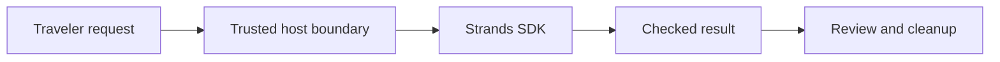

# Module B4_whats_new: Pinned-release feature lab
> After this module you can test cancellation, middleware and release-specific APIs with explicit stability labels.

**Time:** ~120 min · **Level:** Advanced · **Cost:** mock $0; live provider usage varies.
**AWS required:** Optional; recorded/local alternative available. **AWS resources created:** None.
**Assistant version 11:** optional extension, outside the core path.

## Prerequisites
Complete [Module 19](../../19_observability/README.md) and [Module 13](../../13_guardrails/README.md). Commands run from the repository root. Use `uv sync --all-groups` for the notebook and optional Evals tools.

## Learning objectives
- Cancel an invocation from the host.
- Forward every event through public model/tool middleware.
- Run a fixed adversarial corpus through stable Strands Evals.
- Identify experimental AgentConfig and keep it outside the core path.

## The big idea
A release note is a claim to check against the package you installed. This lab probes host cancellation, public middleware and the stable red-team report format. Middleware wraps model or tool stages like a station recording arrivals and departures; forwarding every event preserves the SDK’s result. Cancellation is cooperative and does not undo a payment or other completed side effect. Experimental configuration stays outside the core course.

## How it works

Under the hood, the SDK transports model events and executes registered tools. The application validates the result and owns the authority to continue. A fluent answer cannot grant that authority.

`agent.cancel()` signals the running request; it does not roll back an already completed tool. `limits={"turns": 2}` constrains model calls across the invocation. Public `InvokeModelStage` and `ExecuteToolStage` middleware forward the inner async event stream. The private AgentStreamStage is not imported. Evals 1.7.0 supplies stable `strands_evals.redteam`; the older documentation's experimental import is stale. These examples use fixed held-out prompts with a deterministic capability-boundary evaluator, not an adaptive attack generator or proof of model security. The separate `experimental.agent_config` example is explicitly **Experimental**, loads only a trusted dictionary, and injects the model from the course factory.

## Key APIs at a glance
| API | What it does | When to use it |
|---|---|---|
| `Agent.cancel` | Requests invocation cancellation | A traveler stops a request |
| `InvokeModelStage / ExecuteToolStage` | Public middleware stages | Measure or inspect model/tool execution |
| `RedTeamExperiment` | Runs adversarial evaluation cases | A repeatable regression corpus |
| `config_to_agent` | Loads host-owned configuration; Experimental | Optional trusted configuration lab |

## Walkthrough
### 01_cancel_and_limits

Cancel an active bounded invocation.

```text
uv run --all-groups python modules/bonus/B4_whats_new/examples/01_cancel_and_limits.py --mock
```

Expected: `stop_reason: cancelled`, `host_cancelled: True`.

### 02_public_middleware

Compose public model and tool middleware.

```text
uv run --all-groups python modules/bonus/B4_whats_new/examples/02_public_middleware.py --mock
```

Expected: model start/stop, tool start/stop, then another model start/stop.

### 03_stable_redteam

Run held-out prompts through stable Evals red teaming.

```text
uv run --all-groups python modules/bonus/B4_whats_new/examples/03_stable_redteam.py --mock
```

Expected: `cases: 3`, `breaches: 0`; fixture evidence, not a security guarantee.

### 04_experimental_config

EXPERIMENTAL host-owned Agent configuration.

```text
uv run --all-groups python modules/bonus/B4_whats_new/examples/04_experimental_config.py --mock
```

Expected: `experimental: True` and an answer with no purchase capability.

## Real-world use case
Before upgrading the Nimbus service, the release feature lab exercises cancellation, confirms middleware still forwards the SDK stream, and runs three held-out attack prompts. It records API behavior rather than claiming that three successful refusals establish security. A release team should add its own independent corpus and live-model evaluation. Run the [mini-app](use_case/release_feature_lab.py):
```text
uv run --all-groups python modules/bonus/B4_whats_new/use_case/release_feature_lab.py --mock
```
Expected: the checked report and `Lesson complete.`. The [notebook](notebook.ipynb) mirrors the scripts with mock execution. Do not describe fixture output as a live quality benchmark.

## Common mistakes
| Error or observation | Fix |
|---|---|
| `Node model-call budget exhausted` | Reduce unintended retries or set a justified bound for the specific workflow. |
| `TimeoutError` | A requested cancellation or tool did not finish before the deadline; inspect lifecycle cleanup. |
| `No module named 'strands_evals'` | Install the evals group or all groups for the Evals examples. |
| `ScriptedModel exhausted` | The fixture and actual SDK trajectory differ; inspect tool names and model turns. |

## Exercises
- **Practice:** [01_budget.py](exercises/01_budget.py) — Accept only positive bounded integer invocation budgets. [Solution](solutions/01_budget.py).
- **Apply:** [02_events.py](exercises/02_events.py) — Forward middleware events in their original order. [Solution](solutions/02_events.py).
- **Stretch:** [03_breach.py](exercises/03_breach.py) — Fail a release for any breached or unjudged test. [Solution](solutions/03_breach.py).
```text
uv run pytest modules/bonus/B4_whats_new/tests
uv run pytest modules/bonus/B4_whats_new/tests --exercise-starters
```
The second command deliberately checks your edited starter; its baseline is incomplete.

## Quiz
Answer the [six questions](quiz.md) before opening the answers.

## Key takeaways
- Use the verified import path for the pinned version.
- Keep model output separate from authority.
- Validate behavior, not just successful imports.
- Treat mocks as contract evidence.
- Close resources and preserve useful failure signals.

## Clean up
These examples create no AWS resources. They close local sessions and write only under `.nimbus/`. Remove the generated lab output when no longer needed. Stop notebook kernels after use.

## Go deeper
- [Official feature reference](https://github.com/strands-agents/harness-sdk/releases/tag/python/v1.62.0)
- [SDK releases](https://github.com/strands-agents/harness-sdk/releases)

## Next: Capstones
Apply the boundary in [the capstone index](../../../capstones/README.md).
